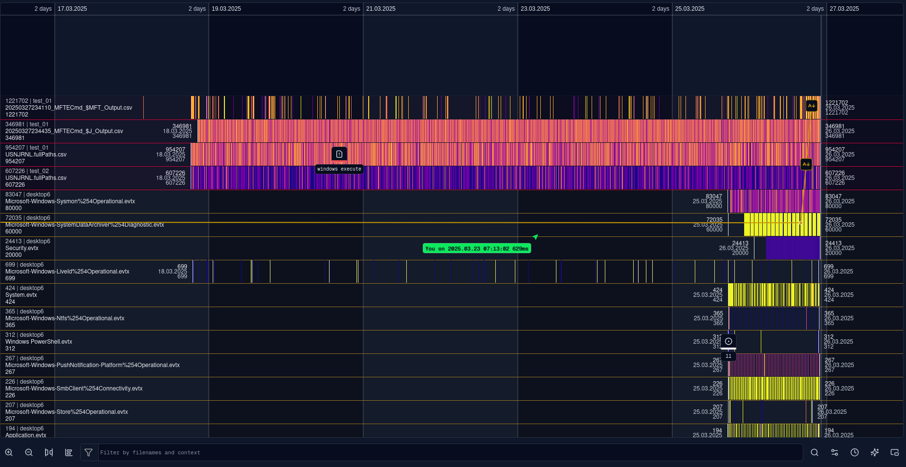
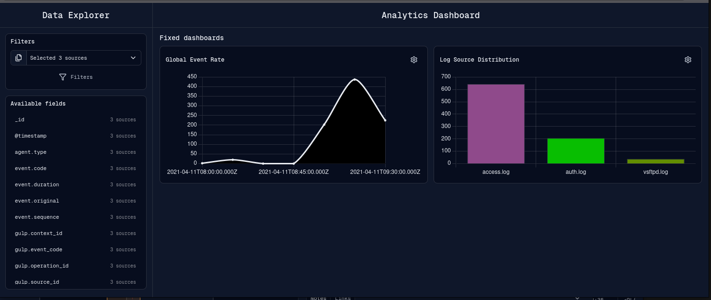

<div align="center">

<picture>
 <source media="(prefers-color-scheme: dark)" srcset="./logo.svg">
 <source media="(prefers-color-scheme: light)" srcset="./logo_dark.svg">
 
</picture>

the graphical, universal Log processor for incident response!

_made with :heart: by Mentat._

</div>

<div align="center">


</div>

<div align="center">

[Description](#description) · [Quick start](#quick-start) · [Web UI](#web-ui) · [Documentation](#documentation) · [Examples](#backend-run-examples)

</div>

## description

gULP is a log-ingestion and incident-response platform. The FastAPI backend uses
OpenSearch, PostgreSQL, Redis, and optional MinIO storage; the included React
web UI provides the investigation workspace.

- **Ingestion plugins** for many log and artifact formats.
- **OpenSearch and ECS** for storage and a consistent event schema.
- **Multiprocessing** for ingestion and querying.
- **Sigma queries**, collaboration, notes, links, enrichment, and plugins.
- **AI assistant chatbot** for [automatic analysis of events](./plugins/extension/ai_assistant.py) (needs `OpenRouter` API key)
- **Scalable deployments**; see the [scaling guide](docs/scaling.md).

> extra features, including an enhanced AI assistant and an automated `MCP server` to completely automatize incident response and reporting, are available on our paid offer.
>
> contact `info@mentat.is` for further information.

## quick start

Requirements: Docker Compose, Git, Python 3.13+, Node.js 22.14.1, and pnpm
10.8.1.

### local source installation

Compose starts only OpenSearch, PostgreSQL, Redis, and MinIO; the backend and UI run from the cloned source:

```bash
# Clone the repository and enter it.
git clone https://github.com/mentat-is/gulp.git && cd gulp
# Create a virtual environment and install gULP from the local source.
python3 -m venv .venv && source .venv/bin/activate && pip install -e .
# Create the local configuration directory.
mkdir -p ~/.config/gulp
# Copy the configuration template on the first run.
[ -f ~/.config/gulp/gulp_cfg.json ] || cp src/gulp/gulp_cfg_template.json ~/.config/gulp/gulp_cfg.json
# Start OpenSearch, PostgreSQL, Redis, and MinIO.
docker compose up -d
# Install the UI dependencies from the local source.
pnpm --dir gulpui-web install
# Start the local backend in the background and the UI in the foreground.
gulp & pnpm --dir gulpui-web start
```

Open [http://localhost:3000](http://localhost:3000), sign in with `admin/admin`, backend API reference is available at [http://localhost:8080/docs](http://localhost:8080/docs).

> The default compose setup is an example for local evaluation and to be used as a base for more complex setups; see the [Docker guide](docs/install_docker.md) before production use.

### install from pypi

To run the released version instead of the cloned source, replace the local
install with `mentat-gulp`. The first `gulp` run creates
`~/.config/gulp/gulp_cfg.json` from its installed configuration template.

```bash
# Clone the repository for Docker Compose and the included UI.
git clone https://github.com/mentat-is/gulp.git && cd gulp
# Create a virtual environment and install the released backend from PyPI.
python3 -m venv .venv && source .venv/bin/activate && pip install mentat-gulp
# Start OpenSearch, PostgreSQL, Redis, and MinIO.
docker compose up -d
# Install the UI dependencies from the local source.
pnpm --dir gulpui-web install
# Start the PyPI backend in the background and the UI in the foreground.
gulp & pnpm --dir gulpui-web start
```

See [development installation](docs/install_dev.md) for OS dependencies,
configuration, and troubleshooting.

## web UI

The browser UI lives in [`gulpui-web/`](gulpui-web/README.md). Its focused
guides cover [installation](gulpui-web/docs/installation.md),
[ingestion](gulpui-web/docs/ingestion.md), [workflow](gulpui-web/docs/flow.md),
[features](gulpui-web/docs/features.md), and [views](gulpui-web/docs/view.md).

Start by connecting to a backend and choosing an investigation operation.


The timeline groups sources by context, lets analysts zoom into activity, and
opens an event in place for investigation.



Analysts can add collaboration notes directly to event details.


Dashboards summarize event rate and source distribution while the timeline stays
focused on the investigation.



## documentation

- [Architecture](docs/architecture.md)
- [Docker installation and services](docs/install_docker.md)
- [Development installation](docs/install_dev.md)
- [Web UI documentation](gulpui-web/README.md)
- [Plugins and mappings](docs/plugins_and_mapping.md)
- [Integration API and raw ingestion](docs/integration.md)
- [Query behavior](docs/query.md)
- [Testing](docs/testing.md)
- [Observability](docs/observability.md)
- [Troubleshooting](docs/troubleshooting.md)

## backend configuration

The following environment variables override common runtime configuration:

- `GULP_BIND_TO_ADDR`, `GULP_BIND_TO_PORT`: set both to change the listen address (defaults: `0.0.0.0:8080`).
- `GULP_WORKING_DIR`: defaults to `~/.config/gulp` and contains the generated `gulp_cfg.json`, optional `plugins/` and `mapping_files/`, certificates, local ingestion files, and temporary uploads.
- `GULP_OPENSEARCH_URL`, `GULP_POSTGRES_URL`, `GULP_REDIS_URL`, `GULP_S3_URL`: override their corresponding configuration values.

## backend run examples

The `gulp` command creates the default configuration and initial `test_operation`
on its first run.

```bash
gulp
```

Reset all collaboration and OpenSearch operation data:

```bash
gulp --reset-collab
```

Reset all data and create an operation:

```bash
gulp --reset-collab --create my_operation
```

Recreate only one operation and its data:

```bash
gulp --create my_operation
```
