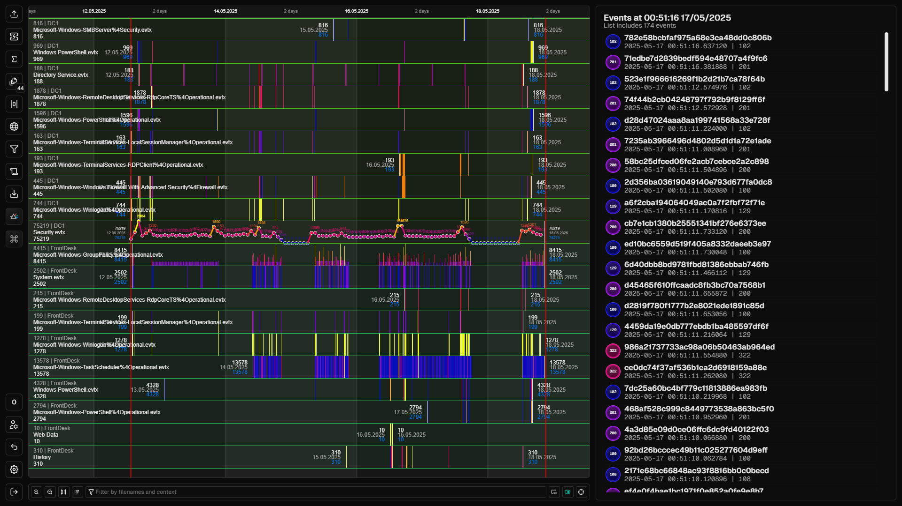
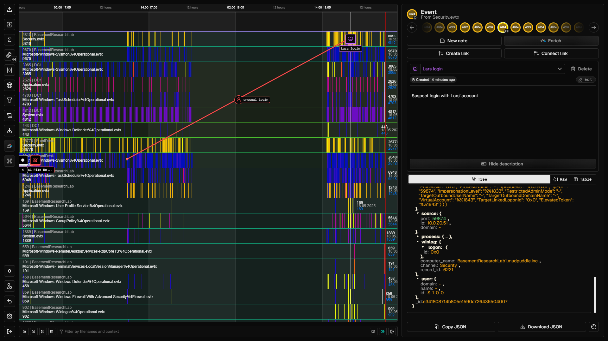
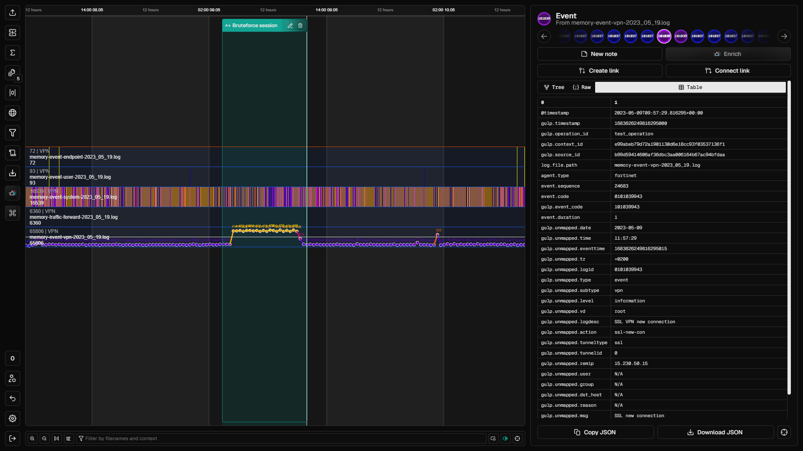

<picture>
 <source media="(prefers-color-scheme: dark)" srcset="./logo.svg">
 <source media="(prefers-color-scheme: light)" srcset="./logo_dark.svg">
 
</picture>

the graphical, universal Log processor for incident response!

_made with :heart: by Mentat._

[Description](#description) - [Quick start](#quick-start) - [Documentation](#documentation) - [Run examples](#run-examples)

## description

Gulp is a powerful software tool designed to streamline incident response and analysis. Its core features includes:

- **Data Ingestion Plugins**: Gulp can ingest data from a variety of sources, thanks to its versatile plugin system.
- **OpenSearch and ECS**: Gulp is built on OpenSearch and uses the _Elasticsearch Common Scheme (ECS)_ as its ingestion format, ensuring compatibility and ease of use.
- **High-Speed Multiprocessing Engine**: Gulp's engine is designed for speed, offering fast ingestion and querying capabilities through multiprocessing.
- **Query using SIGMA rules**: Gulp supports querying using Sigma Rules, allowing for easy, one-click queries with thousands of rules in parallel.
- **Collaboration Platform**: Gulp includes a collaboration platform, enabling teams to work together on the same incident. Features include note-taking, highlighting, and link adding.
- [**An innovative UI**](https://github.com/mentat-is/gulpui-web): Gulp's user interface includes multiple on-screen per-context(i.e. a log source) zoomable timelines for visualizing events, making it easier to understand and analyze incidents.

  

    

    

    

  

- **Scalable**: Gulp is designed with scalability in mind. As your data and team grow, you can simply add more gulp nodes, more cores to increase parallel ingestion and query capabilities, more OpenSearch and PostgreSQL nodes. This makes Gulp a flexible solution that can adapt to your evolving needs!
- **Python based**: Gulp is written in Python, leveraging open-source libraries whenever possible. This maximizes ease of adoption from the community, as Python is widely used and understood.

[here is a detailed datasheet](./DATASHEET.md)

## documentation

- [Architecture and scaling](./docs/architecture.md)
- [Docker install and exposed services](./docs/install_docker.md)
- [Development install](./docs/install_dev.md)
- [Plugins and mapping](./docs/plugins_and_mapping.md)
- [Integration API and raw ingestion](./docs/integration.md)
- [Query behavior](./docs/query.md)
- [Testing and load-test harnesses](./docs/testing.md)
- [Observability](./docs/observability.md)
- [Troubleshooting](./docs/troubleshooting.md)

## quick start

Install the PyPI package and run the required services with the example
[docker-compose.yml](./docker-compose.yml):

> **WARNING**: gulp has been tested extensiely with python3.13, 3.14 is also working and will be the next recommended version after some more testing (but seems ok). it should work with python3.12 too, but was rarely tested and not recommended.

~~~bash
set -e
curl -o .env https://raw.githubusercontent.com/mentat-is/gulp/develop/.env \
  && curl -o docker-compose.yml https://raw.githubusercontent.com/mentat-is/gulp/develop/docker-compose.yml \
  &&pip install mentat-gulp
~~~

~~~bash
docker compose up -d
~~~

~~~bash
gulp --reset-collab --create some_operation
~~~

gulp creates a default configuration in `$HOME/.config/gulp/gulp_cfg.json` if
not already present and starts listening on `http://localhost:8080`.

Common next steps:

- open the API docs at [http://localhost:8080/docs](http://localhost:8080/docs)
- use the default admin user: `admin/admin`
- run the web UI from [gulpui-web](https://github.com/mentat-is/gulpui-web)
- use [install_docker.md](./docs/install_docker.md) for Docker profiles, service
  ports, and certificates
- use [install_dev.md](./docs/install_dev.md) for source installs and extra
  plugins

> pypi/docker registry versions may be outdated... to use the bleeding edge version of gulp, install from sources and use the 'develop' branches.

### configuration

The following environment variables override common runtime configuration:

- `GULP_BIND_TO_ADDR`, `GULP_BIND_TO_PORT` : if set, gulp will listen to this interface and port (either, the default `0.0.0.0`, `8080` is used).
  - for the override to work, both `GULP_BIND_TO_ADDR` and `GULP_BIND_TO_PORT` must be specified, either the value of one alone is ignored.
- `GULP_WORKING_DIR`: this is the **working directory** for gulp (defaults to `~/.config/gulp`), which contains:
  - `gulp_cfg.json`: the configuration, initialized with [template](./src/gulp/gulp_cfg_template.json) if not present
  - `plugins`: optional extra plugins (have precedence over `$INSTALLDIR/plugins`)
  - `mapping_files`: optional extra mapping files (have precedence over `$INSTALLDIR/mapping_files`)
  - `certs`: optional [SSL](./docs/install_docker.md#ssl-certificates) certificates for HTTPS
  - `ingest_local` directory to store big files for quick ingestion (`ingest_local` API)
  - `tmp_upload` folder to cache partial uploads during ingestion

- `GULP_OPENSEARCH_URL`: if set, overrides `opensearch_url` in the configuration to.
- `GULP_POSTGRES_URL`: if set, overrides `postgres_url` in the configuration.
- `GULP_REDIS_URL`: if set, overrides `redis_url` in the configuration.
- `GULP_S3_URL`: if set, overrides `s3_url` in the configuration.

## run examples

default startup, creates collab database with an operation names `test_operation` on the very first run.

~~~bash
gulp
~~~

> to detect if gulp has already run once check for `~/.config/gulp/.first_run_done` and delete it to revert to first run on the next run.

deletes data related to `ALL` existing operations, both on collaboration database and OpenSearch.

~~~bash
gulp --reset-collab
~~~

deletes data related to `ALL` existing operations, both on collaboration database and OpenSearch, in the end creates/recreates `my_operation`.

~~~bash
gulp --reset-collab --create my_operation
~~~

acts only on `my_operation`: creates/recreates operation, deletes all related data both on collaboration database and OpenSearch.

~~~bash
gulp --create my_operation
~~~
