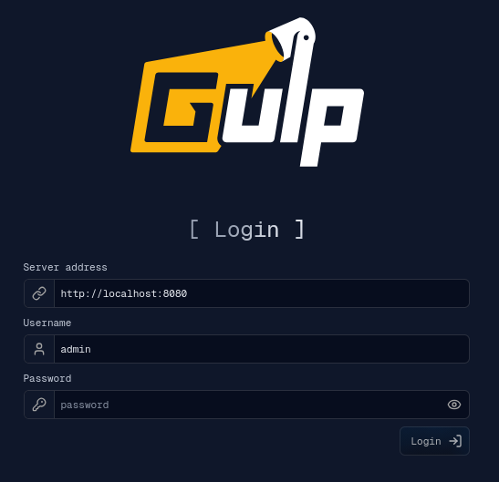
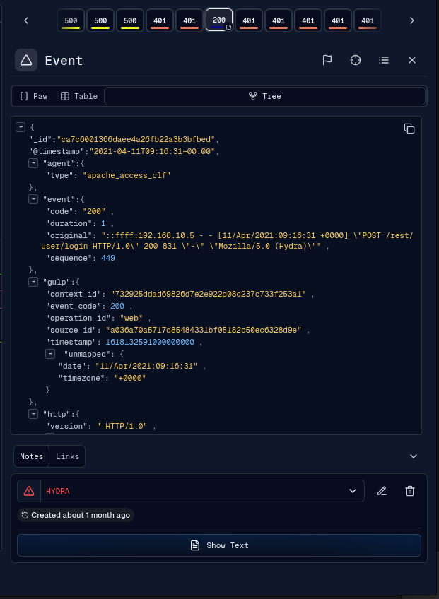

<div align="center">

<picture>
 <source media="(prefers-color-scheme: dark)" srcset="./logo.svg">
 <source media="(prefers-color-scheme: light)" srcset="./logo_dark.svg">
 
</picture>

the graphical, universal Log processor for incident response!

_made with :heart: by Mentat._

</div>

<div align="center">


</div>

<div align="center">

[Description](#description) · [Quick start](#quick-start) · [Web UI](#web-ui) · [Documentation](#documentation) · [Examples](#backend-run-examples)

</div>

## description

gULP is a log-ingestion and incident-response platform. The FastAPI backend uses
OpenSearch, PostgreSQL, Redis, and optional SeaweedFS storage; the included React
web UI provides the investigation workspace.

- **Ingestion plugins** for many log and artifact formats.
- **OpenSearch and ECS** for storage and a consistent event schema.
- **Multiprocessing** for ingestion and querying.
- **Sigma queries**, collaboration, notes, links, enrichment, and plugins.
- **AI assistant chatbot** for [automatic analysis of events](src/gulp/plugins/extension/ai_assistant.py) (needs `OpenRouter` API key)
- **Scalable deployments**; see the [scaling guide](docs/scaling.md).

> extra features, including an enhanced AI assistant and an automated `MCP server` to completely automatize incident response and reporting, are available on our paid offer.
>
> contact `info@mentat.is` for further information.

## quick start

Choose [PyPI installation](docs/installation.md#pypi-installation),
[development installation](docs/installation.md#development-installation), or
[Docker installation](docs/installation.md#docker-installation).

## web UI

The browser UI lives in `gulp-ui/`. Its [documentation](docs/webui.md)
covers [development](docs/webui/install.md),
[ingestion](docs/webui/ingestion.md), [workflow](docs/webui/flow.md),
[features](docs/webui/features.md), and [views](docs/webui/view.md).

PyPI packages include the compiled UI; run `gulp-webui` to serve it on port
3000. The launcher requires Node.js and pnpm. Docker's standalone UI image
serves the production build with nginx.

Start by connecting to a backend and choosing an investigation operation.



The timeline groups sources by context, lets analysts zoom into activity, and
opens an event in place for investigation.


Analysts can add collaboration notes directly to event details.



Dashboards summarize event rate and source distribution while the timeline stays
focused on the investigation.


## documentation

- [Architecture](docs/architecture.md)
- [Installation](docs/installation.md)
- [Docker installation and services](docs/install_docker.md)
- [Development installation](docs/install_dev.md)
- [Web UI documentation](docs/webui.md)
- [Plugins and mappings](docs/plugins_and_mapping.md)
- [Integration API and raw ingestion](docs/integration.md)
- [Query behavior](docs/query.md)
- [Testing](docs/testing.md)
- [Observability](docs/observability.md)
- [Troubleshooting](docs/troubleshooting.md)

## backend configuration

The following environment variables override common runtime configuration:

- `GULP_BIND_TO_ADDR`, `GULP_BIND_TO_PORT`: set both to change the listen address (defaults: `0.0.0.0:8080`).
- `GULP_WORKING_DIR`: defaults to `~/.config/gulp` and contains the generated `gulp_cfg.json`, optional `plugins/` and `mapping_files/`, certificates, local ingestion files, and temporary uploads.
- `GULP_OPENSEARCH_URL`, `GULP_POSTGRES_URL`, `GULP_REDIS_URL`, `GULP_S3_URL`: override their corresponding configuration values.

## backend run examples

The `gulp` command creates the default configuration and initial `test_operation`
on its first run.

```bash
gulp
```

Reset all collaboration and OpenSearch operation data:

```bash
gulp --reset-collab
```

Reset all data and create an operation:

```bash
gulp --reset-collab --create my_operation
```

Recreate only one operation and its data:

```bash
gulp --create my_operation
```
