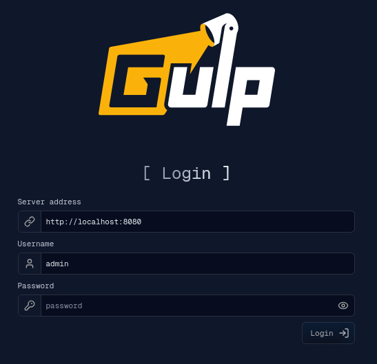
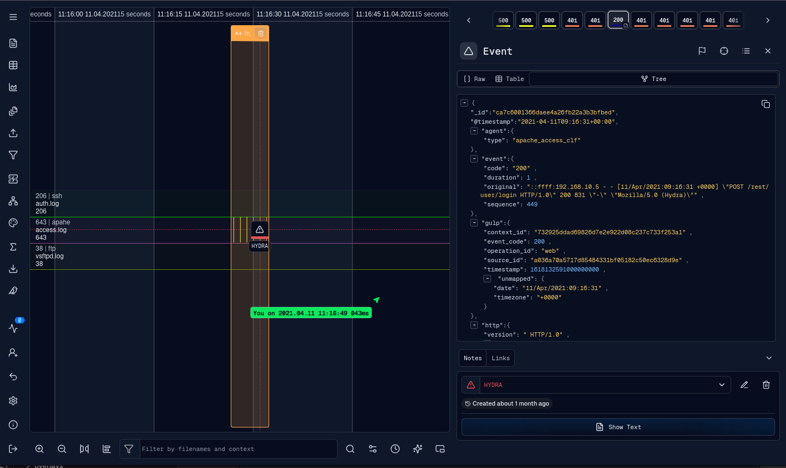

# Web UI

gULP UI is the React and TypeScript browser frontend for gULP. It connects
to a gULP backend to select investigation operations, ingest sources, explore
event timelines, filter data, enrich events, and export analyst work.

The [development guide](webui/install.md) covers local UI setup. The full
backend setup is in the [gULP installation guide](installation.md).

- [Definitions](webui/DEFINITIONS.md)
- [Ingestion](webui/ingestion.md)
- [Workflow](webui/flow.md)
- [Features](webui/features.md)
- [Filters](webui/filters.md)
- [External integrations](webui/external.md)
- [Plugins](webui/plugins.md)
- [Rendering engines](webui/engine.md)
- [Timeline rendering architecture](webui/engine.architecture.md)
- [Query worker and event storage architecture](webui/query-worker.md)
- [Render worker and LOD projection architecture](webui/render-worker.md)
- [Timeline time zones](webui/time-zones.md)
- [Views](webui/view.md)
- [Detached applications](webui/detached-windows.md)

## Main workflow

1. Log in with a backend server URL, username, and password.
2. Select or create an operation.
3. Select existing contexts and sources, load a saved session, or ingest files.
4. Set the timeline frame and inspect events.
5. Use notes, links, filters, enrichment, external queries, dashboards, and
   plugins to complete the investigation.

