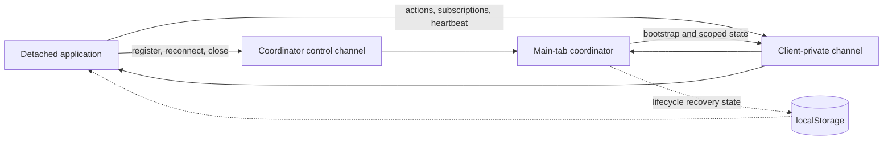

# Detached Applications

gULP can open Notes, Table View, Dashboard, Assistant, and supported event
dialogs as independent browser windows. Each window runs a dedicated React
route and stays synchronized with the main operation through a scoped window
bridge.

Detached applications share authentication and operation context with their
main tab while keeping their React state, document, scheduler, and request
lifecycle independent. State is projected for each application according to
what it consumes.

## Supported applications

| Route | Application | Lifetime |
| --- | --- | --- |
| `/detached/notes` | Operation Notes table | Restored with the main operation |
| `/detached/table` | Paginated source-event table | Restored with the main operation |
| `/detached/dashboard` | Data Explorer and dashboards | Restored with the main operation |
| `/detached/assistant` | Built-in or plugin Assistant | Open-window lifetime |
| `/detached/dialog` | Supported event or event-group dialog | Open-window lifetime |

Notes, Table View, and Dashboard have coordinator-scoped recovery records. The
main tab restores those windows when the matching operation becomes active.
Assistant and Dialog windows are ephemeral and are opened again from the
feature that created them.

Event and event-group dialogs use serializable descriptors. A detached Dialog
receives its descriptor events, relevant already-loaded linked events, related
notes and links, resolved event colors, referenced source summaries, and the
`show_preview` preference. A single-event Dialog also receives a compact,
centered navigation projection containing at most eleven source-event
indicators, including their code, color, and Notes/Links markers. Custom dialogs
made from arbitrary React nodes stay docked because their content cannot be
serialized. A blocked Dialog popup also stays docked. The main operation
workspace can return its detached Dialog without placing an overlay control on
the detached navigation strip.

## User-visible lifecycle

A detached application displays content only while the main tab has an active
operation context. Its possible states are:

| State | Meaning |
| --- | --- |
| `active` | An operation and at least one source are selected; the detached application is usable. |
| `initializing` | The main tab is opening an operation or waiting for source/context selection. |
| `idle` | The main tab is outside an operation. |
| `auth_lost` | Authentication is missing or has been rejected. |

Moving from one operation to another clears request state and operation-owned
caches before the detached application renders the new context. Returning to
an active context delivers one atomic bootstrap containing the status, theme,
and application-specific state.

Refreshing a detached page keeps its recovery record while the browser window
remains open. Refreshing the main tab temporarily moves clients to
`initializing`; they resume after the main operation context is restored.

## Runtime model

The main tab contains a `DetachedWindow.Provider` that acts as the coordinator.
Every detached route contains a `DetachedAppProvider` with its own `Info`
instance, projected application state, document event handlers, and React
scheduler.

Detached routes do not mount the full main `Application.Provider` listener
stack. Extension loading is also scoped:

- Notes, Table View, and the built-in Assistant load no UI extensions.
- Dashboard loads extensions for the dashboard slot.
- Dialog loads event-action, event-context-menu, and send-data extensions.
- A plugin Assistant loads only its requested plugin filename.

Each built-in or plugin Assistant route owns a websocket with an independent
socket ID in its browser realm. Notes, Table View, Dashboard, and Dialog use
the bridge and create no backend websocket.

Same-origin realms that need exact timeline documents open bounded readers on
the operation EventStore namespace identified by the coordinator and operation
IDs. IndexedDB holds the shared exact pages; the bridge carries only compact UI
projections and invalidation state. Document-stream writes and viewport render
projection remain owned by the main application's query worker. See
[Query worker and event storage architecture](query-worker.md).

Route parameters carry the coordinator ID, client ID, and application-specific
startup values such as the initial Table source, Assistant title, or Assistant
plugin filename.

## Coordinator and channels

Each main tab owns a coordinator ID stored in `sessionStorage`. The ID scopes
window names, recovery records, lifecycle state, and every bridge channel.
Detached routes adopt the coordinator ID from their URL.

Coordinator ownership also includes a per-document marker. A same-tab reload
retains the coordinator namespace. A duplicated or opener-created main tab
creates a separate coordinator namespace, so its detached applications cannot
consume state from the original tab.

The channel namespaces are:

- `gulp-window-bridge:control:<coordinatorId>` for initial registration,
  recovery registration, and close lifecycle;
- `gulp-window-bridge:client:<coordinatorId>:<clientId>` for one client's
  bootstrap, state, actions, subscriptions, and lease heartbeat;
- `gulp-window-bridge:assistant-history:<coordinatorId>:<operationId>` for the
  empty IndexedDB-history invalidation used by Assistant panels for one
  operation.

Every bridge message contains a sender ID for echo suppression. Client-private
payloads are delivered only to the addressed browser realm.

Flags use their existing `localStorage` value and the native `storage` event.
Receiving Table, Assistant, and Dialog applications invalidate their local flag
cache and render from the shared stored value.

## Application state

Registration advertises the application kind and its optional subscriptions.
The coordinator creates an atomic bootstrap and incremental updates from those
capabilities.

| Application | Main-to-detached state |
| --- | --- |
| Notes | Compact operation/context/source summaries, canonical selected-source note state, realtime note deltas, selected event ID, and optional Canvas-rendered source IDs. |
| Table View | Operation/context/source summaries, selected event ID, source-selection commands, and query/frame state while synchronized mode is enabled. |
| Dashboard | Operation/context/source summaries used by dashboard definitions, field discovery, and aggregations. |
| Built-in Assistant | Operation identity and an independent websocket connection ID. |
| Plugin Assistant | Assistant state plus query/frame state when the plugin advertises query synchronization. |
| Dialog | Compact dialog descriptor, related collaboration data, a centered eleven-item event-navigation projection, referenced source summaries, resolved colors, and user preview preference. |

All applications receive lifecycle status and a complete theme snapshot.

Notes source summaries contain identity, labels, colors, and the field/hash
settings required to normalize note documents. Its full authoritative note
state is addressed only to the Notes client. Realtime changes are filtered to
the selected operation and sources before delivery.

Other source summaries exclude cached sample event data and source
color-override lookup maps. Bridge projections never contain Canvas scale,
render caches, complete timeline event collections, or render-version counters.

The Notes “visible sources only” option enables the rendered-source
subscription. The subscription is disabled when that option is off. Table
query/frame synchronization follows the same opt-in model through its
synchronized mode.

## Detached-to-main actions

Established applications send actions through their client-private channel.
The main coordinator validates and applies the requested action.

| Message | Action |
| --- | --- |
| `NAVIGATE_TO_EVENT` | Selects an available event in the main tab or runs the event-fetch flow. |
| `EVENT_TARGET_REQUEST` | Sets or clears the selected event by ID. |
| `FOCUS_TIMELINE_REQUEST` | Focuses the main Canvas on a timestamp and optional source. |
| `TIMELINE_ZOOM_REQUEST` | Applies a validated timeline frame and scale. |
| `OPEN_FILTER_REQUEST` | Opens the main filter workflow with explicit source IDs and query. |
| `DOCK_DIALOG` | Returns a detached Dialog to the main workspace. |
| `AUTH_LOST` | Reports authentication failure from a detached API request. |
| `TABLE_SYNC_CHANGED` | Enables or disables Table query/frame synchronization. |
| `NOTES_RENDERED_SYNC_CHANGED` | Enables or disables Notes rendered-source synchronization. |

Notes and Table row actions use `NAVIGATE_TO_EVENT`. Assistant event actions use
the same path, while Assistant point, zoom, and filter tools use the dedicated
focus, frame, and filter messages.

Assistant history lives in IndexedDB. `AI_HISTORY_UPDATED` carries no history
payload; it invalidates only Assistant panels in the same coordinator and
operation namespace.

## Main-to-detached messages

| Message | Purpose |
| --- | --- |
| `DETACHED_BOOTSTRAP` | Atomic lifecycle, theme, and capability-scoped initial state. |
| `MAIN_CONTEXT_STATUS` | Lifecycle transition that does not require an active bootstrap. |
| `CONTEXT_SNAPSHOT` | Operation and compact context/source projection for the addressed client. |
| `QUERY_CONTEXT` | Selected-source filters and timeline frame for subscribed Table or Assistant clients. |
| `RENDERED_SOURCES_CHANGED` | Ordered Canvas-rendered source IDs for a subscribed Notes client. |
| `NOTES_CHANGED` / `NOTES_DELTA` | Canonical Notes state and operation-scoped realtime changes for Notes. |
| `EVENT_TARGET_CHANGED` | Selected event ID for Notes and Table highlighting. |
| `ASSISTANT_CONNECTION_CHANGED` | Main connection identity from which the detached Assistant derives its socket ID. |
| `DIALOG_CHANGED` | Compact events, collaboration state, colors, and nearby navigation indicators for the Dialog client. |
| `TABLE_SELECT_SOURCE` | Source-selection command for the Table client. |
| `THEME_CHANGE` | Complete theme snapshot for one client. |

Per-client semantic signatures suppress messages whose effective payload has
not changed.

## Theme synchronization

Detached documents do not inherit CSS custom properties from the main document.
Every `DETACHED_BOOTSTRAP` and `THEME_CHANGE` therefore contains:

- the theme name;
- the resolved light or dark mode;
- all computed CSS custom properties from the main document root.

After a theme selection, the coordinator waits for the main document theme to
commit, reads the computed variables, and sends one snapshot to each registered
client on its private channel. The detached provider updates `data-theme`,
applies current properties, removes stale properties, updates color mode, and
invalidates its local render version. Identical theme snapshots are ignored.

## Lifecycle and recovery

1. The detached route opens its private channel and registers with
   `DETACHED_READY`.
2. The coordinator records its kind and capabilities, then sends
   `DETACHED_BOOTSTRAP`.
3. An active client renews its 90-second lease every 30 seconds with an empty
   `DETACHED_HEARTBEAT` on the private channel.
4. A client waiting for its first authoritative bootstrap retries registration
   every second. Receiving an authoritative `initializing` bootstrap stops that
   retry and waits for the main context transition.
5. The main tab stores only coordinator-scoped lifecycle status in
   `localStorage`. An `active` storage notification starts a 250 ms recovery
   fallback. The coordinator's normal private state flush has a bounded 100 ms
   timeout, and an arriving bootstrap satisfies the client before the fallback
   sends another registration. If private delivery is unavailable, the delayed
   registration restores the connection.
6. `DETACHED_CLOSED` removes a client after the main tab confirms that its
   browser `Window` is closed. A page refresh therefore retains the client and
   its recovery record.

Application snapshots and entity data are not stored in `localStorage`.

## Request behavior

Backend requests are keyed by query meaning rather than React object identity:

- Notes keys a load by operation, effective source IDs, search-result IDs,
  tags, pagination, and explicit refresh revision.
- Table View serializes query-relevant filters and source metadata and debounces
  synchronized frame changes by 150 ms.
- Dashboard uses deterministic filter and source-metadata signatures for field
  discovery and aggregation requests.
- Event Dialog keys detail loading by operation and event ID. It aborts stale
  loads, caches recently viewed details, and does not repeat `/query_single_id`
  when an equivalent bridge update rerenders the Dialog.

Theme updates, equivalent lifecycle/context payloads, and presentation-only
state do not create a new request key. The Event Dialog's Tree, Raw, or Table
selection is a same-origin localStorage preference, so it requires no bridge
message or payload.

One Notes load normally produces two API requests: `/note_list` for the page and
`/object_count` for the matching total. Dashboard normally produces one
`/query_aggregation` request for each fixed card or requested aggregation. When
the UI and backend use different origins, the browser can show an `OPTIONS`
preflight beside each relevant request.

Dialog navigation carries indicator metadata only. Complete event JSON remains
outside bridge messages and is requested by the detached Dialog when the
selected event changes. Returning to a recently viewed event uses the local
detail cache. The detached Dialog route owns a definite viewport-height
container, without an inherited flex-grow value, so its navigation keeps its
fixed height while Tree, Raw, and Table detail views retain their flex layout in
standalone browser windows.

Safe realtime note edits patch visible data locally. Changes that can alter
membership or ordering request one refresh. Create and delete notifications
retain the visible page and expose the Notes-changed acknowledgement flow.

## Performance guarantees

- Opening or focusing one detached application does not replay state to other
  detached applications.
- A detached Dialog projects at most eleven nearby event indicators and never
  transfers a complete source event collection or Canvas render state.
- Main state projection returns immediately when no matching client capability
  is registered.
- Query, context, rendered-source, event, Assistant, Dialog, and theme updates
  are compared semantically per client.
- Eligible projections are coalesced with `requestIdleCallback` and a bounded
  timeout, with a zero-delay task fallback when idle callbacks are unavailable.
- Large and entity-bearing payloads use client-private channels.
- Notes deltas are source-filtered before `BroadcastChannel` structured cloning.
- Dialog projections reject unrelated note, link, source, and event changes
  before payload construction.
- Active heartbeats contain an empty payload and remain on the private channel.
- The bridge does not request Canvas renders. Docking a Dialog is the only
  detached-window action that triggers the necessary main Canvas layout update.

## Implementation and tests

Primary implementation files:

- `gulp-ui/src/lib/WindowBridge.ts`;
- `gulp-ui/src/context/DetachedWindow.context.tsx`;
- `gulp-ui/src/context/DetachedApp.provider.tsx`;
- `gulp-ui/src/page/DetachedRoute.page.tsx`.

Focused regression coverage:

- `gulp-ui/src/test/lib/WindowBridge.test.ts`;
- `gulp-ui/src/test/lib/WindowBridge.protocol.test.ts`;
- `gulp-ui/src/test/lib/WindowBridge.coordinator.test.ts`;
- `gulp-ui/src/test/lib/WindowBridge.dialog.test.ts`;
- `gulp-ui/src/test/context/DetachedApp.protocol.test.tsx`;
- `gulp-ui/src/test/context/DetachedWindow.isolation.test.tsx`;
- `gulp-ui/src/test/context/detachedTheme.test.ts`;
- `gulp-ui/src/test/page/DetachedRoute.capabilities.test.tsx`;
- `gulp-ui/src/test/components/NotesWindow.behavior.test.tsx`;
- `gulp-ui/src/test/components/DetachedViewQuery.test.ts`;
- `gulp-ui/src/test/components/TableViewWindow.query.test.tsx`;
- `gulp-ui/src/test/components/DashboardViewWindow.query.test.tsx`.

For user-facing details about Notes, Table View, Dashboard, and waiting states,
see [Views](view.md).
