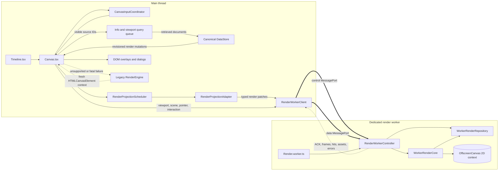
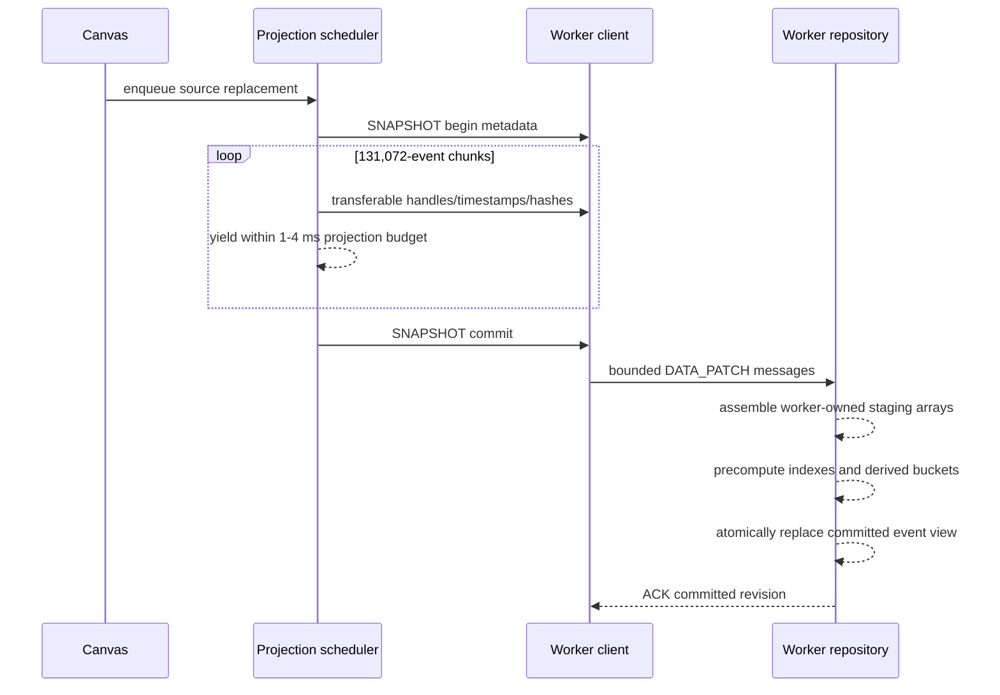
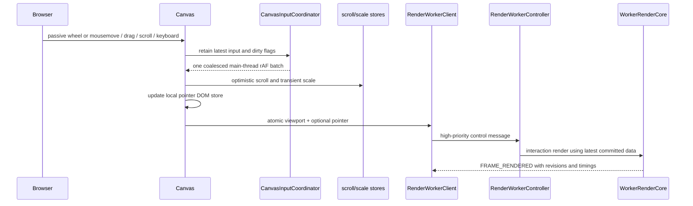

# Timeline Rendering Engine Architecture

This document describes the current timeline rendering architecture implemented in
`gulpui-web`. It focuses on the runtime path from canonical timeline data and browser
input to the pixels drawn on the primary timeline canvas.

For a user-facing description of the available source engines and source settings,
see [Engine](./engine.md).

## Architectural Goals

The renderer is designed around the following constraints:

- keep React, DOM events, dialogs, and canonical application entities on the main
  thread;
- transfer ownership of the primary timeline canvas to one dedicated worker per
  mounted `Canvas`;
- keep high-frequency drawing and render preprocessing away from React;
- preserve a main-thread legacy renderer as a capability and fatal-error fallback;
- prioritize visible sources and interactive control traffic over background data;
- exchange render-only DTOs and transferable typed arrays instead of canonical
  entity objects;
- render at one CSS pixel per canvas backing pixel;
- schedule frames only when state is dirty rather than running a permanent loop.

The canonical `DataStore` still lives on the main thread. The worker owns a compact
render copy, not the application's authoritative documents, notes, links, or
highlights.

## High-Level Architecture

## Ownership Boundaries

| Main thread | Render worker |
| --- | --- |
| React state, `Info`, `Source`, `Doc`, `Note`, `Link`, and `Highlight` entities | Render-only source, event, overlay, pointer, viewport, and scene state |
| Canonical `DataStore` arrays and maps | Transfer-owned typed arrays and precomputed render indexes |
| DOM measurement and native event capture | Primary `OffscreenCanvasRenderingContext2D` |
| Scroll and transient scale coordination | Timeline transforms, culling, drawing, and canvas hit regions |
| Theme CSS resolution and localized string resolution | Concrete colors and localized strings included in render state |
| Dialogs, context menus, and complete entity lookup | Compact note/link hit identities |
| Icon lookup and bitmap creation | Transferred `ImageBitmap` cache |
| DOM pointer, highlight-label, drag-selection, and magnifier surfaces | Primary-canvas highlight fill and magnifier crop production |
| Worker lifecycle, diagnostics, and fallback remount | On-demand frame scheduling and render caches |

The main thread must not call `getContext()` on the primary canvas after
`transferControlToOffscreen()`. If the worker fails after transfer, the same HTML
canvas cannot become the legacy surface. `Canvas.tsx` increments `canvasElementKey`
to mount a fresh `<canvas>` before activating the legacy backend.

## Component Inventory

### Main-thread components

| Component | Responsibility |
| --- | --- |
| [`Timeline.tsx`](../src/app/body/Timeline.tsx) | Mounts the memoized `Canvas` and `Navigator`, exposes focus helpers, and keeps settled scale/autosave subscriptions outside the canvas hot path. |
| [`Canvas.tsx`](../src/app/body/Canvas.tsx) | Owns the DOM layers, selects the backend, captures browser input, creates worker state, subscribes to render mutations, resolves interactions, and manages fallback. |
| [`CanvasInputCoordinator.ts`](../src/app/body/CanvasInputCoordinator.ts) | Coalesces wheel, drag, scrollbar, keyboard, pointer, and dirty invalidations into one main-thread display-tick batch. |
| [`CanvasViewport.ts`](../src/app/body/CanvasViewport.ts) | Calculates visible source IDs from 48-pixel rows with 48 pixels of vertical overscan. |
| [`CanvasRendererBackend.ts`](../src/app/body/CanvasRendererBackend.ts) | Resolves `auto`, `worker`, or `legacy` from `gulp.rendererBackend`; `auto` is worker-first. |
| [`DataStore.ts`](../src/store/DataStore.ts) | Owns canonical renderable entities and publishes domain-scoped React notifications plus synchronous revisioned render mutations. |
| [`DocumentIdentityRegistry.ts`](../src/store/DocumentIdentityRegistry.ts) | Assigns stable, source-local `uint32` handles so document IDs do not cross the worker hot path. |
| [`Info.tsx`](../src/class/Info.tsx) | Owns source retrieval, visible/background query priority, timeline commands, and the settled scale store. |
| [`ViewportQueryGate.ts`](../src/class/ViewportQueryGate.ts) | Adds the trailing 180 ms stabilization window before newly visible source retrieval begins. |
| [`RenderProjection.scheduler.ts`](../src/render-worker/RenderProjection.scheduler.ts) | Runs cooperative, visible-first projection work and pauses background projection while visible work is queued. |
| [`RenderProjection.adapter.ts`](../src/render-worker/RenderProjection.adapter.ts) | Converts canonical entities into strict worker DTOs and transferable typed arrays. |
| [`RenderDataQueue.ts`](../src/render-worker/RenderDataQueue.ts) | Enforces one in-flight data message plus one coalesced pending message. |
| [`RenderDataPatch.ts`](../src/render-worker/RenderDataPatch.ts) | Coalesces unsent patches and collects typed-array transfer lists. |
| [`RenderWorker.client.ts`](../src/render-worker/RenderWorker.client.ts) | Transfers canvas ownership, owns both `MessagePort`s, applies control/data backpressure, validates responses, and reports fatal failures. |
| [`CanvasProfiler.ts`](../src/app/body/CanvasProfiler.ts) | Records backend status, frame timings, pointer/input latency, queue depth, revisions, resynchronizations, and fallbacks. |

### Worker components

| Component | Responsibility |
| --- | --- |
| [`Render.worker.ts`](../src/render-worker/Render.worker.ts) | Validates the initial global `INIT` message and creates one controller. |
| [`RenderWorker.types.ts`](../src/render-worker/RenderWorker.types.ts) | Defines protocol version 4, dirty flags, render DTOs, messages, acknowledgements, hit results, and frame statistics. |
| [`RenderWorkerController.ts`](../src/render-worker/RenderWorkerController.ts) | Routes the two channels, serializes data-message processing, schedules frames, orders interactions, and publishes responses. |
| [`WorkerRenderRepository.ts`](../src/render-worker/WorkerRenderRepository.ts) | Owns committed render projections, staging transactions, derived indexes, overlays, hit regions, and bitmap assets. |
| [`WorkerRenderCore.ts`](../src/render-worker/WorkerRenderCore.ts) | Performs transforms, culling, all worker-mode primary-canvas drawing, and magnifier bitmap generation. |

### DOM and auxiliary canvas layers

`Canvas.tsx` composes several visual layers around the primary canvas:

| Layer | Implementation | Ownership and purpose |
| --- | --- | --- |
| Highlight labels and controls | [`Highlights.List.Overlay`](../src/overlays/Highlights.tsx) | DOM overlay; the worker paints the translucent ranges while React provides labels and delete controls. |
| Primary timeline | `<canvas id="canvas">` | Transferred to the worker, or acquired by the legacy renderer on a fresh fallback element. |
| Local and collaborative pointers | [`Pointers.tsx`](../src/components/Pointers.tsx) | DOM layer. Local movement is applied imperatively through `PointerPositionStore`; it does not rerender `Canvas`. |
| Drag/range selection | `overlay_ref` and `renderOverlay()` in `Canvas.tsx` | Main-thread secondary canvas, never transferred. |
| Magnifier | [`useMagnifier.tsx`](../src/dto/useMagnifier.tsx) and `Magnifier` | Separate DOM canvas. Worker mode paints returned bitmaps; legacy mode copies the primary canvas directly. |
| Vertical scroll control | Hidden `Stack` scrollbar in `Canvas.tsx` | Converts DOM scroll position into coordinated viewport deltas. |
| Context menus and dialogs | `TargetMenu`, `DisplayEventDialog`, and `DisplayGroupDialog` | Main-thread React surfaces backed by canonical entities. |

CSS determines the final stacking order, while this ownership split determines which
runtime is allowed to mutate each surface.

## Backend Selection and Worker Bootstrap

The backend lifecycle is implemented in the `Canvas.tsx` layout effect that starts at
canvas mount or remount:

1. `getCanvasRendererPreference()` reads `gulp.rendererBackend`. Missing or invalid
   values resolve to `auto`.
2. `RenderWorkerClient.probeCapabilities()` checks `Worker`, `MessageChannel`,
   `OffscreenCanvas`, `createImageBitmap`, and
   `HTMLCanvasElement.transferControlToOffscreen()`.
3. If the user selected `legacy`, or capability probing fails, `Canvas` publishes a
   legacy backend status without transferring the canvas.
4. Worker mode sets the backing width and height to the measured CSS size before
   transfer.
5. `RenderWorkerClient.start()` creates the dedicated module worker and separate
   control/data `MessageChannel`s.
6. The client calls `transferControlToOffscreen()` and transfers the canvas and the
   worker ends of both channels in the protocol `INIT` envelope.
7. `Render.worker.ts` validates `INIT`; `RenderWorkerController` is the only code that
   calls `getContext("2d")` on the transferred canvas.
8. The controller reports capabilities, loads the bundled `Geist` and `GeistMono`
   fonts through `FontFace`, and publishes `READY` with either success or an explicit
   font fallback reason.
9. `Canvas` sends source metadata, source snapshots, overlays, scene state, viewport
   state, visibility, and a forced initial invalidation.

There is one client, controller, repository, core, and primary drawing context per
mounted timeline canvas.

## Protocol and State Model

Every message carries:

- `protocolVersion`;
- `operationEpoch`;
- a globally increasing client or worker `sequence`;
- a discriminated `type`;
- a strictly typed `payload`.

The current wire version is `RENDER_PROTOCOL_VERSION = 4`.

### Split frame state

The frequently changing and infrequently changing parts of a frame travel separately:

- `RenderViewportState`: width, height, selected frame, scale, `scrollX`, `scrollY`,
  viewport revision, input sequence, and input timestamp;
- `RenderSceneState`: source order, hidden overlay flags, target, concrete palette,
  localized strings, and cache revisions;
- `RenderPointerState`: canvas-relative pointer coordinates and inside state.

`WorkerRenderRepository.rebuildFrameState()` combines them into the internal
`RenderFrameState` only after both viewport and scene state exist.

### Control and data channels

| Channel | Main-to-worker traffic | Worker-to-main traffic |
| --- | --- | --- |
| Control | `VIEWPORT_STATE`, `SCENE_STATE`, `POINTER`, `HIT_TEST`, `MAGNIFIER_REQUEST`, `ASSET_RESPONSE`, `ASSET_UNAVAILABLE`, `VISIBILITY`, `RESET_OPERATION`, `DISPOSE` | `CAPABILITIES`, `READY`, `FRAME_RENDERED`, `HIT_TEST_RESULT`, `HOVER_CHANGED`, `MAGNIFIER_FRAME`, `ASSET_REQUEST`, `RESYNC_REQUIRED`, `ERROR` |
| Data | `DATA_PATCH` containing source metadata, event batches, snapshot transaction records, and overlay collections | `ACK` containing accepted global and per-source revisions |

Control messages do not wait behind large render-data transfers. Cross-port sequence
tracking in `RenderWorkerController` is used when a hit test or magnifier request must
observe all earlier data and viewport changes.

### Dirty state

`DirtyCanvas` is a bitmask with these reasons:

| Flag | Meaning |
| --- | --- |
| `Size` | Backing dimensions changed. |
| `Viewport` | Frame, scale, horizontal scroll, or vertical scroll changed. |
| `Sources` | Source order or render metadata changed. |
| `Events` | A committed event view changed. |
| `Overlays` | Notes, links, highlights, or flags changed. |
| `Theme` | Concrete palette or localized appearance changed. |
| `Assets` | A glyph bitmap or asset revision changed. |
| `Hover` | The hovered note/link identity changed. |
| `Force` | A complete lifecycle or visibility refresh is required. |

The dirty mask coalesces scheduling and records why a frame was needed. The current
`WorkerRenderCore.render()` still clears and repaints the complete primary canvas; the
mask does not represent rectangular partial repainting.

## Canonical Data to Worker Data

### Observable datastore mutations

`DataStore` remains authoritative and exposes typed mutation methods:

- `replaceSourceEvents()`, `upsertSourceEvents()`, `insertNewSourceEvents()`,
  `clearSourceEvents()`, and `touchSourceEvents()`;
- `replaceNotes()`, `upsertNote()`, and `deleteNotes()`;
- `replaceLinks()`, `upsertLink()`, and `deleteLink()`;
- `replaceHighlights()`;
- `resetRenderOperation()`.

Each render-relevant mutation synchronously emits a discriminated
`DataStoreRenderChange` with an operation epoch, global sequence, and source or
collection revision. React notifications are separately scoped to documents,
overlays, or the compatibility subscription, so document ingestion does not need to
rerender overlay-only consumers.

### Projection

`Canvas.handleWorkerRenderChange()` converts each mutation into the appropriate worker
path:

- request-progress metadata updates skip sources whose metadata signature did not
  change, while membership, settings, graph-resample, and recovery synchronization may
  replay the selected source records;
- small event changes become `RenderEventBatch` upserts;
- a replacement, graph-resampling change, or sustained source backlog becomes an
  authoritative source snapshot;
- notes, links, highlights, and flags are projected independently;
- document-dependent notes or links are reprojected only when previously missing
  documents become available.

`RenderProjectionAdapter` resolves data that cannot be resolved in the worker:

- source context labels, loading state, gradients, overrides, and custom palettes;
- document IDs into stable `uint32` handles;
- event timestamps and numeric hashes into `Float64Array`s;
- note/link icon keys;
- link document IDs into source/timestamp endpoints;
- flagged document positions.

Newly allocated event buffers are transferred when dispatched. Canonical arrays and
objects are never transferred or detached.

### Visible-first cooperative projection

`RenderProjectionScheduler` owns one active main-thread projection job and source-local
queues:

- jobs for current viewport sources are selected before background jobs;
- a queued authoritative replacement cancels obsolete work for that source by
  advancing its generation;
- an active background job pauses at cooperative boundaries while visible work is
  queued;
- projection slices use a 1 ms budget for 120 ms after pointer/scroll activity and a
  4 ms budget while idle;
- yielding uses `requestIdleCallback` when available and an animation-frame-aware
  fallback otherwise;
- queue depth, oldest age, active source, and slice duration are exposed to the
  profiler.

Already committed worker data can render immediately when the viewport changes, and
queued main-thread projection work is reprioritized immediately. The separate network
retrieval gate described below delays only the start of source queries.

### Full source snapshot transaction

Large source replacements use an atomic transaction:

The current chunk size is 131,072 events. `begin` allocates the worker-owned staging
buffers, each `chunk` must be contiguous and correctly sized, and `commit` publishes
the new view only after the declared event count and revision match. Until commit, the
renderer continues drawing the previous committed source view.

### Bounded transport and recovery

`RenderDataQueue` permits one sent data envelope and one coalesced pending envelope.
The pending envelope merges newer source metadata, retains ordered immutable event
batches, replaces newer overlay collections, and discards obsolete unsent snapshot
fragments when a newer snapshot begins.

The worker applies data messages through a serial controller chain. Repository staging
yields every 1 ms during recent interaction and every 4 ms while idle, allowing control
messages to continue arriving between slices.

After applying a patch, the worker sends an `ACK` containing the repository's actual
global and per-source revisions. Revision gaps, invalid snapshot ordering, or rejected
data produce `RESYNC_REQUIRED`; `Canvas.handleWorkerResync()` replays only the requested
source or overlay scope where possible.

## Viewport-First Source Retrieval

Rendering priority and network retrieval priority share the same visible-source signal:

1. `Canvas.flushCanvasInput()` applies the latest vertical scroll and calculates visible
   source IDs through `getCanvasViewportSourceIds()`.
2. Source rows are 48 pixels high and the range includes 48 pixels of overscan above
   and below the canvas.
3. The IDs are published immediately to both `Info.setViewportSourceIds()` and
   `RenderProjectionScheduler.setViewportSourceIds()`.
4. Projection of data already in `DataStore` can therefore reprioritize immediately.
5. `ViewportQueryGate` restarts a 180 ms trailing window whenever the visible row set
   changes.
6. New visible-source queries start only after the row set remains stable for that
   window. Sources crossed during fast scrolling stay queued.
7. Active downloads are not cancelled; they are reclassified as visible or background.
8. Up to four visible query streams and one background stream may run. Background
   insertion pauses while visible work is waiting.

The legacy renderer reports its actually culled `viewportSources` to the same `Info`
API, so the retrieval policy is backend-independent.

## Browser Input and Viewport Updates

### Input capture

- Wheel and mouse movement use passive native listeners on the canvas wrapper.
- `normalizeWheelDelta()` converts pixel, line, and page wheel units into CSS pixels.
- Horizontal-dominant wheel movement pans; vertical-dominant movement performs
  cursor-anchored zoom through `applyTimelineWheelViewport()`.
- Drag, scrollbar, and keyboard movement enter the same coordinator as wheel input.
- Only the newest pointer sample is retained before the next display tick.
- Cached wrapper geometry limits layout reads to at most one required read in a tick.

### Main-thread input flush

`Canvas.flushCanvasInput()` is the central input consumer. It:

1. applies coalesced wheel, drag, and scroll deltas to refs;
2. calculates cursor-anchored scale and horizontal scroll;
3. updates `scrollStore` without requiring a `Canvas` React render;
4. updates the imperative `PointerPositionStore` and active magnifier position;
5. creates scene state only when its signature changed;
6. creates and sends a new viewport revision only when viewport values changed;
7. bundles the pointer into that viewport update when possible, otherwise sends one
   immediate `POINTER` control message;
8. publishes current viewport source IDs for retrieval and projection priority.

Transient wheel scale is rendered immediately from `scaleRef`. After 100 ms of wheel
inactivity, the coordinator persists it through `Info.persistSettledTimelineScale()`.
`CanvasScaleCommitGuard` prevents a stale gesture from overwriting a newer external
scale command. `TimelineScaleStore` lets settled scale consumers update without
rerendering the primary canvas subtree.

### Viewport backpressure

`RenderWorkerClient.sendViewportState()` allows one posted viewport revision awaiting a
rendered frame and retains only the latest pending viewport state. Dirty flags are
merged, and a matching pointer is folded into the retained viewport message. A
`FRAME_RENDERED` response releases the slot and posts the newest pending viewport.

## Worker Scheduling and Frame Lifecycle

`RenderWorkerController` owns the render schedule:

- `markDirty()` ORs dirty reasons so multiple changes collapse into one frame;
- ordinary scene, asset, hover, visibility, and final data invalidations use an
  on-demand worker `requestAnimationFrame`;
- a coalesced interactive `VIEWPORT_STATE` uses `renderInteractionFrameNow()` to cancel
  a redundant passive frame and draw in the current worker task;
- data-only invalidation waits for the serial queue to become quiet, then schedules one
  final redraw after an 8 ms quiet window;
- a control-driven interaction frame consumes any committed pending data dirtiness;
- hidden documents do not schedule ordinary frames, and visibility restoration forces
  a fresh frame;
- the captured dirty mask is cleared before drawing, so an invalidation raised during
  rendering schedules another frame instead of being lost.

### Primary frame drawing order

`WorkerRenderCore.render()` is the worker-mode draw orchestrator. Every accepted frame
uses this order:

1. `resizeCanvas()` reconciles the one-to-one backing size.
2. `context.clearRect()` clears the complete surface.
3. `drawRulerWalls()` paints alternating ruler sections behind the timeline and returns
   header metadata.
4. Ordered sources are traversed. `getSourceCenterY()` applies vertical scroll, and rows
   outside the canvas plus one 48-pixel row buffer are skipped.
5. For each visible row:
   - `drawSourceEvents()` dispatches to the configured source engine;
   - `drawPrimaryRowEdge()` marks the first source row;
   - `drawSourceRow()` paints the context tint and row separator;
   - `drawTargetGuide()` paints the target's horizontal guide;
   - `drawSourceLocals()` paints source bounds, totals, dates, loaded counts, and loading
     decoration;
   - `drawSourceInfo()` paints the source name, count, total, context, and localized
     loading suffix.
6. `drawTargetMarker()` paints the vertical target line.
7. `drawHighlights()` paints translucent timeline ranges.
8. `drawFlags()` paints flagged-event markers.
9. `drawNotes()` groups and paints visible notes.
10. `drawLinks()` paints link connections, endpoints, and badges.
11. The repository replaces its note/link hit-region index with the rectangles produced
    during this frame.
12. `drawFrameEdges()` paints the hard selected-frame boundaries.
13. `drawRulerSections()` paints ruler headers, labels, and the separator above all row
    content.
14. The core stores the rendered viewport revision and returns frame statistics.

The controller adds input/data latency measurements and publishes `FRAME_RENDERED`.

## Source Rendering Algorithms

`WorkerRenderCore.drawSourceEvents()` selects one of three algorithms from
`RenderSource.engine`.

### Default engine

`drawDefaultEvents()`:

- binary-searches descending timestamps to find the visible event interval;
- collapses events that map to the same pixel and draws at most one 1-pixel vertical
  line per visible pixel bucket;
- uses the first explicit color override inside a collapsed bucket when present;
- resolves custom palette or interpolated gradient colors from precomputed hash ranges;
- writes compatible colors into a reusable one-row `ImageData` surface and uploads it
  through `paintRasterSurface()`; unsupported CSS colors use direct `fillRect()` calls.

### Height engine

`drawHeightEvents()`:

- reads worker-precomputed, ascending one-minute event-count buckets;
- finds the first visible bucket with a lower-bound search;
- normalizes each bar against `maxHeightCount`;
- draws a 1-pixel vertical bar up to 47 pixels high;
- uses the reusable raster surface when colors can be represented as packed RGB.

### Graph engine

`drawGraphEvents()`:

- uses server graph samples when available, otherwise derived event buckets;
- chooses `max(source.frequency, visible time represented by 10 pixels)` as the dynamic
  bucket frequency;
- obtains bucket counts through precomputed suffix sums and caches the visible
  aggregation by source, event-view identity, revision, frequency, and bucket range;
- maps density through a base-10 semi-log scale;
- paints bucket boundaries, count labels, colored dots, and gradient connection
  segments.

## Functions That Draw on Canvas

In worker mode, all primary timeline canvas commands originate in
`WorkerRenderCore`. The following table is the direct drawing map.

| Area | Responsible functions in `WorkerRenderCore` |
| --- | --- |
| Frame orchestration | `render()`, `resizeCanvas()` |
| Timeline transform and culling | `getPixelPosition()`, `getTimestamp()`, `getSourceCenterY()`, `isSourceInTimeline()` |
| Engine dispatch | `drawSourceEvents()` |
| Default events | `drawDefaultEvents()`, `paintRasterSurface()`, `writeOpaqueRasterPixel()` |
| Height events | `drawHeightEvents()`, `writeHeightRasterBar()`, `paintRasterSurface()` |
| Graph events | `drawGraphEvents()`, `getGraphBuckets()`, `drawDotCoordinates()`, `drawConnectionSegment()` |
| Source rows | `drawSourceRow()`, `drawPrimaryRowEdge()` |
| Source limits and labels | `drawSourceLocals()`, `drawLocalLabels()`, `drawLoadingLine()`, `drawSourceInfo()` |
| Target | `drawTargetGuide()`, `drawTargetMarker()` |
| Highlights and flags | `drawHighlights()`, `drawFlags()` |
| Notes | `drawNotes()`, `drawNoteBadge()` |
| Links | `drawLinks()`, `drawLinkBadge()`, `drawDot()`, `drawConnection()` |
| Icons and badges | `drawIcon()`, `drawIconPlaceholder()`, `drawTextLabel()`, `drawRoundedRect()` |
| Ruler | `drawRulerWalls()`, `drawRulerSections()` |
| Selected frame boundaries | `drawFrameEdges()` |
| Magnifier scratch canvas | `createMagnifierBitmap()` |

The methods named `get*`, `find*`, and `compute*` do not directly paint, but provide the
transforms, searches, cached layouts, and aggregations used by the listed draw methods.

### Auxiliary canvas functions

Two main-thread functions paint canvases other than the primary timeline surface:

| Surface | Responsible function |
| --- | --- |
| Drag/range selection canvas | `Canvas.renderOverlay()` resizes, clears, and paints the current selection rectangle on `overlay_ref`. |
| Magnifier DOM canvas | `useMagnifier.drawMagnifier()` paints a worker-returned `ImageBitmap`, or copies the primary canvas directly in legacy mode. |

The DOM pointer and highlight-label layers use CSS/DOM updates rather than Canvas 2D
commands.

## Notes, Links, Hover, and Click Handling

Notes and links are both visual elements and interaction targets:

- `drawNotes()` partitions notes by source, binary-searches the visible timestamp range,
  groups badges whose positions are within the 32-pixel note size, and calls
  `drawNoteBadge()`;
- `drawLinks()` resolves source rows, paints ordered endpoint connections and dots, and
  calls `drawLinkBadge()` at endpoints or segment midpoints;
- each badge appends a compact rectangle to the current frame's `hitRegions`;
- `WorkerRenderRepository.hitTest()` searches those rectangles from topmost to bottom;
- pointer hover repaints only when the note/link identity under the pointer changes;
- `HIT_TEST` includes the required viewport revision and is ordered behind only earlier
  data and control sequences;
- `HIT_TEST_RESULT` returns note IDs or a link ID, never complete entities;
- `Canvas.handleClick()` resolves the canonical notes, links, and documents and opens the
  appropriate React dialog;
- ordinary event clicks remain a main-thread binary search over canonical source
  documents, because full documents are intentionally not copied into the renderer.

The context menu also remains on the main thread: its source is calculated from the
pointer Y coordinate, vertical scroll, and the 48-pixel row index.

## Icons, Fonts, and Magnifier

### Icon assets

When `drawIcon()` cannot resolve an `(assetKey, color)` bitmap, it draws a transparent
placeholder and emits one deduplicated `ASSET_REQUEST`. `Canvas` resolves the registered
glyph and creates a bitmap with `createCanvasIconBitmap()`, then
`RenderWorkerClient.respondWithAsset()` transfers ownership to the worker. Asset
revision mismatches close the stale bitmap. Repository reset and disposal close all
worker-owned bitmaps.

### Magnifier

The transferred primary canvas cannot be read through a main-thread 2D context.
Therefore worker mode uses this path:

1. `useMagnifier()` requests a crop only while the magnifier is active.
2. `RenderWorkerClient.requestMagnifier()` tags the request with the required viewport
   revision and supersedes older pending requests.
3. The controller waits until that viewport and all earlier changes are rendered.
4. `WorkerRenderCore.createMagnifierBitmap()` copies the primary canvas into a reusable
   scratch `OffscreenCanvas` and transfers an `ImageBitmap`.
5. `useMagnifier.drawMagnifier()` paints the bitmap into the separate DOM canvas and
   closes stale or superseded bitmaps.

Legacy mode instead copies directly from the main-thread primary canvas.

## Legacy Rendering Path

The legacy path is intentionally independent of the transferred surface but preserves
the same visible behavior.

`Canvas.renderCanvas()` is its frame orchestrator:

1. acquire the primary `CanvasRenderingContext2D`;
2. reconcile size and clear the canvas;
3. calculate visible timeline limits;
4. create or update the singleton [`RenderEngine`](../src/class/RenderEngine.tsx);
5. call `RulerDrawer.draw()`;
6. cull source rows and invoke the selected engine's `render()` method;
7. draw row lines, target guides, local labels, source information, target marker,
   highlights, flags, notes, links, frame edges, and ruler sections;
8. report the actually visible source IDs and profiler statistics.

### Legacy drawing functions

| Area | Responsible functions |
| --- | --- |
| Frame orchestration | `Canvas.renderCanvas()` |
| Default source events | `DefaultEngine.render()` in [`Default.engine.tsx`](../src/engines/Default.engine.tsx) |
| Height source events | `HeightEngine.render()` in [`Height.engine.tsx`](../src/engines/Height.engine.tsx) |
| Graph source events | `GraphEngine.render()` in [`Graph.engine.tsx`](../src/engines/Graph.engine.tsx) |
| Ruler | `RulerDrawer.draw()`, `wall()`, `sections()`, `section()`, `separator()` in [`Ruler.drawer.tsx`](../src/class/Ruler.drawer.tsx) |
| Rows and source metadata | `RenderEngine.primary()`, `lines()`, `fill()`, `locals()`, `loading()`, `draw_info()` |
| Target | `RenderEngine.target()`, `targetMarker()` |
| Highlights and flags | `RenderEngine.drawHighlights()`, `highlight()`, `highlightFlaggedDocuments()` |
| Notes | `RenderEngine.drawNotes()`, `renderNote()` |
| Links | `RenderEngine.drawLinks()`, `renderLinkBadge()`, `connection()`, `dot()` |

`DataStore.isDirty`, the generic datastore subscription, entity lookups, theme globals,
localization, and static engine caches remain part of the legacy implementation only.
Worker mode consumes typed render mutations instead.

## Failure, Reset, and Disposal

### Operation reset

`DataStore.resetRenderOperation()` increments the operation epoch before clearing
canonical collections and handle registries. `Canvas.handleWorkerRenderChange()` then:

- cancels projection generations and source jobs;
- clears source, metadata, overlay, graph, viewport, and scene revision state;
- calls `RenderWorkerClient.resetOperation()`;
- forces a new initial frame.

The client clears pending data, interaction promises, acknowledgements, and viewport
backpressure before sending `RESET_OPERATION`. The controller cancels scheduled work,
resets ordering state, and calls both `WorkerRenderRepository.resetOperation()` and
`WorkerRenderCore.reset()`. Messages from older epochs are ignored.

### Fatal worker failure

A bootstrap timeout, malformed response, message deserialization failure, missing
required capability, worker crash, or fatal render error calls
`RenderWorkerClient.failFatal()`. Worker mode is disabled for the page session, ports
and worker resources are released, and `Canvas.activateLegacyRenderer()`:

1. cancels projection work;
2. disposes the client;
3. clears legacy caches;
4. records and logs the fallback reason;
5. remounts a fresh primary canvas;
6. publishes the legacy backend status.

Non-fatal data gaps use scoped resynchronization instead of fallback.

## Performance Characteristics

The current architecture protects interaction responsiveness through:

- worker ownership of primary drawing and event-derived render indexes;
- one main-thread input rAF for all high-frequency event sources;
- immediate refs/external stores instead of a `Canvas` React render per pointer or
  scroll event;
- memoized `TimelineCanvas` and `TimelineNavigator` boundaries;
- an imperative local pointer and imperative scroll translations for pointer/highlight
  overlays;
- renderless settled scale state through `TimelineScaleStore`;
- visible-first projection and source retrieval;
- 1 ms interactive projection/staging slices and 4 ms idle slices;
- transferable typed arrays and stable numeric document handles;
- one in-flight plus one pending data envelope;
- one posted plus one latest pending viewport state;
- vertical row culling and horizontal event-range searches;
- per-pixel default event collapsing;
- reusable raster surfaces, color caches, graph bucket caches, and revision-scoped
  overlay layouts;
- data-domain and overlay-domain React subscriptions;
- an on-demand worker frame loop with no idle rendering.

The worker migration does not move the canonical `Doc` object graph out of the main
thread. Very large operations can therefore still create main-process garbage
collection or memory pressure even when worker draw times remain low.

## Diagnostics and Verification

[`CanvasProfiler.ts`](../src/app/body/CanvasProfiler.ts) exposes:

- requested and active backend plus fallback reason;
- worker draw average and p95;
- main-frame intervals, drops, stalls, and Long Task data where supported;
- local pointer and end-to-end input latency;
- worker receive and wait duration;
- data visibility latency;
- in-flight and pending data queue depth;
- projection queue depth, oldest age, and slice duration;
- expected, acknowledged, and rendered revisions;
- resynchronization, worker error, and fallback counts.

[`RendererTest.page.tsx`](../src/page/RendererTest.page.tsx) provides the deterministic
`/renderer-test` workload and the blocking `?gate=1` release-gate mode. It can exercise
default, height, graph, or mixed sources and publishes a machine-readable terminal
result for browser automation.

Tests for protocol, repository, scheduling, input, viewport calculation, datastore
mutations, overlays, fallback, and profiling live under [`src/test`](../src/test).

## Safe Extension Guide

### Adding a new primary-canvas visual

1. Decide whether the visual is derived from viewport/scene state or canonical data.
2. Extend the strict DTO and protocol types in `RenderWorker.types.ts` only when new
   state is required.
3. Project canonical values in `RenderProjectionAdapter` or `Canvas`; do not import
   main-thread entity singletons into the worker.
4. Store revisioned data in `WorkerRenderRepository`.
5. Add a focused draw method to `WorkerRenderCore` and call it from the documented
   frame order.
6. Add the narrowest `DirtyCanvas` invalidation.
7. Preserve or explicitly update legacy parity while fallback remains supported.
8. Add unit coverage and exercise `/renderer-test`.

### Adding a new canvas interaction

1. Capture only minimal native event fields in `Canvas.tsx`.
2. Route high-frequency input through `CanvasInputCoordinator`.
3. Include a viewport revision and protocol sequence when the result depends on drawn
   geometry.
4. Return compact identities from the worker.
5. Resolve canonical entities and open React UI on the main thread.

### Changing event ingestion or source retrieval

1. Mutate canonical documents through a typed `DataStore` method.
2. Preserve operation epoch and source revision checks.
3. Keep visible-source priority and the 180 ms retrieval stabilization gate.
4. Avoid synchronous full-source projection in mutation callbacks.
5. Use an atomic snapshot when a delta can no longer be applied cheaply or safely.

### Ingestion recovery polling

`SelectFiles.Banner` asks `Info` to reconstruct missing loading markers when an
operation is reopened during ingestion. Recovery accepts only ongoing `ingest` and
`raw_ingest` request statistics with linked sources. The five-second source-total
refresh remains active only while a marker created by that recovery routine still
owns its source; query, enrichment, and unrelated loading markers do not extend it.

Unmounting the source-selection banner invalidates both the active timer and any
pending recovery startup. Operation changes perform the same cleanup before
operation-scoped websocket listeners are replaced. This prevents a delayed
`request_list` response or a completed timeline query from leaving the full
`mapping_file_list` plus `query_operations` synchronization running.

## Source Reference

- Main canvas bridge: [`src/app/body/Canvas.tsx`](../src/app/body/Canvas.tsx)
- Input coordinator: [`src/app/body/CanvasInputCoordinator.ts`](../src/app/body/CanvasInputCoordinator.ts)
- Viewport calculation: [`src/app/body/CanvasViewport.ts`](../src/app/body/CanvasViewport.ts)
- Canonical store: [`src/store/DataStore.ts`](../src/store/DataStore.ts)
- Query priority: [`src/class/Info.tsx`](../src/class/Info.tsx)
- Ingestion recovery scope: [`src/class/IngestionResync.ts`](../src/class/IngestionResync.ts)
- Protocol: [`src/render-worker/RenderWorker.types.ts`](../src/render-worker/RenderWorker.types.ts)
- Client: [`src/render-worker/RenderWorker.client.ts`](../src/render-worker/RenderWorker.client.ts)
- Projection: [`src/render-worker/RenderProjection.adapter.ts`](../src/render-worker/RenderProjection.adapter.ts)
- Projection scheduler: [`src/render-worker/RenderProjection.scheduler.ts`](../src/render-worker/RenderProjection.scheduler.ts)
- Worker controller: [`src/render-worker/RenderWorkerController.ts`](../src/render-worker/RenderWorkerController.ts)
- Worker repository: [`src/render-worker/WorkerRenderRepository.ts`](../src/render-worker/WorkerRenderRepository.ts)
- Worker drawing core: [`src/render-worker/WorkerRenderCore.ts`](../src/render-worker/WorkerRenderCore.ts)
- Legacy renderer: [`src/class/RenderEngine.tsx`](../src/class/RenderEngine.tsx)
- Legacy engines: [`src/engines`](../src/engines)
