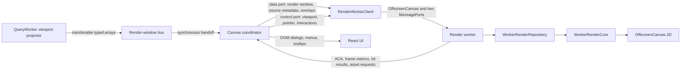

# Timeline rendering architecture

The timeline is rendered by a dedicated render worker that owns the primary
canvas through `OffscreenCanvas`. The worker receives compact, revisioned state
and viewport-resolution event projections. It performs transforms, culling,
drawing, overlay layout, and overlay hit testing without blocking React or
browser input handling on the main thread.

Exact event ingestion and storage are described in the
[query worker and EventStore architecture](query-worker.md). Rendering engine
behavior visible to users is described in [Rendering engines](engine.md).

## Rendering topology

There is one render-worker session for each mounted primary timeline Canvas.
The HTML canvas is transferred once and is not used to acquire a main-thread 2D
context afterward.

## Responsibilities

### Main thread

The main thread owns:

- React components and application state;
- browser input events and viewport calculation;
- source selection, order, labels, settings, and loading state;
- conversion of CSS theme values into concrete render colors;
- compact note, link, highlight, and flag projections;
- icon discovery and `ImageBitmap` creation;
- event dialog, group dialog, menus, tooltips, and other DOM surfaces;
- exact event lookup through `DataStore.Events` after an empty-canvas click.

The main thread sends render-only records. It does not send canonical source,
note, link, or event class instances to the worker.

### Query worker

The query worker reads the operation EventStore and creates an atomic render
window for the current viewport. Each source projection contains only the typed
arrays and aggregate values needed by its selected drawing engine. The main
thread is an ephemeral transfer hop for these buffers and does not cache the
window.

### Render worker

The render worker owns:

- the `OffscreenCanvasRenderingContext2D`;
- the latest accepted viewport and scene state;
- current visible-source render windows;
- compact overlay records and their hit regions;
- loaded icon bitmaps and font readiness;
- frame invalidation, scheduling, drawing, and profiling.

It does not query IndexedDB and it does not retrieve full event details. This
keeps storage concerns in QueryWorker and drawing concerns in the renderer.

## Worker bootstrap

Before starting a renderer, Canvas checks for all required browser facilities:

- dedicated workers;
- `MessageChannel`;
- `OffscreenCanvas` and `transferControlToOffscreen()`;
- `createImageBitmap()`.

`RenderWorkerClient.start()` creates the module worker and two message channels,
transfers their worker-side ports and the canvas in one `INIT` message, and waits
for capability and readiness responses. The worker loads declared fonts when
possible and reports whether a font fallback is active.

The active render protocol has a fixed version. Every message envelope also
contains an operation epoch and a monotonically increasing sequence. A protocol
version mismatch, malformed envelope, or invalid transferred window is rejected
instead of being partially applied.

## Priority-separated channels

The worker uses two `MessagePort` channels so high-volume data cannot indefinitely
delay interactive control state.

### Control channel

The control port carries:

- viewport state and an optional pointer captured in the same input batch;
- standalone pointer changes;
- scene configuration changes;
- overlay hit-test requests;
- magnifier requests;
- icon responses and unavailable notices;
- page visibility;
- operation reset and disposal.

Worker responses on the control path include capabilities, readiness, rendered
frame statistics, hover changes, hit-test results, magnifier bitmaps, asset
requests, resynchronization requests, and fatal errors.

### Data channel

The data port carries revisioned patches for:

- source render metadata;
- the complete current render window;
- notes, links, highlights, and flags.

Each successfully staged data envelope produces an acknowledgement containing
the accepted global revision, accepted source revisions, and any rejected
source IDs.

The client permits one data message in flight and one coalesced pending message.
New source or overlay records are merged into the pending envelope. For render
windows, only the newest operation, viewport, and projection revision remains
eligible. Queue depth therefore cannot grow with pan rate or incoming query
rate.

## State model

The wire state is split by update frequency.

### Viewport state

Viewport state contains:

- physical canvas width and height;
- timeline frame minimum and maximum;
- horizontal scale and scroll;
- vertical scroll;
- viewport revision;
- input sequence and original input timestamp.

Canvas coalesces browser wheel, drag, resize, and pointer input into the latest
viewport state. If a viewport is awaiting a rendered frame, only one newer
viewport state is retained. Dirty reasons are accumulated rather than losing
the invalidation represented by a superseded message.

### Scene state

Scene state contains less frequently changing values:

- selected source order;
- note and link visibility;
- target marker;
- concrete theme palette and target guide color;
- localized renderer strings;
- settings, sources, overlays, theme, and asset revisions.

Source render metadata is stored separately from the scene header. It includes
row order, label, context color, time range, full event count, loading state,
timestamp offset, engine kind, graph frequency, palette, and explicit color
overrides.

### Render window

A render window is a complete multi-source projection identified by:

- operation epoch;
- viewport revision;
- projection revision;
- projected source records;
- explicit source IDs to evict.

Each projected source carries:

- source revision and covered time range;
- selected bucket width and degraded-LOD marker;
- full committed event count and full hash range;
- representative handles, timestamps, and hashes;
- HeightMap timestamps, counts, and global maximum count;
- Graph timestamps and counts.

The typed arrays have exact backing-buffer capacity. The render repository adopts
their transferred buffers directly and does not construct spare-capacity arrays
or a dense handle-to-position index.

All source views in a window are staged before any becomes active. The worker
then atomically publishes the window and applies explicit evictions. A frame
cannot observe a mixture of old and new sources from the same projection.

## Revision fences

The renderer uses revisions as consistency boundaries rather than relying on
message timing.

- `operationEpoch` rejects all state from an operation that has been reset.
- `viewportRevision` rejects a projection older than the latest known viewport.
- `projectionRevision` orders complete replacements for the same viewport.
- source revisions order source metadata and its event projection.
- collection revisions independently order notes, links, highlights, and flags.
- the global data revision is acknowledged after a complete data patch stages.

An invalid or stale projection is rejected as a unit. Missing source or
collection revisions produce a scoped resynchronization request. Canvas can
replay only that render-only state rather than rebuilding unrelated worker
state.

## Render repository

`WorkerRenderRepository` is the worker-local state authority. It stores compact
records in maps keyed by source or asset ID and arrays for overlays. Its event
views cover only the current render window.

When staging a source window, the repository may allocate small derived arrays
for:

- color-override representative indexes;
- suffix sums used by HeightMap aggregation;
- suffix sums used by Graph aggregation.

It reuses transferred representative arrays as their backing storage. Staging
yields through a worker-local `MessageChannel`, allowing control-port tasks to
run between large source projections. If a newer epoch or projection arrives,
stale staging stops without publishing partial state.

Invisible source rows are removed through `evictedSourceIds`. Horizontal data
outside the visible area is bounded by the render window's overscan. The
repository therefore has no reason to retain a full-source event snapshot.

## On-demand frame scheduling

Rendering is invalidation-driven. The worker records a bitmask of dirty reasons:

- size;
- viewport;
- sources;
- events;
- overlays;
- theme;
- assets;
- hover;
- forced redraw.

At most one worker `requestAnimationFrame` is scheduled. Additional messages
merge their dirty bits into that pending frame. The renderer captures and clears
the bitmask before drawing; an invalidation raised during the frame schedules
the next frame.

Interactive viewport controls can cancel a passive pending frame and render in
the current worker task. Data-only updates use a short quiet window so a burst of
commits produces a final guaranteed redraw without redrawing every intermediate
revision. A subsequent interaction consumes all committed data dirtiness
immediately.

When the document is hidden, passive drawing pauses while state continues to be
validated. Visibility restoration marks the necessary state dirty and schedules
a current frame.

## Coordinate system and culling

The worker converts timestamps into canvas x coordinates from the frame range,
horizontal scale, and scroll. Source timestamp offsets are applied consistently
to event bars, overlays, target markers, and the inverse click transform used by
Canvas.

Vertical scroll and source row order determine y coordinates. Rendering first
culls sources that do not overlap the visible rows or timeline frame. Each
engine then clips its own projected values to the canvas and its source row.

The query projection normally includes one canvas width of horizontal overscan
on each side and two source rows of vertical overscan. Small continuous pans can
therefore reuse already resident values while the next projection is prepared.

## Drawing engines

### Default

Default rendering draws one vertical activity mark per projected pixel bucket.
The hash selects a palette color unless an explicit override applies. The
projection already resolves multiple exact events in one bucket to the correct
visual representative, so the render worker performs no exact-event search.

### HeightMap

HeightMap draws event density from persisted one-minute counts aggregated for
the current viewport. Bar height is normalized against the source-wide maximum
provided with the render window. The worker does not reconstruct counts by
iterating exact events.

### Graph

Graph rendering consumes projected timestamps and counts, aggregates them into
the configured graph pixel interval, applies semi-log scaling, and connects the
visible points. The source frequency setting supplies the minimum sampling
interval used by the projection and renderer.

### LOD budget

A single render window is capped at 1,000,000 representatives. During atomic
replacement, old and new windows may coexist briefly, so the resident limit is
2,000,000 representatives. If a viewport would exceed its projection budget,
the query worker increases the bucket width. Drawing remains bounded even when
the IndexedDB operation contains tens of millions of exact events.

## Overlay rendering and hit regions

Notes, links, highlights, and flags are sent as independent revisioned
collections. The worker receives only their render fields:

- IDs and resolved source/timestamp anchors;
- label and color data;
- icon keys;
- already resolved link endpoints;
- highlight time ranges;
- source-local event handles for flags.

During drawing, the worker builds the note and link hit regions that correspond
to the completed frame. Hit-test responses contain only compact identities:
note IDs or a link ID. React resolves the entity and opens the corresponding DOM
surface.

Hover state is evaluated after a completed frame and published only when the
compact hit identity changes. This avoids sending repeated hover messages for
the same region.

## Icons, fonts, and magnifier

The main thread resolves SVG or browser assets and creates colored
`ImageBitmap` objects. The render worker requests an asset by key and color,
caches the transferred bitmap, and redraws after it becomes available. Missing
assets are reported without creating an endless repaint loop.

Font descriptions are provided during bootstrap. Font readiness is completed
before the worker publishes `READY`; an explicit fallback reason accompanies a
failed worker font load.

The DOM magnifier asks the worker for a crop associated with a viewport
revision. The worker copies the relevant primary-canvas area into a reusable
scratch `OffscreenCanvas` and transfers an `ImageBitmap` result. Only the newest
pending magnifier request is retained.

## Canvas click and exact event selection

LOD representatives determine pixels, but they do not determine which exact
events are selectable. Canvas uses this ordered interaction flow:

1. Request a render-worker hit test at the currently rendered viewport revision.
2. If a note or link is hit, resolve that overlay identity and handle it.
3. Otherwise, convert the clicked pixel to an exact raw timestamp interval,
   accounting for frame, scale, scroll, source row, and source timestamp offset.
4. Call `DataStore.Events.queryPixelBucket()` for the exact source and interval.
5. If no event exists, repeat the exact lookup for the adjacent `x - 1` and
   `x + 1` pixel intervals.
6. Open the event dialog for one match or the paginated group dialog for
   multiple matches.

Each exact read returns at most 100 event records plus a total and cursor. The
group dialog requests further pages instead of receiving an unbounded array.
Full event detail continues through the normal backend retrieval path when the
dialog needs fields beyond the compact timeline document.

Hit-test requests are ordered behind earlier control and data messages and are
answered only after the requested viewport revision has rendered. If the user
moves again while awaiting the result, Canvas discards the obsolete interaction.
An exact EventStore result is also checked against operation, viewport, and
source revisions; a source-only revision change can be retried once.

## Projection request timing

Canvas requests a render window when viewport geometry, selected source rows,
source revision, engine settings, or render-affecting overrides change. The
query worker may skip an obsolete pending request because every response is a
complete replacement.

Committed updates for a building source are projected at most four times per
second. A terminal source revision bypasses that throttle so the final state is
requested immediately.

The render-window bus has one synchronous consumer: the mounted Canvas. Canvas
validates operation and viewport revisions, creates a data patch, and transfers
the buffers immediately to `RenderWorkerClient`. If the current request produces
no usable projection while the same viewport is still active, Canvas performs
one short delayed retry. A later viewport revision cancels the relevance of that
retry.

## Failure and lifecycle behavior

Operation reset is an explicit protocol boundary. Canvas increments the epoch,
sends `RESET_OPERATION`, clears pending data and interactions, and requests a
fresh scene and render window. The worker closes staged snapshots, render views,
hit regions, and transient bitmaps that no longer belong to the active epoch.

Unmount sends `DISPOSE`, closes both ports, terminates the dedicated worker, and
releases pending hit-test and magnifier promises.

Before canvas transfer, an unsupported browser can select the configured
renderer fallback. After transfer, the main thread cannot safely reclaim the
same canvas. A fatal worker or LOD pipeline failure therefore persists the
rollback flag and reloads the application before mounting the alternate event
pipeline. It never silently constructs a full main-thread event collection in
the active session.

Non-fatal asset failures and scoped revision gaps use retry or resynchronization
without resetting the renderer. Fatal protocol, initialization, data-staging,
or drawing errors include a phase, message, and optional stack for diagnostics.

## Diagnostics and performance gates

Each completed worker frame reports:

- draw duration and worker wait duration;
- input-to-worker receive duration;
- committed-data-to-frame latency;
- dirty reason mask;
- viewport and data revisions;
- visible source and rendered row counts;
- rendered event pixels;
- graph samples and buckets;
- visible notes, links, and interactive region counts.

The main client also exposes readiness, data queue depth, acknowledged data
revision, requested viewport revision, and rendered viewport revision. These
values make a blank or delayed frame distinguishable from a storage failure,
stale projection, render backlog, or drawing failure.

The renderer benchmark page and focused tests cover:

- continuous pan, zoom, and wheel input;
- queue depth of one in-flight plus one pending data patch;
- atomic render-window replacement and source eviction;
- stale epoch, viewport, projection, and source revisions;
- Default, HeightMap, and Graph drawing at multiple scales;
- overlay hit testing and magnifier ordering;
- representative and resident memory limits;
- frame p95, FPS, input latency, and data latency gates.

## Extension rules

New rendering behavior should preserve these boundaries:

1. Keep canonical event persistence and exact lookup in EventStore.
2. Add only render-required fields to a worker projection.
3. Use transferable typed arrays for high-volume numeric data.
4. Give mutable collections an explicit revision and replacement contract.
5. Keep control traffic independent from bulk data traffic.
6. Bound every queue and coalesce replaceable viewport work.
7. Stage a multi-source projection fully before publishing it.
8. Resolve DOM interaction from compact IDs on the main thread.
9. Add frame counters or timings when a new path can affect release gates.

## Source reference

The main implementation entry points are:

- [`Canvas.tsx`](../../gulp-ui/src/app/body/Canvas.tsx)
- [`CanvasViewport.ts`](../../gulp-ui/src/app/body/CanvasViewport.ts)
- [`CanvasEventLookup.ts`](../../gulp-ui/src/app/body/CanvasEventLookup.ts)
- [`RenderWorker.client.ts`](../../gulp-ui/src/render-worker/RenderWorker.client.ts)
- [`Render.worker.ts`](../../gulp-ui/src/render-worker/Render.worker.ts)
- [`RenderWorkerController.ts`](../../gulp-ui/src/render-worker/RenderWorkerController.ts)
- [`WorkerRenderRepository.ts`](../../gulp-ui/src/render-worker/WorkerRenderRepository.ts)
- [`WorkerRenderCore.ts`](../../gulp-ui/src/render-worker/WorkerRenderCore.ts)
- [`RenderWindowProjection.bus.ts`](../../gulp-ui/src/render-worker/RenderWindowProjection.bus.ts)
- [`RenderDataQueue.ts`](../../gulp-ui/src/render-worker/RenderDataQueue.ts)
- [`RenderWorker.types.ts`](../../gulp-ui/src/render-worker/RenderWorker.types.ts)
