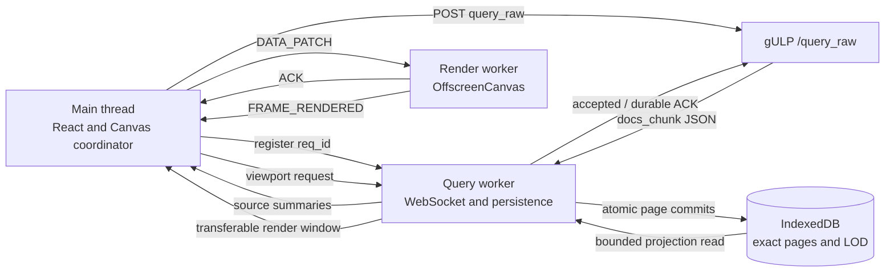

# Timeline rendering engine

The timeline is designed to show operations that are much larger than browser
memory. Exact event documents live in IndexedDB. The main thread coordinates UI
state, a query worker owns the high-volume socket and storage path, and a render
worker draws compact viewport projections on an `OffscreenCanvas`.

The important rule is simple: the number of events in an operation must not
determine how many document objects are kept on the main thread. The main thread
receives summaries, bounded lookups, and render projections; it never receives a
complete `docs_chunk` from the scalable path.

The detailed socket, IndexedDB schema, and projection protocol are documented in
[Query worker and event storage architecture](query-worker.md). This guide
explains how the pieces cooperate and how to diagnose the current engine.

## The path from query to pixels



A normal raw query follows these stages:

1. The main thread generates the request ID and registers its stream in the
   query worker before calling `/query_raw`.
2. `docs_chunk` WebSocket messages are parsed and normalized inside the query
   worker. Their document arrays do not cross the main thread. Once raw memory
   has been released, the worker acknowledges acceptance so the backend can
   advance its negotiated two-chunk window.
3. IndexedDB transactions atomically update exact pages, document indexes, LOD,
   height data, and source metadata.
4. After a durable commit, the query worker publishes only a compact source
   summary. Canvas uses the summary to schedule a viewport projection.
5. The query worker reads the exact pages and LOD records needed by the current
   viewport and transfers typed arrays back to Canvas.
6. Canvas immediately transfers the projection to the render worker. The worker
   applies it to its repository, acknowledges the data patch, and draws a frame.

`query_done` remains a backend lifecycle message. It does not prove that the
last `docs_chunk` is durable or visible. Storage completion and frame completion
have their own explicit fences.

## Responsibilities of the three threads

### Main thread

The main thread owns React state and user interaction. In the rendering path it:

- registers queries before dispatching backend work;
- retains compact source summaries and current viewport state;
- coalesces projection triggers into one active request and one trailing request;
- transfers render windows and other incremental scene patches;
- correlates terminal source revisions with worker ACKs and frames;
- performs bounded exact-event lookups for dialogs, notes, links, and selections.

The main thread does not decode or retain a source-wide event collection while
the scalable EventStore mode is active.

### Query worker

The query worker owns the authenticated WebSocket and the persistence pipeline.
It:

- routes document chunks by registered request ID;
- accounts for raw bytes before a chunk enters an ordered promise chain;
- normalizes documents cooperatively so socket/control work can continue;
- writes exact pages and their indexes to IndexedDB;
- publishes durable source summaries;
- builds render-window projections from IndexedDB;
- exposes diagnostics only when `GET_QUERY_DIAGNOSTICS` is requested.

The query worker never sends full source documents to React or the render worker.

### Render worker

The render worker owns the transferred canvas, its render repository, drawing
caches, and hit regions. It receives:

- viewport and input state over the control channel;
- source, overlay, and projection patches over the data channel;
- bounded asset responses for icons and fonts.

It applies a data patch atomically before acknowledging it. A frame reports the
highest applied data sequence actually included in that draw.

## What is stored and what is rendered

IndexedDB is a rebuildable exact-event cache. It contains source manifests,
encoded event pages, LOD records, height/graph aggregates, and paged document
indexes. The backend remains authoritative.

A render window is not a page of documents. It is a bounded projection for the
visible time range and visible source rows, plus horizontal and vertical
overscan. Depending on zoom and source settings it contains representative
handles, timestamps, hashes, height counts, or graph buckets. Exact event detail
is fetched separately when the user selects or opens an item.

The render worker supports the current source engines:

- **Default** draws representative events and grouped counts;
- **HeightMap** draws density columns from persisted height aggregates;
- **Graph** draws fixed-frequency count buckets.

Projection budgets may reduce visual density when the viewport would otherwise
exceed its representative limit. This degradation changes detail, not the exact
event authority stored in IndexedDB.

## Revisions, generations, ACKs, and frames

Several counters exist because they answer different questions.

| Fence | Meaning |
| --- | --- |
| operation epoch | Rejects work from an operation that is no longer active. |
| viewport revision | Identifies the current dimensions, scroll, scale, and visible rows. |
| projection revision | Orders accepted snapshots for the same viewport. |
| source generation | Identifies one replacement build; older generations are obsolete. |
| source revision | Orders durable changes within one generation. |
| source status | Distinguishes `building`, `complete`, and `incomplete` authority. |
| data sequence | Identifies the `DATA_PATCH` that applied a source revision. |
| `globalRevision` | Aggregate telemetry; it is not terminal-render proof. |

The render protocol is version 7. ACKs travel on the data port and frames travel
on the control port, so their delivery order can be inverted. Canvas therefore
stores, for each acknowledged source revision, the data sequence that applied
it. A terminal target is cleared only when all of these statements are true:

- the frame belongs to the current operation epoch and viewport;
- the acknowledged source revision covers the exact terminal revision;
- the frame's `renderedDataSequence` covers the ACK's applying sequence;
- the terminal projection has the exact generation, status, revision, and event
  count from the complete summary.

A stale frame received after a newer ACK cannot complete convergence. A watchdog
requests another projection after 500 ms and backs off to at most two seconds
until the correct frame arrives or the lifecycle changes.

## Behavior while a query is loading

Backend chunks remain 10,000 events. EventStore pages hold 16,384 events. A
replacement builder carries a partial page across chunks, writes every complete
page, and writes the last partial page only at the terminal chunk. A 14,000,000
event source therefore creates 855 pages, of which only the last may be partial.

Canvas allows one projection in flight and one coalesced trailing trigger for a
viewport. Repeated building summaries do not continuously invalidate useful
work. A coherent building snapshot from the current generation may be published
even when a newer summary already exists; the trailing request then catches up.
A real operation, epoch, or viewport change invalidates the old request
immediately.

The render worker normally waits for an 8 ms quiet window before drawing a dirty
data batch. Continuous traffic cannot postpone drawing indefinitely: while the
page is visible, a non-renewable 100 ms deadline forces a frame of the latest
atomically committed repository state.

## Terminal behavior

The final chunk first flushes every residual page and commits a `complete`
manifest. That manifest makes the new generation authoritative and records any
old generation as pending cleanup. The complete source summary and completed
stream state are published before old physical records are removed.

Canvas requests an exact terminal projection as soon as it observes the complete
summary. Cleanup continues independently in IndexedDB batches of at most 256
delete operations. A cleanup failure is non-fatal for the already authoritative
generation; its marker is retried before the next source mutation.

This separation ensures that an old multi-million-event generation cannot make
the terminal transaction unbounded or delay the final render.

## Memory and queue limits

The scalable path has explicit UI-side bounds:

| Resource | Bound |
| --- | ---: |
| raw `docs_chunk` backlog, all requests | 128 MiB |
| raw backlog, one request | 64 MiB |
| normalized documents, including page builders | 32,768 |
| normal EventStore page | 16,384 events |
| concurrent persistence commits | 2 |
| render data queue | 1 in flight + 1 pending |
| obsolete-generation cleanup transaction | 256 deletes |

Raw bytes are reserved synchronously before a chunk is queued. A chunk that
would exceed either raw limit is cleared immediately, the affected stream fails
with reason `backlog`, and the existing `/request_cancel` path stops backend
work. Other streams remain valid.

The authenticated UI socket negotiates a two-chunk acknowledgement window with
the backend. Normalization and ordered persistence use separate chains, so raw
JSON can be released while an earlier IndexedDB transaction is still pending.
An `accepted` ACK advances normal streaming only after bounded normalized credit
exists; the terminal `durable` ACK follows the authoritative manifest commit.

The byte limits remain independent safety boundaries. They still stop and
cancel an overloaded request if negotiation is unavailable, several child
queries combine into a larger request backlog, one frame is oversized, or the
consumer stops advancing.

Under normalized-memory pressure, a replacement stream flushes the largest
residual builder in its current context until global capacity is available. The
low watermark is 16,384 documents. This prevents four concurrent replacements
from waiting indefinitely while preserving densely filled pages in the normal
single-source case.

## Errors and compatibility mode

Normalization, backlog, and disconnect failures close only the affected stream
and use the normal user-visible failure path. Storage and quota failures preserve
the last coherent generation and publish an explicit compatibility decision.

An unavailable or fatal render worker follows the same explicit policy while
EventStore owns the documents. No error writes the legacy marker or reloads the
page automatically. The localized banner offers:

- **Retry scalable mode**, which reloads without changing the marker;
- **Use compatibility mode**, which remains disabled until explicit confirmation,
  writes and reads back `gulp:event-store-lod-enabled=false`, and then reloads.

If the marker cannot be persisted, the page does not reload and the banner shows
a recoverable error. Compatibility mode has no event-count threshold, but it
keeps canonical events in main-thread RAM and can consume substantial memory.

Operation reset, hidden-document state, unmount, and worker disposal cancel their
timers, projection relevance, pending interactions, and transient bitmaps. An
operation epoch prevents late asynchronous work from becoming visible afterward.

## Diagnostics

Diagnostics are passive until a benchmark or troubleshooting tool asks for them.
The query worker accepts:

- `GET_QUERY_DIAGNOSTICS`, returning a correlated snapshot;
- `RESET_QUERY_DIAGNOSTICS`, clearing cumulative counters while preserving
  current gauges and active work.

The query snapshot includes current and maximum raw/normalized backlog, active
and maximum commits, commit count and latency, pages created and fill ratio,
loaded operations, active streams, and projection started/completed/superseded/
retry counts.

Canvas diagnostics add maximum worker-frame interval, render queue depth,
resync/error/fallback counts, oldest terminal-target age, current ACK/frame data
sequences, and their timestamps. This makes it possible to distinguish storage
progress, projection delay, data-channel delay, and a missing frame.

### Renderer test profiles

The existing EventStore resource benchmarks remain available:

```text
/renderer-test?docs=10m
/renderer-test?docs=20m
/renderer-test?docs=30m
```

The query replay profiles exercise the real JSON socket/persistence path in a
dedicated worker:

```text
/renderer-test?queryReplay=steady
/renderer-test?queryReplay=burst
```

The steady profile produces 14,000,000 events for one source in 10,000-event
chunks, allows at most two chunks to await persistence, and sends `query_done`
immediately after the last chunk. Its machine-readable gate requires 855 pages,
an exact terminal render count, ACK-covered building frames at least every two
seconds while the source advances, terminal projection within five seconds,
terminal frame within 250 ms of its ACK, and no resync, worker error, fallback,
or queue overflow.

The burst profile deliberately outruns persistence. It passes only when the
stream ends with controlled reason `backlog` and the recorded raw high-water
marks remain within 128 MiB globally and 64 MiB for the request.

Automation can read `window.__rendererQueryReplayDiagnostics`, the
`rendererQueryReplay*` document data attributes, or listen for
`renderer-query-replay-complete`. The existing benchmark publishes its original
diagnostics and release-gate events unchanged.

## Troubleshooting

Use the diagnostics in pipeline order:

1. **Raw backlog grows**: verify that the socket advertised
   `query_chunk_ack_window`, then inspect normalization progress. With negotiated
   flow control a slow commit may fill normalized credit, but the backend stops
   after its bounded unaccepted window. A `backlog` failure means the independent
   UI safety bound stopped an oversized or non-advancing request.
2. **Raw is low but normalized backlog stays high**: inspect commit latency,
   active commits, quota, and IndexedDB errors.
3. **Summaries advance but projections do not complete**: inspect started,
   superseded, retry counts, viewport churn, and oldest projection age.
4. **Projection completes but ACK does not advance**: inspect the two-slot data
   queue and any resync request.
5. **ACK advances but the target remains pending**: compare the source's ACK data
   sequence with `renderedDataSequence`, viewport revision, and terminal age.
6. **Frames arrive slowly during traffic**: compare maximum frame interval with
   the 100 ms visible-page deadline and check tab visibility or fatal errors.

For schema fields, stream descriptors, exact-read APIs, and projection selection
rules, continue with [query-worker.md](query-worker.md).

## Extension rules

Changes to the engine must preserve these boundaries:

- do not move complete documents onto the main thread or into the render worker;
- keep persisted pages and render projections versioned and atomically replaceable;
- retain one active and one trailing projection/data slot rather than unbounded
  queues;
- carry operation epoch and relevant revisions across every asynchronous boundary;
- close superseded typed-array and bitmap resources;
- add protocol fields to validators, tests, and documentation together;
- keep benchmark diagnostics machine-readable and off the production hot path.
