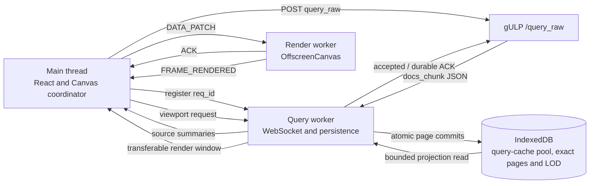
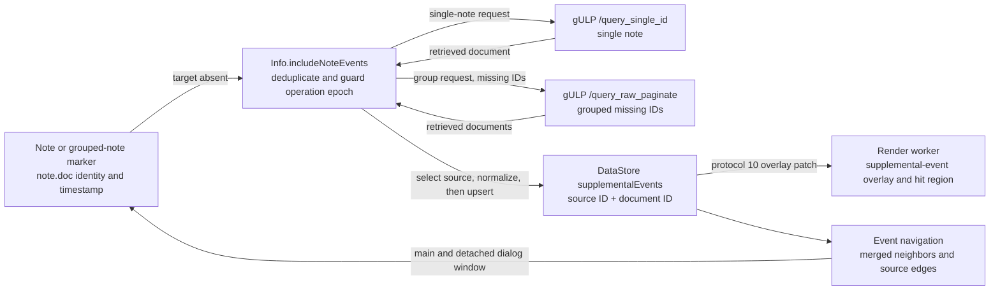

# Timeline rendering engine

The timeline is designed to show operations that are much larger than browser
memory. Exact event documents live in IndexedDB. The main thread coordinates UI
state, a query worker owns the high-volume socket and storage path, and a render
worker draws compact viewport projections on an `OffscreenCanvas`.

The important rule is simple: the number of events in an operation must not
determine how many document objects are kept on the main thread. The main thread
receives summaries, bounded lookups, and render projections; it never receives a
complete `docs_chunk` from the scalable path.

The detailed socket, IndexedDB schema, and projection protocol are documented in
[Query worker and event storage architecture](query-worker.md). This guide
explains how the pieces cooperate and how to diagnose the current engine.

## The path from query to pixels



A backend raw query follows these stages:

1. The main thread generates the request ID and registers its stream in the
   query worker before calling `/query_raw`.
2. `docs_chunk` WebSocket messages are parsed and normalized inside the query
   worker. Their document arrays do not cross the main thread. Once raw memory
   has been released, the worker acknowledges acceptance so the backend can
   advance its negotiated two-chunk window.
3. IndexedDB transactions atomically update exact pages, document indexes, LOD,
   height data, and source metadata.
4. After a durable commit, the query worker publishes only a compact source
   summary. Canvas uses the summary to schedule a viewport projection.
5. The query worker reads the exact pages and LOD records needed by the current
   viewport and transfers typed arrays back to Canvas.
6. Canvas immediately transfers the projection to the render worker. The worker
   applies it to its repository, acknowledges the data patch, and draws a frame.

`query_done` remains a backend lifecycle message. It does not prove that the
last `docs_chunk` is durable or visible. Storage completion and frame completion
have their own explicit fences.

Before the initial backend request, each selected source is reconciled with its
IndexedDB cache pool. An exact query-fingerprint hit activates its compact
manifest immediately. A fresh cache with the same query shape is also reusable
without warning when its cached range covers the desired range intersected
with the complete source range. Otherwise the most recently activated
complete, non-mutated cache is shown with a query-mismatch warning. A source
with no usable cache, including one with only mutated entries, dispatches
`/query_raw`; cached and uncached sources can therefore load together.

After initial reconciliation, the source history intentionally contains only
the chosen cache and the other entries are cleaned up. Queries explicitly
requested during the session always call the backend and append a new cache.
Undo/Redo in a source menu switches only that source's active manifest and query
without copying event pages or calling the backend.

## Responsibilities of the three threads

### Main thread

The main thread owns React state and user interaction. In the rendering path it:

- registers queries before dispatching backend work;
- retains each source's applied query, compact cache/freshness state, source
  summary, and current viewport state;
- requests initial cache reconciliation and source-local Undo/Redo;
- coalesces projection triggers into one active request and one trailing request;
- transfers render windows and other incremental scene patches;
- correlates terminal source revisions with worker ACKs and frames;
- performs bounded exact-event lookups for dialogs, notes, links, and selections;
- owns the operation-scoped supplemental events explicitly retrieved from notes.

The main thread does not decode or retain a source-wide event collection while
the scalable EventStore mode is active.

### Query worker

The query worker owns the authenticated WebSocket and the persistence pipeline.
It:

- routes document chunks by registered request ID;
- accounts for raw bytes before a chunk enters an ordered promise chain;
- normalizes documents cooperatively so socket/control work can continue;
- writes exact pages and their indexes to IndexedDB;
- owns source cache reconciliation, activation, bounded history, and cleanup;
- publishes durable source summaries;
- builds render-window projections from IndexedDB;
- exposes diagnostics only when `GET_QUERY_DIAGNOSTICS` is requested.

The query worker never sends full source documents to React or the render worker.

### Render worker

The render worker owns the transferred canvas, its render repository, drawing
caches, and hit regions. It receives:

- viewport and input state over the control channel;
- source, overlay, and projection patches over the data channel;
- bounded asset responses for icons and fonts.

It applies a data patch atomically before acknowledging it. A frame reports the
highest applied data sequence actually included in that draw. The bounded
pending-envelope merge retains the newest value of each independent overlay
section, including supplemental note-linked events, when dialog target state or
a render-window projection is published concurrently.

## What is stored and what is rendered

IndexedDB is a rebuildable exact-event cache. Version 4 contains source heads,
query-cache records with provenance, encoded event pages, LOD records,
height/graph aggregates, and paged document indexes. The backend remains
authoritative.

Each source head selects one physical cache manifest and stores a source-local
history cursor. A new query-cache record contains a query, exact and
range-independent shape fingerprints, normalization, server-source snapshot
and result summary; its physical generation addresses the existing exact
pages, LOD, and document indexes. The backend range remains in the query
snapshot. Up to five complete caches are retained per source.

A render window is not a page of documents. It is a bounded projection for the
visible time range and visible source rows, plus horizontal and vertical
overscan. Depending on zoom and source settings it contains representative
handles, timestamps, hashes, height counts, or graph buckets. Exact event detail
is fetched separately when the user selects or opens an item.

The render worker supports the current source engines:

- **Default** draws representative events and grouped counts;
- **HeightMap** draws density columns from persisted height aggregates;
- **Graph** draws fixed-frequency count buckets.

Projection budgets may reduce visual density when the viewport would otherwise
exceed its representative limit. This degradation changes detail, not the exact
event authority stored in IndexedDB.

## Note-linked supplemental event flow

Notes use the ID, source, and timestamp embedded in `note.doc`, so their overlay
does not depend on the target event being present in the active query. A note-only
source row remains renderable while notes are visible. A source with a
supplemental event remains renderable independently of note visibility.



The collection is deliberately outside QueryWorker and IndexedDB. Its documents
are session-only, deduplicated per source and document ID, and never enter an
exact page, LOD aggregate, query manifest, or query-cache history. Retrieval can
complete partially: successful documents are published immediately and another
confirmation retries only unresolved IDs. An operation-epoch check discards a
response that belongs to a previous operation. Single-note retrieval uses
`/query_single_id`; grouped retrieval batches missing IDs through
`/query_raw_paginate` and requests complete documents for source-specific
normalization. The affected source selection is committed before the synchronous
supplemental mutation reaches Canvas, preserving source/overlay ordering.

The render worker draws supplemental records above the active LOD projection for
all three engines. The records create `supplemental-event` hit regions but do not
change `loadedCount`, `frameEventCount`, source authority, generation, revision,
freshness, density aggregates, or source totals.

For navigation, `EventStoreReader.getTimestampNeighbors` reads bounded query
events around a timestamp that need not identify a persisted document.
`EventStoreFacade.getNeighbors` merges those query neighbors with every retained
supplemental event for the source, deduplicates by document ID, sorts by timestamp,
and slices the requested centered window. The same projection feeds main and
detached event dialogs, so the included event remains reachable after navigation
moves to an adjacent query event. Source first/last navigation reads the bounded
query edge and compares it with the small in-memory supplemental collection; the
outer timestamp wins, while the query event remains authoritative for equal
timestamps. Dialog navigation keeps its bounded 51-event prefetch window
separate from the 11-slot visual projection. Both main and detached projections
place the selected event at the middle index; source-boundary gaps are explicit,
non-shrinking placeholders rather than missing flex items.

Supplemental events are cleared on operation reset, source removal, a new
source replacement query, and successful Undo/Redo activation. A failed
activation retains them. Pan, zoom, collaboration reloads, and dialog lifecycle
do not clear the collection.

## Applied query and cache freshness

The query shown for a source is the immutable snapshot that produced its active
cache, not an approximation rebuilt from the current global controls. Session
snapshots and detached-window context derive their filters from this
source-owned applied query.

Freshness compares the cache's full-source server snapshot with current source
metadata: total count, complete min/max range, and `time_updated` when both
snapshots expose it. The current `/query_operations` response may omit that
marker, so matching count and range remain sufficient in that case. It never
compares a filtered cache's `eventCount` with the source total. Range comparison
uses nanoseconds and allows one millisecond only when one server value has no
finer precision.

An exact fingerprint or a source-local covered range with matching metadata
produces `fresh`; a newly completed backend replacement and a source without an
active cache are also `fresh`. Coverage uses inclusive raw-nanosecond intervals
and requires `(desired range intersection source range)` to be contained by
`(cached range intersection source range)`. A latest-cache fallback is
`query-mismatch`; changed comparable server metadata takes precedence as
`source-changed`; post-query upserts are `mutated`; insufficient count/range
evidence is `unknown`.

## Revisions, generations, ACKs, and frames

Several counters exist because they answer different questions.

| Fence | Meaning |
| --- | --- |
| operation epoch | Rejects work from an operation that is no longer active. |
| viewport revision | Identifies the current dimensions, scroll, scale, and visible rows. |
| projection revision | Orders accepted snapshots for the same viewport. |
| source authority revision | Monotonically orders builds and cache activations, including Undo to an older physical generation. |
| source generation | Identifies the physical cache, pages, LOD, and index records. An older generation may remain reachable in history. |
| source revision | Orders durable changes within one physical generation. |
| source status | Distinguishes `building`, `complete`, and `incomplete` authority. |
| data sequence | Identifies the `DATA_PATCH` that applied a source revision. |
| `globalRevision` | Aggregate telemetry; it is not terminal-render proof. |

The render protocol is version 10. ACKs travel on the data port and frames travel
on the control port, so their delivery order can be inverted. Canvas therefore
stores, for each acknowledged source revision, the data sequence that applied
it. A terminal target is cleared only when all of these statements are true:

- the frame belongs to the current operation epoch and viewport;
- the acknowledged source revision covers the exact terminal revision;
- the frame's `renderedDataSequence` covers the ACK's applying sequence;
- the terminal projection has the exact authority, generation, status, revision,
  and event count from the complete summary.

A stale frame received after a newer ACK cannot complete convergence. A watchdog
requests another projection after 500 ms and backs off to at most two seconds
until the correct frame arrives or the lifecycle changes.

Protocol version 10 retains the exact `frameEventCount` introduced with the LOD
projection and adds `RenderSupplementalEventRecord`, its independently
revisioned overlay patch, and the `supplemental-event` hit result. `loadedCount`
remains the complete-generation authority used by terminal convergence. The
projector sums active counts from pages entirely inside the selected frame and
inspects only partial boundary pages; tombstones and supplemental events are
excluded. The result is cached per source authority, generation, revision, raw
frame and offset so scroll and zoom do not repeat IndexedDB reads.

Cache freshness is no longer duplicated in render-worker source metadata.
Source warnings are exposed by one DOM overlay shared by the worker and legacy
backends. It shows the Lucide `AlertTriangle` icon only for a settled active
cache with a non-`fresh` warning and provides a localized hover tooltip
explaining that the displayed events came from cache. Fresh caches, sources
without cache authority, and backend replacements still in progress show no
indicator. Warning ownership is matched by the applied query's exact source
ID, never by the source display name. The source menu continues to expose the
detailed reason and actually applied query.

## Behavior while a query is loading

Backend chunks remain 10,000 events. EventStore pages hold 16,384 events. A
replacement builder carries a partial page across chunks, writes every complete
page, and writes the last partial page only at the terminal chunk. A 14,000,000
event source therefore creates 855 pages, of which only the last may be partial.

Canvas allows one projection in flight and one coalesced trailing trigger for a
viewport. Repeated building summaries do not continuously invalidate useful
work. A coherent building snapshot from the current generation may be published
even when a newer summary already exists; the trailing request then catches up.
A real operation, epoch, or viewport change invalidates the old request
immediately.

The preceding complete cache remains the rollback while the new generation is
building. Cancel, storage failure, or quota failure restores its physical
manifest and applied query. Cache-pool queries never discard this rollback for
an in-place replacement, because its pages may still be required by Undo.

The render worker normally waits for an 8 ms quiet window before drawing a dirty
data batch. Continuous traffic cannot postpone drawing indefinitely: while the
page is visible, a non-renewable 100 ms deadline forces a frame of the latest
atomically committed repository state.

## Terminal behavior

The final chunk first flushes every residual page and atomically commits a
`complete` query-cache record, source head, active cache, and history cursor.
The complete source summary and completed stream state are then published.

Canvas requests an exact terminal projection as soon as it observes the complete
summary. The previous complete generation remains reachable for Undo and is not
deleted at finalization. Cleanup applies only to a truncated Redo branch, an
entry evicted beyond the five-cache bound, or caches discarded by initial
reconciliation. It continues independently in IndexedDB batches of at most 256
delete operations. A cleanup failure is non-fatal for the authoritative cache;
its durable marker is retried before the next source mutation.

This separation ensures that cache history and an old multi-million-event
generation cannot make the terminal transaction unbounded or delay the final
render.

## Memory and queue limits

The scalable path has explicit UI-side bounds:

| Resource | Bound |
| --- | ---: |
| raw `docs_chunk` backlog, all requests | 128 MiB |
| raw backlog, one request | 64 MiB |
| normalized documents, including page builders | 32,768 |
| normal EventStore page | 16,384 events |
| concurrent persistence commits | 2 |
| reachable query caches per source | 5 |
| render data queue | 1 in flight + 1 pending |
| cache/generation cleanup transaction | 256 deletes |

Raw bytes are reserved synchronously before a chunk is queued. A chunk that
would exceed either raw limit is cleared immediately, the affected stream fails
with reason `backlog`, and the existing `/request_cancel` path stops backend
work. Other streams remain valid.

The authenticated UI socket negotiates a two-chunk acknowledgement window with
the backend. Normalization and ordered persistence use separate chains, so raw
JSON can be released while an earlier IndexedDB transaction is still pending.
An `accepted` ACK advances normal streaming only after bounded normalized credit
exists; the terminal `durable` ACK follows the authoritative manifest commit.

The byte limits remain independent safety boundaries. They still stop and
cancel an overloaded request if negotiation is unavailable, several child
queries combine into a larger request backlog, one frame is oversized, or the
consumer stops advancing.

Under normalized-memory pressure, a replacement stream flushes the largest
residual builder in its current context until global capacity is available. The
low watermark is 16,384 documents. This prevents four concurrent replacements
from waiting indefinitely while preserving densely filled pages in the normal
single-source case.

## Errors and compatibility mode

Normalization, backlog, and disconnect failures close only the affected stream
and use the normal user-visible failure path. Storage and quota failures preserve
the last coherent cache and its applied query, then publish an explicit
compatibility decision.

An unavailable or fatal render worker follows the same explicit policy while
EventStore owns the documents. No error writes the legacy marker or reloads the
page automatically. The localized banner offers:

- **Retry scalable mode**, which reloads without changing the marker;
- **Use compatibility mode**, which remains disabled until explicit confirmation,
  writes and reads back `gulp:event-store-lod-enabled=false`, and then reloads.

If the marker cannot be persisted, the page does not reload and the banner shows
a recoverable error. Compatibility mode has no event-count threshold, but it
keeps canonical events in main-thread RAM and can consume substantial memory.
It has no persistent query-cache history, so initial loads use the backend and
source-menu Undo/Redo is disabled.

Operation reset, hidden-document state, unmount, and worker disposal cancel their
timers, projection relevance, pending interactions, and transient bitmaps. An
operation epoch prevents late asynchronous work from becoming visible afterward.

## Diagnostics

Diagnostics are passive until a benchmark or troubleshooting tool asks for them.
The query worker accepts:

- `GET_QUERY_DIAGNOSTICS`, returning a correlated snapshot;
- `RESET_QUERY_DIAGNOSTICS`, clearing cumulative counters while preserving
  current gauges and active work.

The query snapshot includes current and maximum raw/normalized backlog, active
and maximum commits, commit count and latency, pages created and fill ratio,
loaded operations, active streams, and projection started/completed/superseded/
retry counts.

Canvas diagnostics add maximum worker-frame interval, render queue depth,
resync/error/fallback counts, oldest terminal-target age, current ACK/frame data
sequences, and their timestamps. This makes it possible to distinguish storage
progress, projection delay, data-channel delay, and a missing frame.

### Renderer test profiles

The existing EventStore resource benchmarks remain available:

```text
/renderer-test?docs=10m
/renderer-test?docs=20m
/renderer-test?docs=30m
```

The query replay profiles exercise the real JSON socket/persistence path in a
dedicated worker:

```text
/renderer-test?queryReplay=steady
/renderer-test?queryReplay=burst
```

The steady profile produces 14,000,000 events for one source in 10,000-event
chunks, allows at most two chunks to await persistence, and sends `query_done`
immediately after the last chunk. Its machine-readable gate requires 855 pages,
an exact terminal render count, ACK-covered building frames at least every two
seconds while the source advances, terminal projection within five seconds,
terminal frame within 250 ms of its ACK, and no resync, worker error, fallback,
or queue overflow.

The burst profile deliberately outruns persistence. It passes only when the
stream ends with controlled reason `backlog` and the recorded raw high-water
marks remain within 128 MiB globally and 64 MiB for the request.

Automation can read `window.__rendererQueryReplayDiagnostics`, the
`rendererQueryReplay*` document data attributes, or listen for
`renderer-query-replay-complete`. The existing benchmark publishes its original
diagnostics and release-gate events unchanged.

## Troubleshooting

Use the diagnostics in pipeline order:

1. **Raw backlog grows**: verify that the socket advertised
   `query_chunk_ack_window`, then inspect normalization progress. With negotiated
   flow control a slow commit may fill normalized credit, but the backend stops
   after its bounded unaccepted window. A `backlog` failure means the independent
   UI safety bound stopped an oversized or non-advancing request.
2. **Raw is low but normalized backlog stays high**: inspect commit latency,
   active commits, quota, and IndexedDB errors.
3. **Summaries advance but projections do not complete**: inspect started,
   superseded, retry counts, viewport churn, and oldest projection age.
4. **Projection completes but ACK does not advance**: inspect the two-slot data
   queue and any resync request.
5. **ACK advances but the target remains pending**: compare the source's ACK data
   sequence with `renderedDataSequence`, viewport revision, and terminal age.
6. **Frames arrive slowly during traffic**: compare maximum frame interval with
   the 100 ms visible-page deadline and check tab visibility or fatal errors.
7. **A source loads a cache but shows a warning**: inspect the source menu for
   the applied query and freshness reason, then compare its fingerprint and
   server snapshot with the current source metadata. Refetch explicitly when a
   current result is required.

For schema fields, stream descriptors, exact-read APIs, and projection selection
rules, continue with [query-worker.md](query-worker.md).

## Extension rules

Changes to the engine must preserve these boundaries:

- do not move complete documents onto the main thread or into the render worker;
- keep explicitly retrieved note targets outside query generations and LOD counts;
- keep persisted pages and render projections versioned and atomically replaceable;
- keep query provenance source-scoped and activate cached manifests without
  copying their pages;
- preserve monotonic authority independently from physical generation;
- retain one active and one trailing projection/data slot rather than unbounded
  queues;
- carry operation epoch and relevant revisions across every asynchronous boundary;
- close superseded typed-array and bitmap resources;
- add protocol fields to validators, tests, and documentation together;
- keep benchmark diagnostics machine-readable and off the production hot path.
