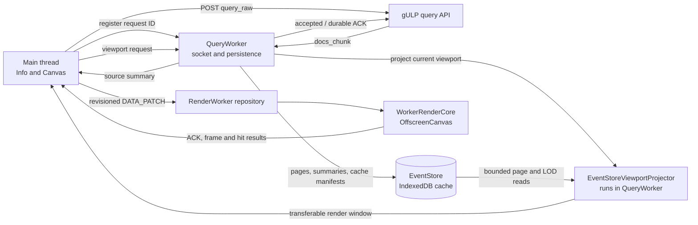

# Timeline rendering architecture

The timeline separates query ingestion, persistent event authority, viewport
projection, and canvas drawing so an operation can be larger than browser
memory. This page is the component map and lifecycle overview. Detailed behavior
belongs to the document for the component that implements it:

- [Query worker and event storage architecture](query-worker.md): WebSocket
  streams, backpressure, normalization, IndexedDB pages, query-cache pools,
  reconciliation, mutations, and exact reads.
- [Render worker and LOD projection architecture](render-worker.md): viewport
  cache reads, LOD selection, projection transfer, RenderWorker state, drawing,
  ACK/frame fences, and render diagnostics.
- [Rendering engines](engine.md): user-facing behavior and source settings.

## Code structure

The documentation follows the main `gulp-ui/src` boundaries.

| Area | Main code | Owns |
| --- | --- | --- |
| Application and Canvas | `class/Info.tsx`, `app/body/Canvas*.ts(x)` | React state, operation/source selection, query registration, applied-query and freshness UI, viewport scheduling, exact interaction requests |
| Query worker | `event-store-worker/` | Authenticated query socket, stream routing, normalization, persistence coordination, cache commands, viewport projection requests |
| EventStore | `event-store/` | IndexedDB/Memory backends, exact pages, LOD and height summaries, document indexes, query-cache manifests, bounded readers, viewport projector |
| Render worker | `render-worker/` | Protocol validation, atomic render repository, `OffscreenCanvas`, drawing algorithms, hit regions, frame scheduling |
| Main-thread overlays | `store/DataStore.ts`, note/link/flag flows | Small collaboration and supplemental-event projections independent from query generations |

`EventStoreViewportProjector` is implemented in `event-store/` and executes in
QueryWorker. RenderWorker never opens IndexedDB. This distinction keeps exact
documents and page decoding off both the main thread and the drawing worker.

## End-to-end data flow

The main thread coordinates the two workers but does not become a high-volume
event relay. Full `docs_chunk` arrays remain inside QueryWorker. Render-window
typed arrays cross the main thread only as transferred buffers and are
immediately transferred again to RenderWorker.

## Query and cache lifecycle

Before `/query_raw` is dispatched, the main thread registers its request ID and
source descriptors with QueryWorker. Incoming chunks are accounted, normalized,
and persisted in order. An `accepted` acknowledgement means raw JSON has been
released into bounded normalized credit; the terminal `durable` acknowledgement
means the authoritative EventStore commit completed. `query_done` remains a
backend lifecycle packet and is not a storage or frame fence.

On initial source load, QueryWorker reconciles each source independently. It
prefers a fresh exact cache, then a fresh range-covering cache; a stale exact
cache still precedes an unrelated latest-cache fallback. Freshness warnings are
derived afterward from comparable server metadata, so a server change takes
precedence over a query mismatch. A source with no reusable cache calls the
backend, and cached and uncached sources can initialize together.

Explicit queries always execute against the backend and append a new cache.
Source-local Undo/Redo activates another retained manifest without copying event
pages or issuing a query. The query worker owns replacement rollback, cache
pruning, and bounded cleanup. See [query-worker.md](query-worker.md#initial-cache-reconciliation)
for the authoritative selection and warning rules.

## Viewport and render lifecycle

After a durable source summary, Canvas schedules a projection for the visible
time range and source rows. QueryWorker reads the active EventStore manifest and
uses page catalogs, LOD records, height counts, and exact refinement only where
the current pixel resolution requires it.

The returned projection contains render-only typed arrays and source authority.
Canvas validates the operation and viewport revisions and transfers it in one
data patch. RenderWorker atomically adopts the whole render window, acknowledges
the applying data sequence, and draws the current repository state. Its frame
result identifies the highest committed data sequence included in that draw.

Default uses pixel-equivalent event representatives, HeightMap uses fixed
one-minute density counts, and Graph uses viewport-dependent dynamic count
buckets. The selection algorithm and engine-specific drawing rules are defined
in [render-worker.md](render-worker.md#lod-selection).

## Ownership boundaries

### Main thread

The main thread owns:

- React entities, user interaction, selected operation and sources;
- each source's applied query and compact cache/freshness state;
- viewport and projection scheduling;
- source/theme/overlay metadata supplied to RenderWorker;
- bounded exact lookups for selection, dialogs, and navigation;
- explicitly included note-linked supplemental events.

It does not retain an event collection proportional to an operation.

### QueryWorker and EventStore

QueryWorker owns:

- the authenticated high-volume WebSocket path;
- request registration, stream routing, cancellation, and backpressure;
- normalization, exact page persistence, and query-cache lifecycle;
- source authority summaries and exact read commands;
- EventStore viewport projection and transferable-buffer preparation.

EventStore is rebuildable browser storage. The backend remains the event
authority. Persisted Graph aggregates do not exist: `page_lod` contains default
LOD microblocks and HeightMap minute counts, while Graph data is derived for the
viewport.

### RenderWorker

RenderWorker owns:

- the transferred `OffscreenCanvas` and drawing context;
- compact source, projection, theme, and overlay state;
- Default, HeightMap, and Graph drawing;
- notes, links, flags, targets, supplemental-event markers, and hit regions;
- ordered patch application, frame scheduling, and protocol responses.

It receives neither query documents nor cache-freshness state. Freshness
warnings are a main-thread DOM overlay shared by scalable and compatibility
renderers.

## Exact documents and interaction

A render window is not a document page. It contains enough numeric data to draw
the viewport, but an event handle is only a compact source-local reference.
Clicks issue an exact `queryPixelBucket` read; single matches can open directly,
while dense pixels use bounded cursor pagination. Dialog navigation and detached
views use the same bounded EventStore facade rather than a source-wide document
map.

This separation makes visual LOD independent from interaction accuracy: a
degraded viewport still resolves all exact events in the selected pixel bucket.
See [query-worker.md](query-worker.md#exact-read-api).

## Supplemental note-linked events

Notes can refer to events outside the active query. Missing targets are retrieved
through the main-thread API flow and stored in a small operation-scoped
supplemental collection, not in QueryWorker or an IndexedDB cache generation.
Canvas publishes the collection as an independently revisioned render overlay.

RenderWorker draws supplemental markers above every engine and includes them in
hit testing. They do not alter source authority, exact pages, LOD or density
aggregates, query totals, frame counts, or cache freshness. Detailed user
behavior is in [engine.md](engine.md#notes-whose-events-are-outside-the-active-query);
the render boundary is in [render-worker.md](render-worker.md#supplemental-note-linked-events).

## Authority and asynchronous fences

Different revisions answer different questions:

| Fence | Purpose |
| --- | --- |
| operation epoch | Rejects work belonging to a released or reset operation |
| source authority revision | Orders builds and cache activations independently from physical generation |
| source generation and revision | Identifies the active physical cache and its durable state |
| viewport revision | Identifies frame, scale, scroll, dimensions, and visible rows |
| projection revision | Orders accepted render windows for one viewport |
| data sequence | Identifies the patch that applied a source revision in RenderWorker |
| rendered data sequence | Proves which applied patches were included in a completed frame |

Because data ACKs and frames travel over separate channels, arrival order is not
proof of convergence. Canvas correlates source authority with the applying data
sequence and the frame that covers it. Detailed acceptance rules belong to
[render-worker.md](render-worker.md#acks-frames-and-terminal-convergence).

## Loading and terminal state

Committed building summaries may refresh the viewport while a query continues.
Canvas coalesces those triggers so storage progress cannot create an unbounded
projection queue. The previous complete cache remains the rollback until the new
generation becomes authoritative. Cancellation or persistence failure restores
that rollback when available.

Completion publishes the final exact page, source/cache manifest, and history
state before the complete summary. Canvas then requests the terminal projection
and waits for an authority-matching ACK-covered frame. Cache cleanup proceeds in
bounded background transactions and is not part of terminal render latency.

## Errors and compatibility mode

Normalization, backlog, disconnect, storage, and projection failures are scoped
to the affected work wherever possible. Storage/quota failure or a fatal render
worker preserves the last coherent cache and publishes an explicit compatibility
decision. No failure writes a marker or reloads automatically.

The user can retry scalable mode, or explicitly confirm the RAM compatibility
pipeline. Only the confirmed choice persists
`gulp:event-store-lod-enabled=false` and reloads. Compatibility mode keeps events
on the main thread, has no persistent query-cache history, and can consume much
more memory.

## Diagnostics and troubleshooting

Start with the component that stopped advancing:

1. If chunks, summaries, or cache state do not advance, inspect
   [QueryWorker diagnostics](query-worker.md#on-demand-diagnostics).
2. If summaries advance but no projection completes, inspect projector retries,
   superseded work, and viewport churn in
   [Render diagnostics](render-worker.md#diagnostics-and-performance-checks).
3. If a projection completes but no data ACK arrives, inspect RenderWorker patch
   validation, queue depth, and resynchronization requests.
4. If ACKs arrive but the terminal target remains pending, compare the applying
   data sequence with `renderedDataSequence` and the current viewport revision.
5. If the pixels are current but exact selection is wrong, inspect the
   EventStore source authority and pixel cursor revision.
6. If a cache warning appears, inspect the source's applied query, selection
   reason, and server snapshot; refetch explicitly when current backend results
   are required.

## Extension rules

Changes to the timeline engine must preserve these boundaries:

- keep complete query documents out of the main thread and RenderWorker;
- keep IndexedDB access and viewport projection in QueryWorker;
- keep explicitly retrieved note targets outside query generations and LOD
  counts;
- version persisted pages and publish manifests atomically;
- preserve source authority independently from physical cache generation;
- bound socket, persistence, projection, and render queues;
- carry operation and relevant revision fences across asynchronous boundaries;
- transfer or release typed arrays and bitmaps instead of retaining stale views;
- update protocol validators, tests, and the owning component document together;
- keep benchmark diagnostics machine-readable and off the production hot path.
