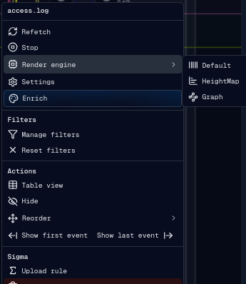

# Engine

The render engine controls how each source row is drawn on the timeline canvas.
Source settings also control offset, sampling, colors, and field hashing.

The primary timeline canvas is owned by a render worker. A query worker reads
the operation EventStore and supplies only the event representatives and
aggregates required for the visible viewport. See
[Query worker and event storage architecture](query-worker.md) and
[Timeline rendering architecture](engine.architecture.md) for the internal
design.

## Render Engines

gULP UI has three source render engines:

- `Default`: draws event activity as one-pixel vertical bars colored from the
  configured hash field.
- `HeightMap`: groups events into fixed one-minute buckets and draws vertical
  bars proportional to event density.
- `Graph`: aggregates source sample data into dynamic buckets, draws a semi-log
  density graph, and connects graph points.

The source context menu can switch engines directly.

## Source Settings

The source settings banner is opened from the source context menu. It saves
settings through the frontend source settings flow and refreshes rendering.

Configurable source settings:

- timestamp offset in milliseconds;
- minimum frequency sample for graph rendering;
- render engine;
- hash function used for event value coloring;
- render color palette;
- event field used for the color scheme;
- context color.

If a knowledge-base color override or custom palette is applied, source settings
can show the active override and allow clearing it.

## Timestamp Offset

Offset shifts a source's rendered event timestamps without changing the original
event data. This is useful when a source clock is known to be ahead or behind the
operation timeline.

Offset is stored in milliseconds and applied during rendering, event hit testing,
note positioning, and timeline targeting.

## Frequency Sample

The Graph engine uses `frequency_sample` as the minimum sample size. When zoomed
out, the engine dynamically increases the sample rate based on visible time range
and canvas width to avoid excessive overlap and keep rendering performant.

## Timeline Zoom Limit

All Canvas zoom paths use a maximum scale derived from the active frame. Maximum
zoom keeps a ten-millisecond duration visible, so the ruler displays approximately
ten one-millisecond sections independently of Canvas width. Timeline events are
normalized to whole milliseconds; maximum zoom separates adjacent millisecond
timestamps but does not invent sub-millisecond event precision.

Render work at maximum zoom remains based on viewport pixels rather than the
overall frame span. The query worker projects only the visible source rows and an
overscanned horizontal viewport into pixel-sized buckets. A render window is
capped at 1,000,000 representatives and automatically uses wider degraded-LOD
buckets if that cap would be exceeded. Deep zoom can require additional exact-page
refinement for dense sub-second intervals, but those reads remain worker-owned,
page-bounded, and superseded by newer viewport requests.

## Colors and Fields

Default and HeightMap rendering resolve colors from the selected palette and the
configured event field. The hash function converts field values into stable
numeric values for palette lookup. Explicit color overrides can replace palette
colors for selected field values.

Context color is used as the row tint and separator color so related sources can
be visually grouped.

## Caching

Exact timeline events are stored in an operation-scoped IndexedDB EventStore.
The render worker keeps a bounded render window for the visible source rows and
time range, including horizontal and vertical overscan. It does not cache the
complete event collection.

The Default engine receives pixel-equivalent event representatives, HeightMap
receives persisted density counts, and Graph receives viewport-scale samples.
Palette-only changes reuse the exact stored pages; source revisions, offsets,
engine settings, overrides, notes, flags, or viewport changes publish the
corresponding revisioned render state.
