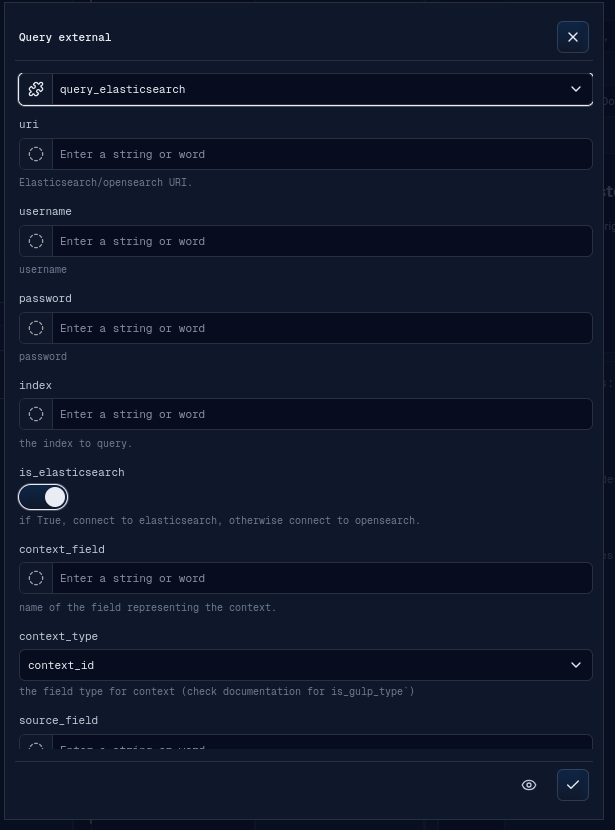
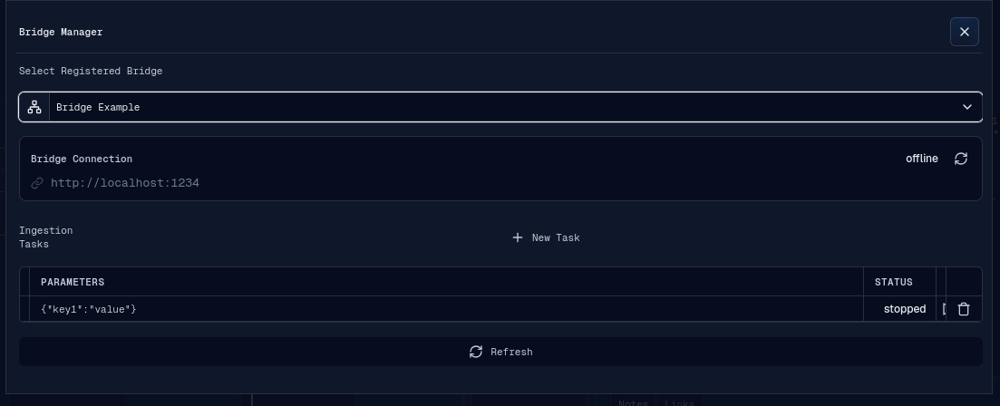

# External Integrations

The External menu contains Query External, Bridge Manager, and Data Enrichment.
Enrichment is documented in [Features](features.md#enrichment). This page covers
Query External and Bridge Manager.

## Query External Source

Query External runs backend-provided plugins whose type includes `external`.

The banner supports:

- external plugin selection;
- dynamic request fields based on the selected plugin's custom parameters;
- advanced plugin parameters through the shared Advanced Plugin Params editor;
- optional raw query JSON;
- optional query options JSON;
- preview mode;
- run mode.

Preview mode opens a Preview banner with returned documents and total hits. Run
mode registers an ingestion stream before starting the external query. As soon
as the backend accepts the request, source selection opens so newly created or
updated sources and contexts can be followed and selected while ingestion is
still running. Closing source selection returns to Query External with the
selected plugin, custom parameters, query, and query options restored; the
ingestion continues independently and reports its final result through the
normal notification flow.

External queries use the same live progress and EventStore lifecycle as file
ingestion. QueryWorker publishes cumulative per-source counts after every
accepted chunk, including documents still held in a partial EventStore page,
so source-selection badges advance without waiting for a 16,384-event page or
terminal flush. Their `ext_query` terminal statistics finish or discard the
provisional source data, while `query_done` only reports that backend query
execution has ended and is not a persistence-completion signal. After a
successful durable completion, the created sources leave their loading state
and their events can be rendered or refetched.

The backend does not currently include source links in
`request.data.sources` for `ext_query` requests. Source discovery works during
the live WebSocket session, but restoring the association for an ingestion
that is still running after a page refresh or reconnect is not guaranteed.

## Bridge Manager

Bridge Manager works with registered ingestion bridges.

The Bridge Manager banner supports:

- loading the registered bridge list;
- selecting a bridge;
- viewing bridge URL and current status;
- refreshing bridge status;
- listing ingestion tasks for the selected bridge and current operation;
- creating a new task with plugin parameters;
- starting stopped tasks;
- stopping ongoing tasks;
- deleting tasks;
- refreshing the task table.

Bridge status and task lifecycle details depend on backend bridge availability.
This documentation only covers the frontend workflow and visible controls.
