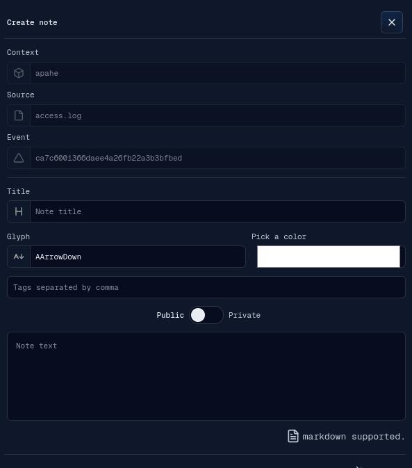
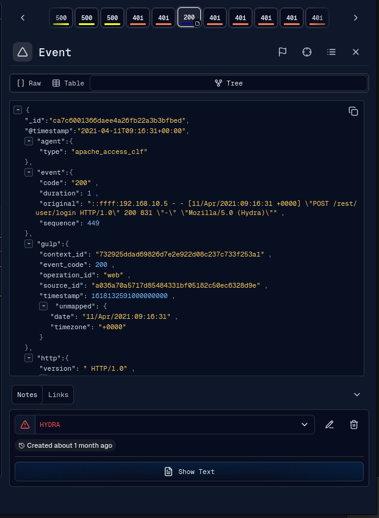
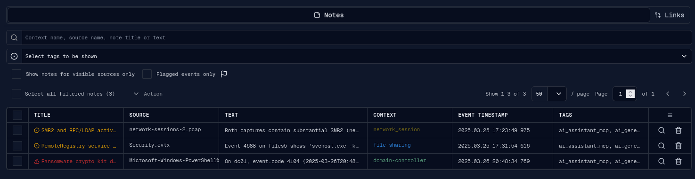
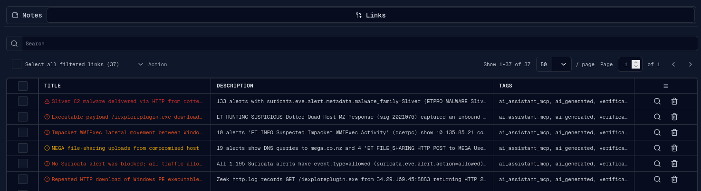
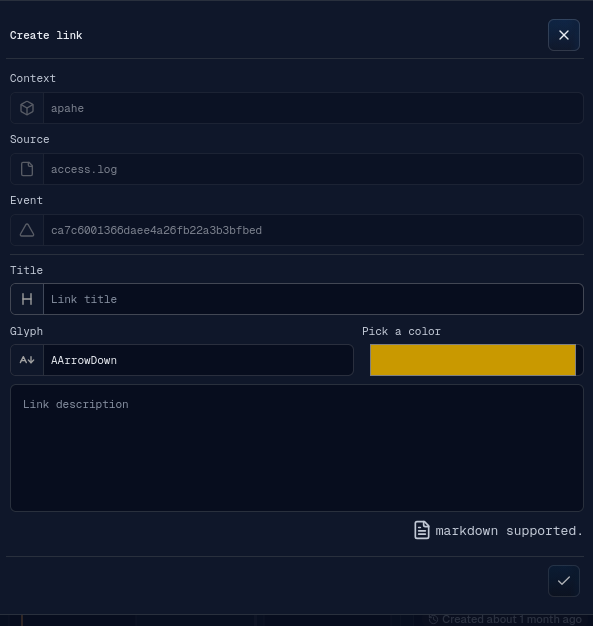
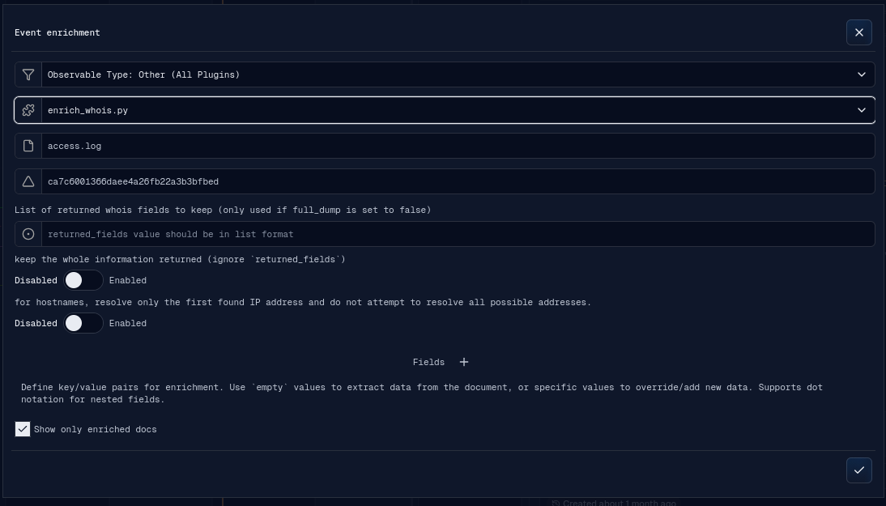
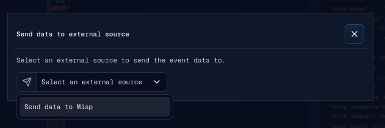

# Features

This section covers the analyst collaboration and enrichment features: notes,
links, enrichment, and Send IOC.

## Notes

Notes attach analyst context to one or more events. They are visible in the event
detail panel and can be shown on the timeline as markers.
Clicking a timeline note marker opens its event, or the grouped-note selector when
multiple notes share a marker. Marker clicks take precedence over events rendered
beneath them at every zoom level during normal interaction. Hovering a marker
highlights its fill and displays an inset outline without changing its clickable
area. While the magnifier is active, an exact event under the pointer takes
precedence so events covered by the marker remain selectable. If that pixel
contains no event, the click still selects the marker.

A note contains:

- target context, source, and event;
- title;
- glyph;
- color;
- comma-separated tags;
- public or private visibility when creating a new note;
- markdown-supported note text.

The event detail panel shows notes in the lower `Notes` tab. Existing notes can
be edited or deleted from the event panel.

The detached Notes & Links window provides Notes and Links tables for the selected
operation and sources.

The Notes & Links window supports:

- search by context name, source name, note title, or text;
- tag filtering;
- "visible sources only" filtering based on the source rows currently rendered by
  the timeline, including its source-name/context filter and hidden-empty-source
  setting;
- filtering notes to events flagged in the active operation;
- selecting notes;
- bulk deletion;
- targeting a note to open or fetch its event in the main tab.

The Links tab shows each link's glyph, colored title, description, tags, and
origin event ID. Its case-insensitive search covers title and description text
plus exact tags. The visible page and matching count are loaded from the
collaboration API when the tab opens and whenever its debounced query or
20/50/100-row pagination changes. Current-page and all-filtered selection plus
confirmed bulk deletion remain backed by stable canonical link IDs. The origin
ID and entries in the related-events popup target their event in the main
operation window. Row actions open the available origin and destination events
or delete the complete link after confirmation.

Realtime Link creation or deletion leaves the current page stable and displays
a changes-available warning. The analyst explicitly refreshes to load and
acknowledge the latest matching page; renderer state still receives the compact
delta immediately.

Creating, editing, connecting, disconnecting, or deleting a Link applies the
mutation result directly instead of reloading the complete Link collection.

See [Detached Applications](detached-windows.md) for lifecycle, synchronization,
and request behavior shared by detached views.

## Links

Links connect related events. They let an analyst represent relationships such as
cause/effect, repeated activity, or a meaningful investigative sequence.
Clicking a timeline link marker opens the connected event or the link event group.
As with note markers, normal link marker clicks take precedence over underlying
events at every zoom level. Link markers use the same bounded hover highlight and
allow exact-event click-through while the magnifier is active.

A link contains:

- target context, source, and event;
- title;
- glyph;
- color;
- markdown-supported description.

The event detail `Links` tab lists connected links. From that tab an analyst can
open connected events, disconnect the current event from a link, or delete the
link. A link can also be connected to additional events through the Connect Link
banner.

## Enrichment

Enrichment uses backend-provided enrichment plugins to add context to an event or
source range.

The enrichment banner supports:

- observable type selection, with automatic type detection when opened from an
  event field;
- enrichment plugin selection;
- source selection or a fixed event target;
- event ID or source time range;
- plugin custom parameters;
- key/value fields to extract from the document or override manually;
- a "show only enriched docs" option for source-range enrichment.

From an event detail view, selecting a field or selection can prefill the
enrichment key/value input. From the operation menu or source context menu,
enrichment runs against a selected source and frame range.

## Send IOC

Send IOC is exposed from the event detail action menu when at least one UI plugin
targets the `send-data` slot.

The Send Data plugin supports:

- sending a simple IOC from event data;
- sending a structured object (defined by plugin);
- setting event/object fields in the plugin UI;
- receiving async success or failure feedback through WebSocket messages.

The Send IOC parent banner does not implement destination-specific behavior. It
loads the selected plugin and calls the plugin's `onDone()` ref method when the
analyst confirms the action.
