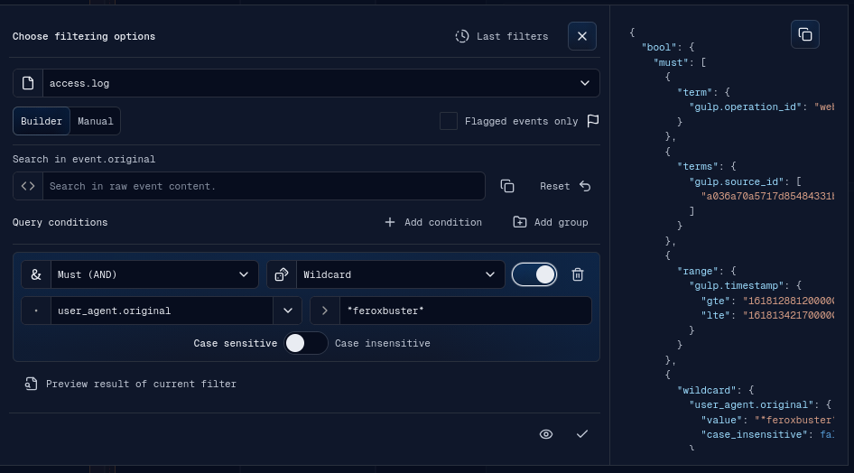
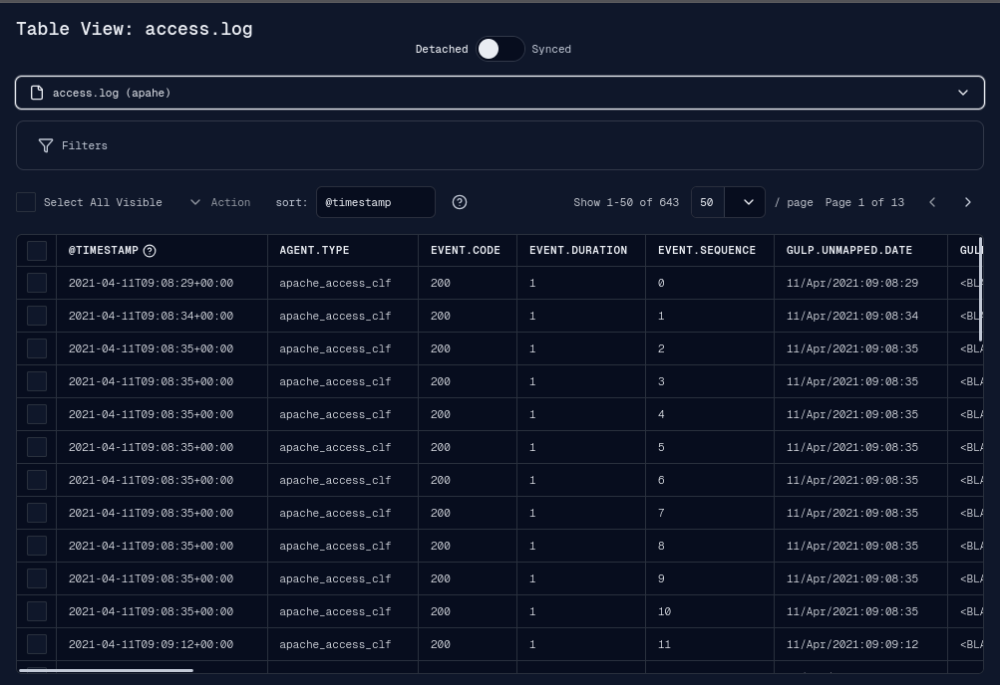
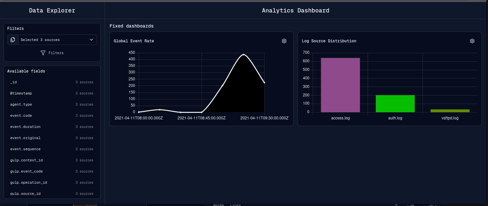

# Filters

Filters narrow source events in the timeline, table view, previews, and dashboard
queries. The main filter UI is the Apply Filters banner.

## Scope

A filter is applied to one or more sources. The banner starts with the selected
sources passed from the operation menu, source context menu, or previous filter
history. The multi-select search filters visible source and context names without
changing the selection. Source changes update the query scope.

When filters are applied, the frontend caches the current source events for undo,
stores the query against each selected source, refetches those sources, and
triggers a timeline render.

Applying another filter first removes pending queries for the affected sources,
then cancels their active streams before queuing the replacements. Navigator
applies this replacement to every source selected in the timeline; Apply Filters
uses only the sources selected in its multi-select. Work belonging exclusively
to other sources continues unchanged, and the replacement batch retains visible
source priority.

## Navigator Event Search

The Navigator search starts in event mode and targets `event.original` on every
source selected in the timeline. The search input embeds an icon selector with
two mutually exclusive strategies:

- **Text** is the default. It collapses whitespace and surrounds every word with
  wildcard characters, so `failed login` becomes `*failed* *login*` in one
  case-insensitive wildcard condition;
- **Regex** sends the trimmed input as a regular-expression condition without
  escaping or adding anchors.

Search runs from the Search button or Enter. Repeating a search replaces the
previous Navigator condition while preserving every other source filter. An
empty search removes only the Navigator condition. The mode icon switches to
source/context filtering; doing so removes the active Navigator event condition
and hides the event-search strategy dropdown. In source/context mode, filtering
updates while the user types. Whitespace-delimited terms are case-insensitive
alternatives: a source remains visible when any term occurs in its source name
or context name. Repeated or surrounding whitespace is ignored.

The embedded selector is a reusable `Input` capability. Callers provide
`key`/`label`/`icon` values and controlled selection state. It is single-select
by default and displays the selected value's icon; optional multi-select mode
allows independent choices and displays `ListChecks` in the input trigger.

Navigator conditions are stored with each source query. Opening Apply Filters
for one source therefore shows the same `event.original` wildcard or regular
expression in Builder mode, where it can be inspected or edited.

## Builder Mode

Builder mode provides:

- source multi-select;
- text filtering;
- condition groups;
- field selectors and data types loaded from the selected sources;
- generated OpenSearch query preview;
- optional "flagged only" preview mode.

The query display label is generated from the actual filter state. It is not used
as the filtering source of truth.

### Conditions by field type

New conditions use equality (`eq`) by default. Equality produces an OpenSearch
`term` query. The condition selector always shows the complete list and disables
conditions that are not valid for the selected field type:

| OpenSearch field type | Available conditions |
| --- | --- |
| `keyword`, `wildcard` | Equality, wildcard, regular expression, range, less-than-or-equal, and greater-than-or-equal |
| `text` | Equality and wildcard |
| Numeric types, `date`, `date_nanos`, `ip` | Equality, range, less-than-or-equal, and greater-than-or-equal |
| `boolean` and known non-scalar types | Equality only |
| Unknown type or unavailable metadata | Equality, wildcard, regular expression, range, less-than-or-equal, and greater-than-or-equal |

Selecting or typing a different field immediately resets an incompatible
condition to equality. This behavior also applies inside nested condition groups
and when reopening saved filters. Query generation performs the same validation
so incompatible filters received from history or external data are safely
handled as equality conditions. When field metadata is not available, the UI
preserves the selected condition and leaves validation to OpenSearch instead of
silently rewriting it to equality.

An empty source-field response means the backend catalog is still pending. The
UI does not persist that empty response, so opening or refreshing the filter can
request the completed catalog later.

The field dropdown has an independent search input. It starts empty every time
the dropdown opens, and typing or clearing a search does not change the selected
field or its condition. Compatibility is evaluated only when a field is chosen
or directly entered as the filter field.

Numeric range limits are emitted as numbers. Date, IP, and keyword limits remain
strings, and either side of a range can be left empty. Invalid numeric comparison
limits are not emitted as query clauses.

## Manual Mode

Manual mode exposes a raw JSON editor for advanced OpenSearch queries. If manual
JSON is invalid when applying or previewing, the UI rejects the action. A reset
action can regenerate a clean query from the current sources and timeline frame.

Changing source selection in manual mode resets the generated query to avoid
stale source IDs or ranges.

## Preview

Preview runs the current query without committing it to the timeline. Results
open in a Preview banner. Returning from preview restores the filter banner with
the current query, source selection, notes settings, and field metadata.

## Last Filters

The Last Filters popover loads recent query history from the backend. A historical
filter can be applied with its saved source scope or adapted to the currently
selected sources.

## Apply, Reset, and Undo

Apply saves the final filter and refetches selected sources. Reset removes active
filters for a source and always queries the backend instead of activating a cached
generation; the completed result becomes the new cache authority. Undo is available
when the timeline cache contains previous data for the source.

Source context menu filter actions:

- Manage filters;
- Reset filters;
- Undo last filters change when cached data exists.

Right-clicking an empty area below the source rows opens the global timeline
menu. Its actions always target every user-selected source, including sources
currently excluded by the timeline text filter or hidden-empty-source setting:

- **Refetch all** reuses complete, fresh, compatible source caches and queries the
  backend where no reusable cache is available. During the session it preserves
  Undo/Redo history; only each source's first initialization resets old history;
- **Reset all filters** clears each selected source query and performs one bulk
  authoritative refetch. The reset does not activate a latest-cache fallback,
  because that cache may still contain the filters being removed;
- **Stop all** first removes pending refetches for the selected sources, then
  cancels only their requests that have already started;
- **Undo all query caches** activates the preceding browser-local cache for each
  selected source where Undo is available;
- **Redo all query caches** activates the following browser-local cache for each
  selected source where Redo is available.

## Table View Filters

The Table View window supports its own filter panel. In synced mode, it follows
the global source filters and timeline range. In detached mode, it uses local
search, local filters, date range controls, sorting, and pagination. Its source
selector can filter the visible contexts and sources by name without changing
the current selection or the scope of select-all and context actions.

## Dashboard Filters

The Dashboard window has a Data Explorer filter area. It can use selected sources,
time range, text filter, and structured conditions to build dashboard queries.
The source selector starts with the operation sources selected and supports an
explicit empty selection. With no source selected, fixed and field aggregations
remain paused and their result areas ask the analyst to select at least one
source. Selecting a source resumes the fixed dashboards and any open field
aggregation. Its search field filters the visible groups by context name or
source name without changing the current selection; context and select-all
actions continue to apply to their complete source sets.

