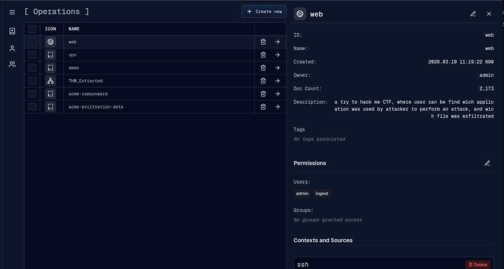
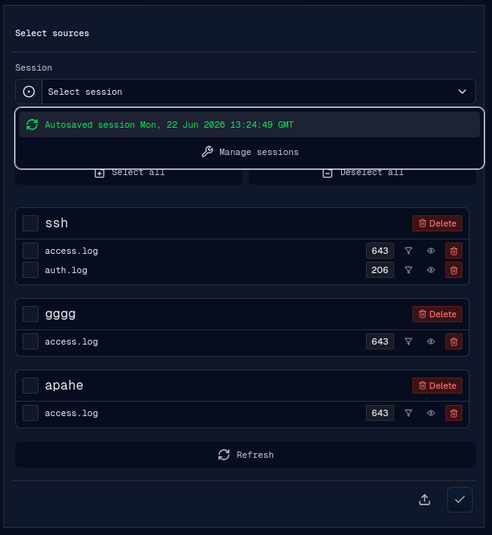
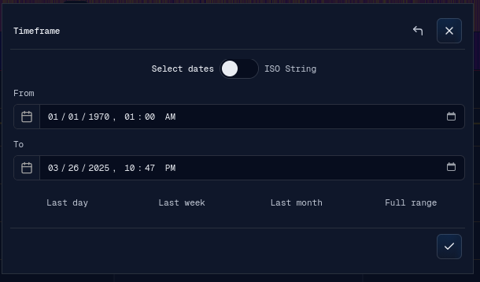
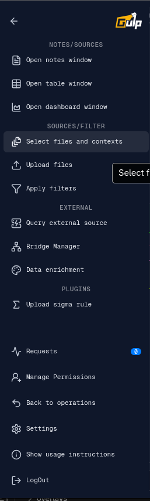
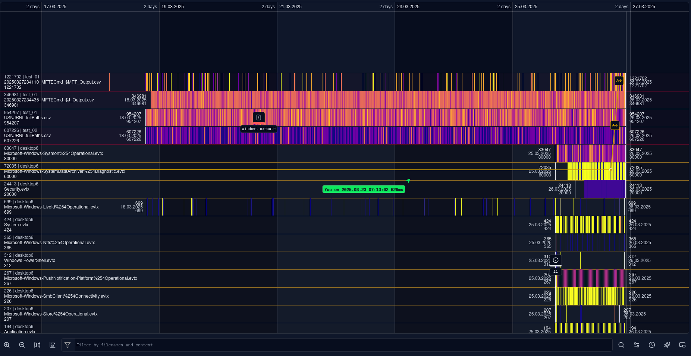

# Flow

The operation flow starts from the operations page, moves through source/context
selection, and ends in the timeline workspace where events are investigated.

## Operations

An operation is the investigation workspace. The operations page lets an analyst:

- create a new operation;
- select an existing operation;
- inspect operation metadata, document count, permissions, contexts, and sources;
- delete operations or sources when permitted.

After an operation is selected, gULP UI opens the operation route and checks
whether sources are already selected or whether a saved session should be loaded.

## Operation Context

The operation context is made from selected contexts and sources. A context is a
logical grouping, usually a host or investigation container. A source is a log or
event collection inside that context.

The source selection banner supports:

- loading an autosaved or manually saved session for the operation;
- saving the current workspace as a named session;
- renaming or bulk-deleting saved sessions;
- manually refreshing session data changed on another device;
- selecting or deselecting all visible sources;
- selecting a complete context;
- selecting individual sources;
- filtering the visible context/source list;
- refreshing operation data from the backend.

The session selector is available both when entering an operation and whenever
the source selection banner is opened from the investigation workspace.

When the selection is saved, the app applies the contexts and sources as one
state update and publishes the context to detached applications that consume
it. Workspace autosave observes selection, timeline, filter, source-setting,
and scroll changes.

## Workspace Sessions

Workspace sessions are scoped to the selected operation. Each operation has one
rolling autosave and can have multiple named sessions. A session stores:

- selected contexts and sources;
- timeline frame, scale, scroll position, text filter, and selected event;
- source filters and hidden-state preferences;
- render engine, sampling frequency, timestamp offset, field, hash function,
  palettes, color overrides, and pinning for each source.

Named sessions can be saved, loaded, renamed, or deleted in bulk. Session names
must be unique within an operation but can be reused in other operations.
Deleting or replacing a session affects only the selected operation.

Autosave treats the loaded workspace as its initial state and does not save it
again until relevant data changes. It saves after ten seconds without further
changes. During continuous activity, it saves at least once every sixty
seconds. Unchanged workspace state is not saved.

Only one autosave request is active at a time. Changes made while a request is
active are included in a later save. A failed autosave remains pending until
another relevant change occurs, and the UI displays one failure warning.

Successful session updates are synchronized across tabs logged in as the same
user. The session manager also provides a manual refresh for updates made in
another browser or device.

## Timeline Frame

After source selection, the frame banner sets the visible time range. The frame
can be entered with date inputs or ISO strings and can be quickly set to common
ranges such as the last day, week, month, or full range.

The selected frame is used for timeline rendering, refetching selected sources,
filters, enrichment ranges, table view defaults, and dashboard defaults.

## Workspace Menu

The left menu groups operation actions by area.

Top menu sections:

- Notes/Sources: open Notes, Table View, and Dashboard detached windows.
- Sources/Filter: select sources, upload files, and apply filters.
- External: query external sources, manage bridges, and run enrichment.
- Plugins: built-in and backend-provided UI plugins for the operation menu.

Bottom menu actions:

- requests;
- permission management;
- back to operations;
- settings;
- usage instructions;
- logout/session save.

## Timeline Sources

Selected sources are displayed as rows in the timeline. Each row belongs to a
context and shows event activity across the active frame.

Source queries are registered with the query worker before the backend request
starts. Incoming event chunks are stored incrementally in the operation
EventStore, and committed source revisions refresh the visible render window.
Loading several sources can proceed concurrently while the timeline remains
interactive.

Source rows support:

- right-click context menu actions;
- render engine switching;
- source settings;
- enrichment;
- filter management;
- table view opening;
- hide, pin, move up, and move down;
- first/last event navigation.

## Timeline Navigation

The bottom toolbar contains timeline navigation and display controls.

Available controls include zoom, scale reset/navigation tools, filename/context
filtering, search, filter controls, frame/time controls, note/link overlays, and
detached or auxiliary view actions.

## Event Selection

Clicking a rendered event performs an exact EventStore lookup for the selected
source and pixel time interval. A single result opens the event detail view;
multiple results open the group dialog with pages of up to 100 events. This
selection uses exact events even when the timeline is displaying a
viewport-resolution LOD projection.

The event panel can be docked in the workspace or opened as a detached dialog
window. Its selected ID is synchronized with detached Notes and Table View for
row highlighting. Detached row and Assistant event actions can select or fetch
an event in the main tab.
