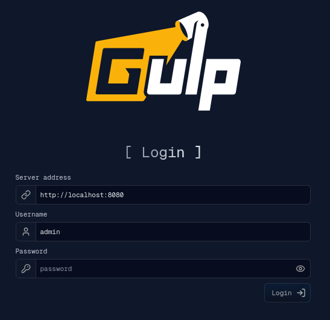

# Web UI development

The web UI is the React and TypeScript application in `gulp-ui/`. It connects
to a running gULP backend from the login page. To run it as a user, follow an
[installation guide](../installation.md); this page is for working on it.



Requirements: Node.js 22, pnpm 10, and a running backend.

## Run with live reload

From the repository root:

```bash
pnpm --dir gulp-ui install
pnpm --dir gulp-ui start
```

Open the printed URL and enter the backend address (for example
`http://localhost:8080`), user name and password on the login page.

If pnpm reports that it ignored dependency build scripts, approve them with
`pnpm --dir gulp-ui approve-builds`.

## Build

```bash
pnpm --dir gulp-ui run build
```

The production build is a static site in `gulp-ui/build/`.
`pnpm --dir gulp-ui run server` serves it locally; in production use a static
web server such as nginx, as the Docker UI image does.

`scripts/build_webui_package.sh` builds the UI and copies it into the Python
package (`src/gulp/webui`); after `pip install .`, `gulp-webui` serves it on
`0.0.0.0:3000` (change it with `--host` and `--port`). `gulp-webui` does not
rebuild the UI, and downloads its pinned `serve` package through pnpm on first
use.

## Scripts

- `pnpm start`: development server with live reload.
- `pnpm run build`: production build in `build/`.
- `pnpm run server`: serve `build/`.
- `pnpm run check:locales`: check the translations' fallback coverage.

## Browser storage

The scalable EventStore pipeline attempts to persist streamed events in
IndexedDB on every origin, including a non-secure hostname such as
`http://gulp:3000`. The UI deliberately does not use
`navigator.storage.estimate()` or secure-context detection as a preflight gate:
IndexedDB remains usable in browsers that expose it even when quota telemetry is
not available.

If opening or writing IndexedDB fails, including a real quota-exceeded error,
the UI preserves the last coherent cache and shows an explicit compatibility
decision. It never writes a marker or reloads automatically. The user can retry
the scalable pipeline, or confirm the RAM compatibility pipeline; only that
confirmed choice writes and verifies `gulp:event-store-lod-enabled=false` before
reloading. Sources and events still load in compatibility mode, but large
operations can consume substantially more RAM and persistent query-cache
Undo/Redo is unavailable. HTTPS remains recommended for deployed environments
because it enables the full set of browser security and storage APIs, but it is
not required by this EventStore selection logic. Deleting site data also deletes
the persisted fallback marker.
