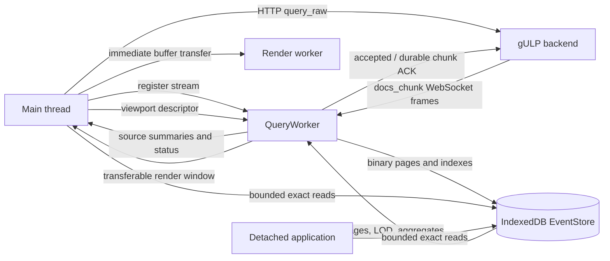
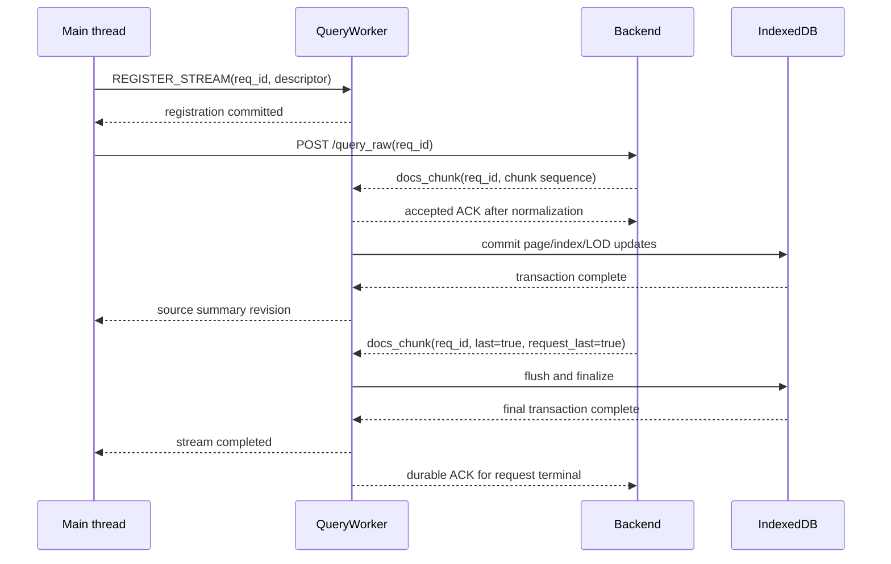

# Query worker and event storage architecture

The query worker owns the high-volume event path used by the timeline. It
receives `docs_chunk` messages from the authenticated WebSocket, normalizes and
persists exact events, and builds compact render-window projections from
IndexedDB. Document payloads do not pass through the main thread.

This architecture keeps the application's long-lived memory related to the
current viewport rather than to the total number of events. IndexedDB is a
rebuildable browser cache; the gULP backend remains the authoritative event
source.

The companion [timeline rendering architecture](engine.architecture.md)
describes how a projection is transferred to the render worker and drawn on the
`OffscreenCanvas`.

## Persistence selection and compatibility mode

The UI selects the persistent EventStore/LOD path by default on every origin.
It does not gate persistence on `isSecureContext` and does not call
`navigator.storage.estimate()` before registering or writing a stream. A plain
HTTP hostname such as `http://gulp:3000` therefore attempts the same IndexedDB
path as HTTPS or `http://localhost`.

The build-time rollout flag and the browser-local
`gulp:event-store-lod-enabled=false` rollback retain precedence. If IndexedDB
cannot be opened or a transaction fails, including a real quota-exceeded error,
the UI stops and closes the affected stream but does not change the rollback
flag or reload the page. Instead, one typed and deduplicated compatibility
request is exposed through the application context. Its localized banner
describes the reason, shows the estimated event count, and warns that RAM use
can grow with operation size.

The user can retry the scalable path, which reloads without changing the
marker, or explicitly confirm compatibility mode. Only the confirmed action
writes and verifies `gulp:event-store-lod-enabled=false` before reloading. If
browser storage blocks that write or verification, the banner remains open
with a recoverable error and no reload occurs. Compatibility has no event-count
gate. After a confirmed reload, document streams use `passthrough`, the direct
transport is selected, and canonical events remain in main-thread RAM. Deleting
site data also deletes the persisted fallback marker.

## Runtime topology



The main thread starts backend requests and owns visible UI state. The query
worker owns the WebSocket, document routing, storage writes, and LOD projection.
The render worker owns drawing. Main and detached browser realms can open the
same operation database for bounded, asynchronous reads.

## Ownership boundaries

| Component | Owns | Does not retain |
| --- | --- | --- |
| gULP backend | Authoritative events, query execution, detail retrieval | Browser cache state |
| Query worker | WebSocket, stream contexts, normalization queues, IndexedDB writers, viewport projector | A permanent object collection containing every event |
| IndexedDB EventStore | Exact event pages, source manifests, LOD records, density aggregates, document index | Backend-only event details outside the timeline document shape |
| Main thread | React state, source summaries, interaction state, bounded event cache | Full query chunks or a dataset-sized event map |
| Render worker | Current render window, source drawing metadata, overlays, hit regions, bitmap assets | Exact events outside the projected window |
| Detached application | Its own UI state and bounded EventStore readers | A duplicate full event collection |

## Query worker lifecycle

`SmartSocket` is the main-thread facade for the worker-owned transport. It
creates `QueryWorker`, initializes the authenticated WebSocket session, and
exposes correlated control requests to the application.

The worker accepts these command families:

- initialize, reconnect, send, and close the WebSocket;
- register, complete, cancel, or release document streams;
- cancel all streams for an operation epoch;
- request a render window for one viewport revision;
- read or reset diagnostics through correlated `GET_QUERY_DIAGNOSTICS` and
  `RESET_QUERY_DIAGNOSTICS` commands.

Socket state and non-document WebSocket messages are forwarded to the main
thread. `docs_chunk` messages remain inside the query worker and are given to
the registered persistence context.

### Registration before the backend request

The UI generates the `req_id`. Before calling `/query_raw`, it registers a
stream descriptor with the query worker and waits for the registration
acknowledgement. The backend receives the same ID and uses it in each
`docs_chunk` WebSocket message.

This order establishes ownership before any normal response chunk can arrive:



An unknown-request mailbox exists only as a protocol guard for messages that do
not follow this registration contract, such as a stale server message or a
message racing reconnect and teardown. It retains at most 64 MiB for 30
seconds. It is not part of the normal query flow.

### Stream descriptor

Each registered stream records:

- request ID, operation ID, and operation epoch;
- owner: `persist`, `ignore`, or `passthrough`;
- mutation kind: `replace`, `query-upsert`, `enrichment`, or
  `realtime-ingest`;
- completion mode: final `last` chunk or explicit completion;
- known source IDs and source-specific hash settings;
- optional expected event count and request revision;
- whether numeric chunk sequences can be deduplicated globally for the request.

The router tracks the states `registered`, `streaming`, `flushing`,
`completed`, `canceled`, and `failed`. Terminal request IDs are guarded for a
bounded interval so late chunks cannot reopen a completed or canceled stream.

The UI can dispatch up to four source queries concurrently. Streams targeting
different sources can progress independently. Mutations for the same source are
serialized by source leases, and a superseding replace cancels the obsolete
writer before publishing the newer generation.

The router applies chunks for one stream in arrival order and can discard
duplicate numeric sequences when the endpoint declares them globally unique.
The backend must preserve the sequence order of chunks belonging to the same
stream.

## Ingestion and backpressure

Each accepted chunk passes through four stages:

1. Route the WebSocket frame to its registered stream context.
2. Normalize raw documents into the minimal timeline document shape.
3. Build or update exact pages, LOD records, density aggregates, and document
   index segments.
4. Commit the prepared mutations atomically to IndexedDB.

Normalization yields cooperatively after short work slices so control messages,
click-related reads, and viewport requests remain responsive. It has its own
per-stream chain, separate from the ordered IndexedDB persistence chain. A slow
page transaction therefore does not retain later raw JSON frames that can
already be normalized within the global normalized-document budget. Persistence
still observes the original chunk order.

Before a registered chunk joins its ordered promise chain, QueryWorker reserves
its conservative WebSocket frame size against two UI limits: 128 MiB across all
streams and 64 MiB for one request. The limits are injectable for deterministic
tests. A value exactly on either boundary is accepted. The worker releases the
reservation and clears the raw document array as soon as normalization consumes
it, or when cancel, failure, disconnect, or worker destruction drops the work.

The UI advertises `query_chunk_ack_window: 2` in the authenticated WebSocket
metadata. A backend that sees this capability keeps at most two unaccepted
chunks ahead for each active child query. QueryWorker sends:

- `accepted` after normalization has acquired bounded document credit, released
  the raw-byte reservation, and cleared the original document array;
- `durable` for `request_last=true` only after the terminal manifest and every
  residual page are committed.

The acknowledgement carries `req_id`, query name, and numeric chunk sequence,
so interleaved child queries do not release each other's window. The optional
`request_last` marker is distinct from `last`: `last` terminates one child query,
while `request_last` identifies the terminal chunk of a complete single-query
request. Multi-query requests retain their explicit completion fence after all
child `query_done` messages. Servers that do not see the capability never wait
for these acknowledgements, which keeps the WebSocket contract opt-in.

The normalized queue is deliberately bounded:

- at most 32,768 normalized documents are pending across streams;
- at most two IndexedDB commits execute concurrently;
- replace builders combine backend chunks into full 16,384-event pages;
- only a final residual page, or a residual released under global pressure, is
  smaller than the page size;
- queued work receives FIFO credit so a large stream cannot starve every other
  stream.

The default builder low watermark is 16,384 documents: the normalized limit
minus one full page. After each non-terminal chunk the worker commits every full
page and retains the remaining documents for the next chunk. If all builders
together exceed the low watermark, the current stream commits its largest
residual first until capacity is available again. This pressure path prevents
four concurrent 10,000-event streams from waiting indefinitely for credit while
keeping the normal single-source replace densely packed. The terminal chunk,
including an empty terminal chunk, commits every remaining residual before
finalization.

If accepting a frame would cross either raw-byte boundary, the frame is not
queued, its `payload.docs` array is cleared synchronously, and that stream fails
with reason `backlog`. The existing main-thread failure path then requests
`/request_cancel` for a query that was already dispatched. Other streams retain
their own queues and authority. A single chunk containing more than 32,768
documents remains a normalized-backlog protocol failure; the normal backend
chunk size stays below that bound.

The negotiated acknowledgement window is the normal backpressure mechanism for
the scalable query path. The 128/64 MiB UI limits remain a final overload guard
for an unnegotiated server, several concurrent child queries, a single oversized
frame, or a consumer that cannot make normalization progress. Crossing a guard
still cancels only the affected request; it is not used as routine pacing.

If normalization or the IndexedDB write path fails,
the worker marks the stream failed and reports its `req_id` and failure reason.
The main thread requests backend cancellation only when that request crossed
the HTTP or ingestion-worker dispatch boundary. Registration failures therefore
cannot issue `/request_cancel` for a request the backend has never seen. There
is no in-place RAM handoff for a partially persisted stream. Storage and real
quota failures request the explicit choice described above; normalization,
backlog, and connection failures remain ordinary stream failures. The failed
stream is torn down in either case, so dismissing the choice does not leave a
stale request registered.

`last` means complete only after all page builders have flushed and the final
IndexedDB transaction has committed. Other WebSocket messages, including
statistics updates and `query_done`, continue through the normal main-thread
event path. `query_done` reports backend query completion; it does not finalize
EventStore persistence ahead of the durable terminal stream transition.
For a negotiated single-query request the backend waits for the terminal
`durable` acknowledgement before publishing `query_done`. Cancellation while a
producer is waiting is an ordinary canceled result and is not logged as a query
execution error.

## Operation-scoped EventStore

Every cache is namespaced by `coordinatorId` and `operationId` and uses the
database name:

```text
gulp-event-store:<coordinatorId>:<operationId>
```

The namespace allows the main window, compatible detached windows, and workers
on the same origin to open the same exact event data without copying the whole
dataset between realms. A `BroadcastChannel` distributes compact source
revision summaries; exact documents remain in IndexedDB.

The EventStore contains four object stores.

### `sources`

One source manifest contains:

- active generation and revision;
- status: `building`, `complete`, or `incomplete`;
- active event count and next source-local handle;
- timestamp and hash ranges;
- encoded byte count;
- a compact catalog of exact pages and their ranges.

The manifest is the source authority used for revision checks and page
selection. It contains metadata, not event objects.

### `pages`

An exact page contains at most 16,384 events in columnar binary form:

- `Uint32Array` source-local handles;
- `Float64Array` timestamps, numeric hashes, and event codes;
- UTF-8 document IDs with an offset array;
- a tombstone bitmap;
- page count, ranges, generation, revision, and encoded size.

Backend `docs_chunk` frames remain capped at 10,000 events. A replace therefore
keeps its partial builder across frames: for example, three 10,000-event chunks
produce one full 16,384-event page and one final 13,616-event page. A source
containing 14,000,000 events occupies 855 exact pages when no pressure flush is
required. Page data, source-local handles, LOD, height aggregates, and document
index mutations are committed together by the existing atomic page append.

Columnar values avoid one IndexedDB record per event and allow the projector to
decode only the fields required for rendering. A source-local handle is a
compact event reference; handle `0` is reserved and the largest valid value is
`4,294,967,294`.

Upserts update an existing location when its source and timestamp remain
compatible. Moving an event creates a tombstone at the prior location and
inserts the new value. A page is compacted when tombstones exceed 25 percent.

### `page_lod`

Each exact page has a default-render summary and up to 256 microblocks. The
records store time ranges, counts, and visual representatives without document
objects or decoded IDs. The same object store also contains page-local
one-minute counts for the HeightMap engine.

LOD records are rebuilt only for pages affected by a mutation. Palette changes
do not rewrite exact pages. Color-override revisions select or rebuild the
corresponding representatives before a new projection is published.

### `document_index_pages`

Document lookup uses binary, segmented index pages instead of an IndexedDB
record or JavaScript map per document. A 64-bit document-ID hash is partitioned
by a 12-bit logical prefix and resolves to candidate source, page, offset, and
handle locations. The exact UTF-8 ID in the event page confirms the candidate,
so hash collisions cannot return the wrong event.

Segments use leveled compaction to keep lookups bounded while avoiding a full
index rewrite on every append.

## Replace and mutation semantics

A replace builds a new source generation. The committed generation remains
readable until the building generation is finalized. The manifest switches
generations atomically after the final page commit. That terminal transaction
contains the new `complete` authority and, when needed, only a compact obsolete
generation number; it does not contain deletes proportional to the previous
source. The complete summary and stream completion are published immediately.

Physical records from the obsolete generation are then enumerated by generation
prefix and deleted in idempotent transactions of at most 256 operations while
the source lease is still held. The lease is released after that first cleanup
attempt. A cleanup error is non-fatal for the already complete generation and
leaves its marker in the manifest. Reopening the store or starting another
mutation on the same source resumes the marker before new writes begin. Cancel,
clear, and replacement of an incomplete generation use the same bounded delete
sets. Cancel before finalization restores the rollback authority; cancel after
the complete manifest was published cannot replace the new authority.

If IndexedDB rejects the building generation before finalization, cleanup
restores the last coherent committed generation before the current fallback
policy is evaluated.

Query upserts, enrichment, and real-time ingestion mutate the active generation
under the same source lease. Browser Web Locks coordinate writers across
same-origin realms; a coordinator-local FIFO lease provides the in-realm order.
Leases are acquired in deterministic source order for multi-source chunks.

## Storage limits

The query worker does not predict how many events a future operation will
occupy and performs no quota admission. Each normalized page is written to
IndexedDB until the browser accepts or rejects the transaction. This avoids
treating unavailable quota telemetry as unavailable storage and avoids
rejecting a stream from an estimate that cannot know its eventual encoded size.
The former capacity calculator, `CAPACITY` worker event, SmartSocket subscriber,
and DataStore snapshot have been removed rather than retained as inactive
test-only behavior.

The source handle range remains the absolute per-source format limit. In
practice, browser quota and device capacity may be reached first. A real
`QuotaExceededError` is classified separately from other storage failures, but
both preserve the last coherent source state and request the same explicit
compatibility decision. Neither failure selects the RAM path automatically.

## Viewport render projection

Canvas describes the current render window with:

- operation ID and epoch;
- viewport and projection revisions;
- visible time frame, scale, scroll, width, and horizontal overscan;
- visible source rows plus two vertical overscan rows;
- each source revision, timestamp offset, render engine, and frequency setting;
- palette, override, and render-setting revision inputs;
- the maximum representative count and sources to evict.

Horizontal overscan is normally one canvas width on each side. It gives small
pans a ready projection without retaining an operation-wide snapshot.

The query worker keeps one active projection and only the newest pending
request. A pending refresh for the same operation, epoch, and viewport does not
cancel the active read: the coherent active snapshot may publish before the
trailing refresh starts. A pending request for another operation, epoch, or
viewport invalidates the active read at its next guard check. Canvas also
coalesces same-viewport summary triggers into one active request and one
trailing slot, so commit bursts do not continuously advance projection
revisions. After projection, the render client applies its own one-in-flight
plus one-coalesced-pending data queue.

While a source is `building`, committed source summaries trigger projection
refreshes at most once every 250 milliseconds. A terminal `complete` or
`incomplete` summary requests the final projection immediately. Canvas retains
the terminal revision and committed `eventCount` until the render worker has
acknowledged that source revision and emitted a frame for the current viewport
whose `renderedDataSequence` includes the `DATA_PATCH` that applied it. ACK and
frame arrival order is not used because they travel on separate message ports;
the ACK records the applying sequence for each accepted source revision.
Same-revision projections with a different `loadedCount` are rejected.
`globalRevision` is aggregate telemetry only. A single capped-backoff watchdog
reissues a current-viewport projection only after the previous request has
settled and the bounded render data queue is empty.

Every source summary contains its IndexedDB generation. Each projected source
also carries generation and manifest status. Canvas can publish an older but
monotonically advancing `building` revision from the same generation when a
newer summary arrived during the read. Terminal projections are accepted only
when generation, status, revision, and count exactly match their summary;
snapshots from an obsolete generation never reach the renderer.

### LOD selection

For the Default engine, the projector chooses the least expensive level that is
pixel-equivalent for the requested scale:

1. Use the page representative when an entire page maps to one pixel bucket.
2. Use microblock representatives when a page spans several buckets.
3. Read the exact page when a microblock needs per-pixel refinement.
4. Within a bucket, choose the most recent applicable event, including the
   active color-override representative rules.

The HeightMap engine reads persisted one-minute counts and aggregates them to
the viewport scale. The Graph engine aggregates source samples into graph
buckets appropriate to the visible width.

The render window carries source-wide totals and hash ranges independently of
the representative arrays. Labels and color scaling therefore describe the
complete committed dataset rather than the LOD sample.

One projection contains at most 1,000,000 representatives. The render worker
may temporarily own the preceding and next atomic projections, keeping the
combined resident bound at 2,000,000. If the requested window would exceed its
budget, the projector increases bucket width to 2, 4, or more pixels and marks
the source as degraded LOD.

### Transfer to the renderer

Projection fields are typed arrays containing only render data:

- representative handles, timestamps, and hashes;
- HeightMap timestamps and counts;
- Graph timestamps and counts;
- covered range, bucket width, total count, hash range, and source revision.

Their `ArrayBuffer` instances are transferred from the query worker to the main
thread. A single-consumer render-window bus synchronously hands the result to
the mounted Canvas, which validates its revisions and transfers the same
buffers to the render worker. The bus does not retain the projection.

## Exact read API

`DataStore.Events` is an asynchronous EventStore facade. It preserves a small
main-thread cache of at most 2,048 documents and exposes bounded reads instead
of a dataset-sized event collection:

- `getById(documentId)` and batched ID resolution;
- `getByHandle(sourceId, handle)`;
- `getNeighbors(sourceId, handle, before, after)`;
- `queryPixelBucket(sourceId, timeRange, limit, cursor?)`;
- source summary reads.

`queryPixelBucket` returns exact events, the total matching count, a stable
cursor, and the source revision. Its page size is capped at 100. This API is
used for Canvas clicks and the paginated group dialog, including a pixel that
contains more events than can safely be materialized in the main thread.

Notes, links, flags, navigation, and detached views resolve required IDs or
handles through the same facade. They do not require a global in-memory event
map.

## Revisions and consistency

Three independent revision domains prevent stale work from becoming visible:

- the operation epoch changes when the active operation data is reset;
- the source revision changes after a committed source mutation;
- the viewport revision changes with frame, scale, scroll, size, or visible
  rows.

A render projection is accepted only when all relevant revisions still match.
An exact lookup is discarded when its operation epoch or viewport revision is
obsolete. If only the source revision changes during a lookup, the caller may
retry once against the new manifest.

Pixel cursors are tied to a source revision. If a source changes during group
dialog navigation, pagination restarts at the first page and the UI reports the
refresh without retaining an inconsistent mixed result.

## Teardown and recovery

Changing or releasing an operation cancels its streams, increments the
operation epoch, closes transient repositories, and makes older projection and
lookup results ineligible. IndexedDB data remains a namespaced cache until its
normal cleanup lifecycle removes it.

On WebSocket disconnect, active persistence streams fail with a disconnected
reason. Reconnect restores the transport but does not silently declare an
interrupted stream complete; incomplete sources can be queried again from the
backend.

Because the EventStore is reconstructible, schema upgrades may rebuild an
incompatible cache. No browser cache migration is allowed to change backend
event authority.

## On-demand diagnostics

The worker does not emit periodic metrics in production. A caller explicitly
requests a detached snapshot with `GET_QUERY_DIAGNOSTICS`; the correlated result
contains no event documents. `RESET_QUERY_DIAGNOSTICS` clears cumulative values
but retains current gauges so active work is never hidden.

The snapshot contains:

- current/global and maximum/per-stream raw backlog bytes;
- current and maximum normalized documents, including page builders;
- active and maximum concurrent commits, completed commit count, average
  latency, and maximum latency;
- exact replacement pages created, stored documents, capacity, and fill ratio;
- active streams and loaded operation repositories;
- projection requests started, completed, superseded, and retried after a stale
  storage read.

Canvas combines this snapshot with render diagnostics: maximum interval between
worker frames, queue depth, pending terminal-target age, ACK/frame data
sequences and timestamps, and worker resync/error/fallback counts. See the
[timeline engine guide](engine.architecture.md#diagnostics) for interpretation.

## Performance invariants

The event path is expected to preserve these bounds:

- no permanent main-thread collection proportional to all events;
- at most 2,048 cached exact documents in the main realm;
- at most 32,768 normalized documents pending in QueryWorker;
- at most 128 MiB of accepted raw WebSocket frames globally and 64 MiB for one
  active request;
- at most two unaccepted backend chunks per active negotiated child query;
- no more than two concurrent IndexedDB commits;
- one active and one newest pending projection request in QueryWorker;
- one in-flight and one coalesced pending render data message;
- at most 1,000,000 representatives in one projection and 2,000,000 resident
  during atomic replacement;
- exact pixel and dialog reads return at most 100 events per page.

Benchmarking at 10, 20, and 30 million events must verify IndexedDB throughput,
actual storage consumption, steady-state memory, query correctness, viewport
latency, and interaction latency on the selected reference device. Successful
persistence remains subject to the origin quota available on that device. The
`/renderer-test` benchmark performs no predictive admission either: it writes
bounded pages until completion or a concrete IndexedDB quota failure.

The 10M, 20M, and 30M EventStore benchmarks remain unchanged. The additional
`?queryReplay=steady` profile creates one 14M source through JSON `docs_chunk`
messages of 10,000 events in a dedicated worker. It uses `QuerySocketSession`,
the persistence coordinator, and IndexedDB, allows at most two chunks to await a
commit, and delivers `query_done` immediately after the last chunk. The
`?queryReplay=burst` profile deliberately crosses the raw boundary and expects a
controlled `backlog` failure. Both expose machine-readable diagnostics without
moving document arrays to the page.

## Source reference

The main implementation entry points are:

- [`Query.worker.ts`](../../gulp-ui/src/event-store-worker/Query.worker.ts)
- [`QueryStream.protocol.ts`](../../gulp-ui/src/event-stream/QueryStream.protocol.ts)
- [`QuerySocket.session.ts`](../../gulp-ui/src/event-store-worker/QuerySocket.session.ts)
- [`QueryPersistenceCoordinator.ts`](../../gulp-ui/src/event-store-worker/QueryPersistenceCoordinator.ts)
- [`QueryStream.router.ts`](../../gulp-ui/src/event-stream/QueryStream.router.ts)
- [`EventStore.repository.ts`](../../gulp-ui/src/event-store/EventStore.repository.ts)
- [`IndexedDbEventStore.backend.ts`](../../gulp-ui/src/event-store/IndexedDbEventStore.backend.ts)
- [`EventStore.viewport-projector.ts`](../../gulp-ui/src/event-store/EventStore.viewport-projector.ts)
- [`EventStore.facade.ts`](../../gulp-ui/src/event-store/EventStore.facade.ts)
- [`DataStore.ts`](../../gulp-ui/src/store/DataStore.ts)
- [`RendererQueryReplay.worker.ts`](../../gulp-ui/src/page/RendererQueryReplay.worker.ts)
- [`RendererQueryReplay.page.tsx`](../../gulp-ui/src/page/RendererQueryReplay.page.tsx)
