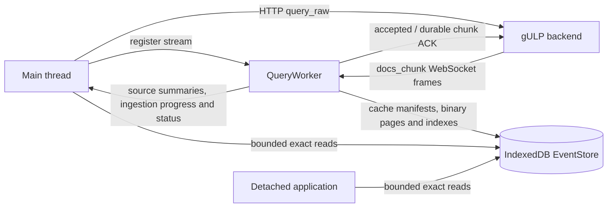
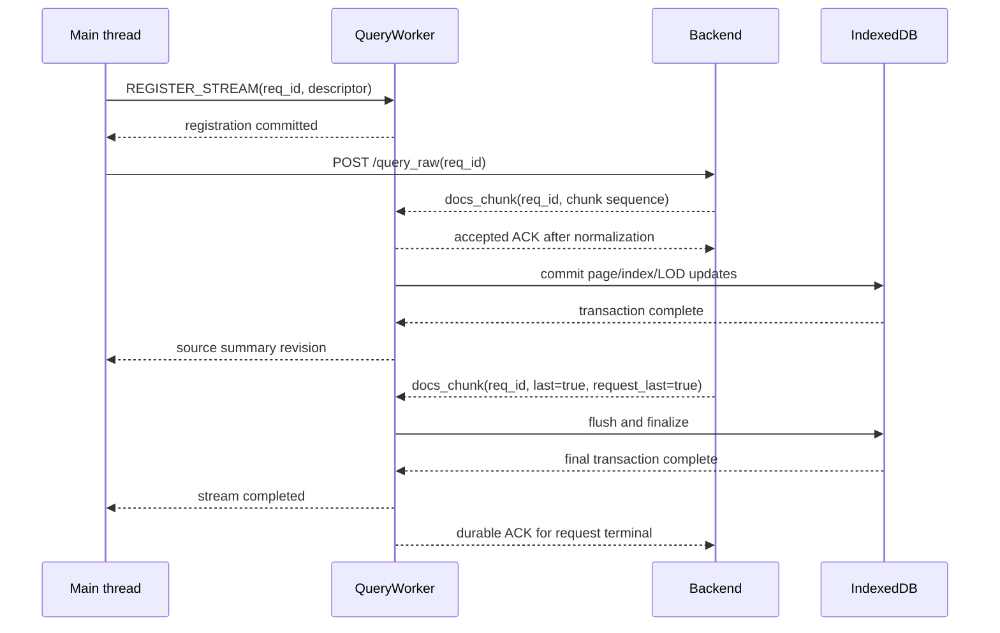

# Query worker and event storage architecture

The query worker owns the high-volume query path used by the timeline. It
receives `docs_chunk` messages from the authenticated WebSocket, normalizes and
persists exact events, and manages each source's query-cache pool. Document
payloads do not pass through the main thread.

This architecture keeps the application's long-lived memory related to the
current viewport rather than to the total number of events. IndexedDB is a
rebuildable browser cache; the gULP backend remains the authoritative event
source.

The companion [render worker and LOD projection architecture](render-worker.md)
describes how the active cache is projected for the viewport, transferred, and
drawn on the worker-owned `OffscreenCanvas`. The higher-level component map is
in [Timeline rendering architecture](engine.architecture.md).

## Persistence selection and compatibility mode

The UI selects the persistent EventStore/LOD path by default on every origin.
It does not gate persistence on `isSecureContext` and does not call
`navigator.storage.estimate()` before registering or writing a stream. A plain
HTTP hostname such as `http://gulp:3000` therefore attempts the same IndexedDB
path as HTTPS or `http://localhost`.

The build-time rollout flag and the browser-local
`gulp:event-store-lod-enabled=false` rollback retain precedence. If IndexedDB
cannot be opened or a transaction fails, including a real quota-exceeded error,
the UI stops and closes the affected stream but does not change the rollback
flag or reload the page. Instead, one typed and deduplicated compatibility
request is exposed through the application context. Its localized banner
describes the reason, shows the estimated event count, and warns that RAM use
can grow with operation size.

The user can retry the scalable path, which reloads without changing the
marker, or explicitly confirm compatibility mode. Only the confirmed action
writes and verifies `gulp:event-store-lod-enabled=false` before reloading. If
browser storage blocks that write or verification, the banner remains open
with a recoverable error and no reload occurs. Compatibility has no event-count
gate. After a confirmed reload, document streams use `passthrough`, the direct
transport is selected, and canonical events remain in main-thread RAM. Deleting
site data also deletes the persisted fallback marker.

Compatibility mode has no persistent source-query pool. Its source summaries
expose an empty cache history, initial loads use the backend, and source-menu
Undo/Redo remains disabled.

## Runtime topology



The main thread starts backend requests and owns visible UI state. The query
worker owns the WebSocket, document routing, storage writes, and cache commands.
Main and detached browser realms can open the same operation database for
bounded, asynchronous reads. The viewport path is shown separately in
[render-worker.md](render-worker.md#from-viewport-to-frame).

## Ownership boundaries

| Component | Owns | Does not retain |
| --- | --- | --- |
| gULP backend | Authoritative events, query execution, detail retrieval | Browser cache state |
| Query worker | WebSocket, stream contexts, normalization queues, IndexedDB writers, viewport projector | A permanent object collection containing every event |
| IndexedDB EventStore | Source heads, query-cache provenance, exact event pages, LOD records, density aggregates, document index, transient ingestion overflow journal | Backend-only event details outside the timeline document shape |
| Main thread | React state, applied query per source, compact cache/freshness state, source summaries, interaction state, bounded event cache, explicitly included note targets | Full query chunks or a dataset-sized query-result map |
| Detached application | Its own UI state and bounded EventStore readers | A duplicate full event collection |

## Query worker lifecycle

`SmartSocket` is the main-thread facade for the worker-owned transport. It
creates `QueryWorker`, initializes the authenticated WebSocket session, and
exposes correlated control requests to the application.

The worker accepts these command families:

- initialize, reconnect, send, and close the WebSocket;
- register, complete, cancel, or release document streams;
- cancel all streams for an operation epoch;
- reconcile a source query with its persisted cache pool;
- activate the preceding or following source-local cache for Undo/Redo;
- reset a source cache pool for rebase, or delete its EventStore when the source
  itself is removed;
- request a render window for one viewport revision;
- read or reset diagnostics through correlated `GET_QUERY_DIAGNOSTICS` and
  `RESET_QUERY_DIAGNOSTICS` commands.

Socket state and non-document WebSocket messages are forwarded to the main
thread. `docs_chunk` messages remain inside the query worker and are given to
the registered persistence context.

### Registration before the backend request

The UI generates the `req_id`. Before calling `/query_raw`, it registers a
stream descriptor with the query worker and waits for the registration
acknowledgement. The backend receives the same ID and uses it in each
`docs_chunk` WebSocket message.

This order establishes ownership before any normal response chunk can arrive:



An unknown-request mailbox exists only as a protocol guard for messages that do
not follow this registration contract, such as a stale server message or a
message racing reconnect and teardown. It retains at most 64 MiB for 30
seconds. It is not part of the normal query flow.

### Stream descriptor

Each registered stream records:

- request ID, operation ID, and operation epoch;
- owner: `persist`, `ignore`, or `passthrough`;
- mutation kind: `replace`, `ingestion-build`, `query-upsert`, `enrichment`, or
  `realtime-ingest`;
- completion mode: final `last` chunk or explicit completion;
- known source IDs and source-specific hash settings;
- for a replace owned by the cache pool, the source-scoped query snapshot,
  exact and range-independent shape fingerprints, normalization settings, and
  current server-source snapshot; the precise backend range remains in the
  query snapshot;
- optional expected event count and request revision;
- whether numeric chunk sequences can be deduplicated globally for the request.

The router tracks the states `registered`, `streaming`, `flushing`,
`completed`, `canceled`, and `failed`. Terminal request IDs are guarded for a
bounded interval so late chunks cannot reopen a completed or canceled stream.

The UI can dispatch up to four source queries concurrently. Streams targeting
different sources can progress independently. Mutations for the same source are
serialized by source leases, and a superseding replace cancels the obsolete
writer before publishing the newer generation.

Cache reconciliation and Undo/Redo activation use the same source lease. They
cannot race a building generation, cleanup, or another activation for that
source. A multi-source user action remains a set of independent source-local
histories rather than one coupled history entry.

The router applies chunks for one stream in arrival order and can discard
duplicate numeric sequences when the endpoint declares them globally unique.
The backend must preserve the sequence order of chunks belonging to the same
stream.

### Query provenance and fingerprint

The main thread builds one query snapshot per source before registration. The
exact fingerprint is derived from deterministic JSON: object keys are sorted
and array order is preserved. It includes operation/source identity, the
effective nanosecond range, text and structured filters, a manual raw query,
manual mode, and the normalization inputs that affect persisted timeline
documents. A second shape fingerprint uses the same inputs but canonicalizes
only the range generated from `source_config`, including its generated backend
clause. User-authored ranges remain semantic. The display-only `Query.string`
and `fieldTypeMap` itself are excluded; the canonical backend filter after
field-type coercion is included, so effective transformed values still
participate. The query snapshot retained for the UI remains complete.

The descriptor is cloned at the registration boundary. Later edits to a filter
form cannot change the provenance attached to a stream already in progress.
Explicit filter, timeframe, normalization, and Refetch actions always dispatch
the backend request and create a distinct generation; fingerprint matching is
reserved for initial reconciliation and source-local Undo/Redo.

## Ingestion and backpressure

Each accepted chunk passes through four stages:

1. Route the WebSocket frame to its registered stream context.
2. Normalize raw documents into the minimal timeline document shape.
3. Build or update exact pages, LOD records, density aggregates, and staged
   document-index segments.
4. Atomically publish the pages, summaries, source manifest, and index catalog.

Normalization yields cooperatively after short work slices so control messages,
click-related reads, and viewport requests remain responsive. It has its own
per-stream chain, separate from the ordered IndexedDB persistence chain. A slow
page transaction therefore does not retain later raw JSON frames that can
already be normalized within the global normalized-document budget. Persistence
still observes the original chunk order.

Before a registered chunk joins its ordered promise chain, QueryWorker reserves
its conservative WebSocket frame size against two UI limits: 128 MiB across all
streams and 64 MiB for one request. The limits are injectable for deterministic
tests. A value exactly on either boundary is accepted. The worker releases the
reservation and clears the raw document array as soon as normalization consumes
it, or when cancel, failure, disconnect, or worker destruction drops the work.

The UI advertises `query_chunk_ack_window: 2` in the authenticated WebSocket
metadata. A backend that sees this capability keeps at most two unaccepted
chunks ahead for each active child query. QueryWorker sends:

- `accepted` after normalization has acquired bounded document credit, released
  the raw-byte reservation, and cleared the original document array;
- `durable` for `request_last=true` only after the terminal manifest and every
  residual page are committed.

The acknowledgement carries `req_id`, query name, and numeric chunk sequence,
so interleaved child queries do not release each other's window. The optional
`request_last` marker is distinct from `last`: `last` terminates one child query,
while `request_last` identifies the terminal chunk of a complete single-query
request. Multi-query requests retain their explicit completion fence after all
child `query_done` messages. Servers that do not see the capability never wait
for these acknowledgements, which keeps the WebSocket contract opt-in.

The normalized queue is deliberately bounded:

- at most 32,768 normalized documents are pending across streams;
- at most two IndexedDB commits execute concurrently;
- replace and file-ingestion builders combine backend chunks into full
  16,384-event pages;
- only a final residual page, or a residual released under global pressure, is
  smaller than the page size;
- queued work receives FIFO credit so a large stream cannot starve every other
  stream.

The default builder low watermark is 16,384 documents: the normalized limit
minus one full page. After each non-terminal chunk the worker commits every full
page and retains the remaining documents for the next chunk. If all builders
together exceed the low watermark, the current stream commits its largest
residual first until capacity is available again. This pressure path prevents
four concurrent 10,000-event streams from waiting indefinitely for credit while
keeping the normal single-source replace densely packed. The terminal chunk,
including an empty terminal chunk, commits every remaining residual before
finalization.

Every committed page publishes a compact `building` source summary. When empty
sources are hidden, the first positive summary adds that source to the Canvas
without waiting for query completion. Canvas then requests its first persisted
LOD window, and later building summaries use the normal coalesced projection
path while the query continues.

Replacement streams also expose their current partial builder page to viewport
projection before it reaches the durable page size. After each accepted
`docs_chunk`, QueryWorker sends an operation- and source-scoped projection
invalidation. Canvas coalesces that signal and requests a new render window;
its source IDs also temporarily count as non-empty so the initial zero-event
building summary cannot hide the first result. When that changes Canvas row
membership, source metadata is queued to RenderWorker before requesting the
preview; later invalidations use the normal building coalescer. The projector
combines the durable manifest with at most one transient page per visible
source. The transient page uses the same future handles and sorted columnar
shape as the eventual commit, but it is never written to IndexedDB, added to
cache provenance, or exposed to exact-read APIs. This lets initial operation
queries and Navigator event filters render continuously without returning to
per-chunk durable pages.

Transient replacement pages remain inside the existing global 32,768-document
normalized bound. When a full, pressure-released, or final partial page enters
an IndexedDB commit, its already encoded page remains available as the source
preview with the same page ID and handles. The projector overlays it only while
the durable manifest still matches its base generation and revision; if the
commit wins the race, the newer durable page is used instead. An in-flight page
therefore cannot suspend the whole multi-source viewport while startup
`query_raw` requests continue filling the cache.

At operation startup, the viewport may request rows whose per-source backend
query is still waiting behind the four-request concurrency limit. Those sources
have no manifest yet and project as canonical empty placeholders. Canvas accepts
those placeholders independently from the building previews already available
for active queries; the absence of a not-yet-started source therefore does not
reject the complete multi-source render window.

After each accepted `ingestion-build` or `realtime-ingest` chunk, QueryWorker
also publishes one compact map of cumulative event totals for the sources
changed by that chunk. For page-builder ingestion the count includes the
current partial page without committing it early. The main thread applies these
absolute values monotonically, so file-ingestion request statistics may coexist
without double counting. Document payloads remain worker-owned, and
`replace`, `query-upsert`, and `enrichment` streams never emit ingestion
progress. Committed source summaries remain the durable authority.

If a query or realtime frame would cross either raw-byte boundary, the frame is
not queued, its `payload.docs` array is cleared synchronously, and that stream
fails with reason `backlog`. A dispatched query is then canceled. File
ingestion is intentionally different: `ingestion-build` never feeds UI
backpressure into the backend producer. An overflow frame is written to the
transient `stream_journal` IndexedDB store, its original object graph is
released after the durable clone, and normalization resumes from the journal
in stream order. The journal record is deleted after the documents enter the
page builder. A single chunk containing more than 32,768 documents remains a
normalized-backlog protocol failure; the normal backend chunk size stays below
that bound.

The negotiated acknowledgement window is the normal backpressure mechanism for
the scalable query path only; ingestion sends no chunk acknowledgements. The
128/64 MiB UI limits remain a final overload guard
for an unnegotiated server, several concurrent child queries, a single oversized
frame, or a consumer that cannot make normalization progress. For query and
realtime streams, crossing a guard cancels only the affected request; it is not
used as routine pacing.

If normalization or the IndexedDB write path fails, the worker marks the stream
failed and reports its `req_id` and failure reason. The main thread requests
backend cancellation only for dispatched queries. A failed
`ingestion-build` is marked `incomplete`, is never exposed as a reusable cache,
and does not call `/request_cancel`; its backend ingestion and progress
lifecycle continue independently. Registration failures cannot issue
`/request_cancel` for a request the backend has never seen. There is no
in-place RAM handoff for a partially persisted stream. Storage and real quota
failures on query streams request the explicit compatibility choice described
above; normalization, backlog, and connection failures remain ordinary query
stream failures.

File and external-query ingestion share the explicit-completion lifecycle.
Request types `ingest`, `raw_ingest`, and `ext_query` are classified as
ingestion requests by the UI. A terminal `done` statistics update is the input
fence: the UI supplies full-source query provenance normalized with
`gulp.event_code`/`fnv1a`, and the worker flushes every source's last partial
page before atomically finalizing each provisional generation as an active
query cache. Loading and progress state is cleared only after that durable
transition. Initial source loading can therefore reuse the ingested events
without `/query_raw`, and the released source lease allows a later Refetch to
start a normal replacement generation. Changing the source hash field later
follows the existing explicit rebuild path.

A terminal `failed` or `canceled` statistics update discards the provisional
generation, releases its source leases, and clears the associated loading and
progress state. This handling applies to every source discovered in a request,
including compatibility mode where chunks remain in main-thread memory.
Registered `realtime-ingest` streams share the compact progress protocol; their
existing persistence and finalization behavior is otherwise unchanged.

`last` means complete only after all page builders have flushed and the final
IndexedDB transaction has committed. Other WebSocket messages, including
statistics updates and `query_done`, continue through the normal main-thread
event path. `query_done` reports backend query completion; it does not finalize
EventStore persistence ahead of the durable terminal stream transition.
For a negotiated single-query request the backend waits for the terminal
`durable` acknowledgement before publishing `query_done`. Cancellation while a
producer is waiting is an ordinary canceled result and is not logged as a query
execution error.

External-query source IDs are discovered from live collaboration and document
messages. The backend does not currently populate `request.data.sources` for
`ext_query`, so a page refresh or reconnect during an active external ingestion
cannot always reconstruct its request-to-source association. This limitation
does not affect a live session or sources whose ingestion has completed.

## Operation-scoped EventStore

Every cache is namespaced by canonical backend identity, authenticated user,
and `operationId`. The resolved `cacheNamespaceId` is stable across browser
restarts for the same backend/user pair and uses the database name:

```text
gulp-event-store:<encoded cacheNamespaceId>:<encoded operationId>
```

Both components are escaped with `encodeURIComponent` before the IndexedDB name
is created.

The namespace allows independent main tabs for the same user, compatible
detached windows, and workers on the same origin to open the same exact event
data without copying the whole dataset between realms. The main realm sends the
resolved namespace in detached bootstrap/context messages. `coordinatorId`
continues to scope WindowBridge only. A `BroadcastChannel` distributes compact
source revision summaries, and Web Locks serialize source writers under the
same namespace when `navigator.locks` is available; exact documents remain in
IndexedDB. Without Web Locks, each coordinator retains its local FIFO but
independent tabs must not mutate the same source concurrently. Cache reuse
across sequential browser sessions is unaffected.

The authenticated application user is authoritative. The persisted
`__user_id` is only a reload/detached recovery fallback; without either identity
the cache falls back to the current tab coordinator and is not shared across
sessions. Logout, auth loss, backend change, and user change immediately close
the current reader and QueryWorker. Legacy databases named by random tab
coordinators are not adopted because they do not carry a verified owner. This
causes one post-upgrade cold load but prevents cross-user cache association.

The EventStore database is version 6 and contains six object stores. Opening a
v1-v5 database rebuilds the EventStore because v6 adds the exact
`event.sequence` column and page-order bounds. Older pages cannot reconstruct
timestamp ties reliably. Browser storage remains reconstructible from the
backend.

### `sources`

One source manifest contains:

- active physical generation, revision, and monotonic authority revision;
- status: `building`, `complete`, or `incomplete`;
- active event count and next source-local handle;
- timestamp and hash ranges;
- encoded byte count;
- a compact catalog of exact pages and their ranges;
- active cache generation, ordered cache history and cursor;
- the next physical generation and bounded-cleanup markers.

The manifest is the source authority used for revision checks and page
selection. It contains metadata, not event objects.

Physical generation identifies page/index records. Authority revision orders
what the user is currently viewing and advances on every cache activation. This
separation allows Undo to make an older physical generation authoritative
without being rejected as stale by Canvas or the projector.

### `source_query_caches`

The key `[sourceId, generation]` selects one complete query-cache record. The
record stores a compact generation manifest, the immutable query snapshot,
exact fingerprint, optional range-independent shape fingerprint, normalization
settings, server-source snapshot, result summary, creation/activation
timestamps, and state `exact` or `mutated`. The precise backend range remains
in the query snapshot.
It does not duplicate documents: its manifest points to records in `pages`,
`page_lod`, and `document_index_pages` with the same physical generation.

Each source keeps at most five reachable cache records. Equal fingerprints may
occur more than once because an explicit query is always executed. Cache
metadata can be listed and activated without decoding event pages.

### `pages`

An exact page contains at most 16,384 events in columnar binary form:

- `Uint32Array` source-local handles;
- `Float64Array` timestamps, event sequences, numeric hashes, and event codes;
- UTF-8 document IDs with an offset array;
- a tombstone bitmap;
- page count, ranges, generation, revision, and encoded size.

Backend `docs_chunk` frames remain capped at 10,000 events. A replace therefore
keeps its partial builder across frames: for example, three 10,000-event chunks
produce one full 16,384-event page and one final 13,616-event page. A source
containing 14,000,000 events occupies 855 exact pages when no pressure flush is
required.

Every page and every cross-page read uses one canonical order: descending
`gulp_timestamp`, descending `event.sequence`, then page/offset only as a final
deterministic fallback. This preserves source order for equal ingestion
timestamps even when the corresponding events arrive in different chunks or
land in different 16,384-event pages.

Document-index segments are prepared in separate bounded transactions. They
remain invisible until the final page append atomically publishes the new page,
LOD and height records, source manifest, and index catalog. A failed final
commit deletes the staged segments; obsolete segments are reclaimed afterward.

Columnar values avoid one IndexedDB record per event and allow the projector to
decode only the fields required for rendering. A source-local handle is a
compact event reference; handle `0` is reserved and the largest valid value is
`4,294,967,294`.

Upserts update an existing location when its source, timestamp, and sequence
remain compatible. Moving an event in time or sequence creates a tombstone at
the prior location and inserts the new value. A page is compacted when
tombstones exceed 25 percent.

### `page_lod`

Each exact page has a default-render summary and up to 256 microblocks. The
records store time ranges, counts, and visual representatives without document
objects or decoded IDs. The same object store also contains page-local
one-minute counts for the HeightMap engine.

LOD records are rebuilt only for pages affected by a mutation. Palette changes
do not rewrite exact pages. Color-override revisions select or rebuild the
corresponding representatives before a new projection is published.

### `document_index_pages`

Document lookup uses binary, segmented index pages instead of an IndexedDB
record or JavaScript map per document. A 64-bit document-ID hash is partitioned
by a 12-bit logical prefix and resolves to candidate source, page, offset, and
handle locations. The exact UTF-8 ID in the event page confirms the candidate,
so hash collisions cannot return the wrong event.

Segments use leveled compaction to keep lookups bounded while avoiding a full
index rewrite on every append.

### `stream_journal`

The ingestion-only journal uses `[requestId, journalId]` keys and contains raw
overflow frames only until their ordered normalization resumes. It is neither
source authority nor a query-cache generation, and normal terminal cleanup
removes every consumed or residual entry.

## Initial cache reconciliation

After operation metadata is available and the user confirms source/timeframe
selection, the main thread requests one reconciliation per source. The request
contains the desired exact and shape fingerprints, raw nanosecond range and
current server snapshot. Under the source lease, the worker:

1. lists only complete cache metadata, without reading event pages;
2. excludes `mutated` records from automatic reuse;
3. selects an exact cache with a fresh server snapshot when available;
4. otherwise selects a fresh same-shape cache when the desired source-local
   range is fully covered;
5. otherwise prefers an exact stale cache and finally the latest complete
   cache;
6. activates the compact manifest and restores the cached query and
   normalization settings;
7. labels a safe range match `covered`, or an unrelated fallback `latest`,
   while preserving the timeframe selected by the user;
8. only after selection resets history to the chosen cache and schedules every
   other cache for bounded cleanup.

All selection branches use only records in state `exact`. If every retained
record is `mutated`, reconciliation prunes them and returns a miss so the source
is fetched again from the backend. Records created before shape fingerprints
remain eligible for exact/latest, but not `covered`; no IndexedDB migration is
required.

For cached range `C`, desired range `N`, and complete current source range `S`,
coverage means `(N intersection S)` is contained by `(C intersection S)`. The
comparison uses inclusive `BigInt` raw-nanosecond boundaries. It has no
millisecond tolerance, and invalid ranges conservatively fail coverage.

Only a source with no usable complete cache dispatches `/query_raw`. Sources in
one selection reconcile independently, so cached and uncached results may be
combined without re-fetching every source.

Freshness compares the cache's full-source server snapshot with the current
source metadata: total count, complete min/max range, and `time_updated` only
when both snapshots provide it. Result `eventCount` is deliberately excluded
because it may describe a filtered subset. Ranges are normalized to
nanoseconds; a one-millisecond tolerance is used only when one server value has
millisecond precision. A source without active cache authority and a newly
completed backend replacement are `fresh`. Exact and covered matches are fresh
only when their server snapshot agrees; server changes take precedence over a
query mismatch. Reopened caches resolve to `fresh`, `query-mismatch`,
`source-changed`, `mutated`, or `unknown` from the comparable metadata.

Undo and Redo move the source-local history cursor and activate another compact
manifest under the same lease. They never call the backend or copy pages. The
activation increments the logical authority revision, publishes the source
summary, restores `Source.appliedQuery`, and triggers a viewport projection.

## Replace and mutation semantics

A provenance-bearing replace builds a new physical source generation. The
previous complete cache remains readable as rollback while committed building
summaries make the new result progressively visible. The terminal multi-store
transaction writes the complete cache record, updates active cache/history and
publishes the `complete` source head atomically.

Finalization does not make the preceding cache obsolete. It remains reachable
for Undo until history pruning removes it. If a new query begins after Undo,
the Redo branch is removed. Before a sixth reachable entry is built, the oldest
complete non-active entry is marked for deletion so the maximum history length
remains five.

Physical records for pruned, truncated, or startup-discarded caches are
enumerated by generation prefix and deleted in idempotent transactions of at
most 256 operations. Cleanup markers are durable. Reopening the store or
starting another mutation on the same source resumes them before new writes.
A cleanup error is non-fatal for an already complete active cache.

Cancel or an IndexedDB/quota failure before finalization restores the preceding
cache manifest and its query. Cache-pool replaces never discard that rollback
for an in-place replacement, because doing so could overwrite pages needed by
Undo. A failure still follows the explicit compatibility decision described
below after coherent authority has been restored.

Query upserts, enrichment, and real-time ingestion mutate only the active cache
under the same source lease and mark its provenance `mutated`; inactive caches
remain immutable snapshots. A mutated cache remains usable in the current
history but is not an automatic exact hit on the next initial reconciliation.
Browser Web Locks coordinate writers across same-origin realms when available;
a coordinator-local FIFO lease always provides the in-realm order. Without Web
Locks, independent tabs must not mutate the same source concurrently. Leases
are acquired in deterministic source order for multi-source chunks.

Rebasing a source calls `resetQueryCachePool(sourceId)`: it removes cache records
and physical data but retains an empty `incomplete` source head, advances its
authority revision, preserves the next physical generation, and clears active
cache/history. The refetch creates the first entry of a new history.
If that acknowledged reset fails after backend rebase completion, the UI stops
before its local reset and refetch and surfaces the error; it never appends a
post-rebase result to an unconfirmed pre-rebase history.
`clearSource` instead deletes the complete head and pool when the source itself
is removed.

## Storage limits

The query worker does not predict how many events a future operation will
occupy and performs no quota admission. Each normalized page is written to
IndexedDB until the browser accepts or rejects the transaction. This avoids
treating unavailable quota telemetry as unavailable storage and avoids
rejecting a stream from an estimate that cannot know its eventual encoded size.
The former capacity calculator, `CAPACITY` worker event, SmartSocket subscriber,
and DataStore snapshot have been removed rather than retained as inactive
test-only behavior.

The source handle range remains the absolute per-source format limit. In
practice, browser quota and device capacity may be reached first. A real
`QuotaExceededError` is classified separately from other storage failures, but
both preserve the last coherent source state and request the same explicit
compatibility decision. Neither failure selects the RAM path automatically.

The five-cache limit bounds retained history, not encoded bytes: query results
can have different sizes and the worker does not promise that five generations
fit the origin quota. At the limit, pruning and its bounded cleanup complete
before a new cache build reserves the next history slot. If the subsequent
write still exceeds quota, the active rollback remains authoritative.

## Render-projection boundary

The query worker also owns `EventStoreViewportProjector`, because IndexedDB must
remain on the worker side of the high-volume path. It accepts bounded viewport
requests and returns transferable typed arrays; it does not draw them.

Visible source manifests are read in one batch before projection and in one
second batch for the final revision fence. The number of source-manifest
transactions is therefore constant for a render-window request, including an
operation with many visible sources.

The projector retains revision-qualified immutable page records in three
least-recently-used working sets: up to 16 MiB of exact pages, 4 MiB of LOD
records, and 4 MiB of HeightMap records, measured by encoded payload size. A
horizontal pan that still touches the same pages avoids another IndexedDB read
and structured clone. Revision and generation changes select different cache
keys, and sources evicted from the vertically retained viewport release their
entries immediately. These worker-local caches do not retain decoded document
objects or transfer-owned render arrays.

While a `replace` generation is building, the coordinator may additionally
supply one request-local partial page for each visible source. Its base
generation and revision must match the manifest read by the projector; otherwise
it is ignored and the newer durable state wins. Default, HeightMap, Graph, and
color-override projections use transient summaries built inside QueryWorker.

Projection scheduling, cache reads, the exact LOD selection algorithm, engine-
specific aggregates, transfer semantics, RenderWorker protocol, ACK/frame
fences, and drawing are documented in
[Render worker and LOD projection architecture](render-worker.md). Keeping those
details there prevents query ingestion and rendering behavior from acquiring
independent, conflicting descriptions.

## Exact read API

`DataStore.Events` is an asynchronous EventStore facade. It preserves a small
main-thread cache of at most 2,048 documents and exposes bounded reads instead
of a dataset-sized event collection:

- `getById(documentId)` and batched ID resolution;
- `getByHandle(sourceId, handle)`;
- `getNeighbors(sourceId, documentIdOrHandle, before, after)`;
- `getTimestampNeighbors(sourceId, timestamp, before, after)` for a virtual,
  non-persisted anchor;
- `queryPixelBucket(sourceId, timeRange, limit, cursor?)`;
- source summary reads.

Main and detached event dialogs request up to 25 neighbors on each side, giving
the facade a bounded 51-event interaction cache window. The navigation component
projects only 11 centered slots from that result, so prefetch capacity does not
control visual layout or source-edge padding. The retained window is reused
while it contains the selected event and at least the five visible neighbors on
each non-terminal side. A new centered read is issued only when the visible
strip reaches a retained-window edge, or when a document/source revision
invalidates the window.

`queryPixelBucket` returns exact events, the total matching count, a stable
cursor, and the source revision. Its page size is capped at 100. This API is
used for Canvas clicks and the paginated group dialog, including a pixel that
contains more events than can safely be materialized in the main thread.

Notes, links, flags, navigation, and detached views resolve required IDs or
handles through the same facade. They do not require a global in-memory event
map.

`DataStore.supplementalEvents` is a separate operation-scoped collection for
events explicitly retrieved through notes. It is not owned by QueryWorker,
written to IndexedDB, or included in query-cache provenance. The facade can merge
this small collection with bounded persisted neighbors, but supplemental records
never change source authority, cache history, counts, or freshness. Retrieval
and drawing behavior is documented in [Rendering engines](engine.md#notes-whose-events-are-outside-the-active-query)
and [Render worker and LOD projection architecture](render-worker.md#supplemental-note-linked-events).

## Revisions and consistency

Three EventStore revision domains prevent stale query or cache work from
becoming authoritative:

- the operation epoch changes when the active operation data is reset;
- the source authority revision changes when a build or cache activation becomes
  visible;
- the source generation/revision identifies durable data inside that authority.

An exact lookup is discarded when its operation epoch or source authority is
obsolete. If only the durable source revision changes during a lookup, the
caller may retry once against the new manifest. Viewport, projection, data-patch,
and frame fences belong to the render path and are documented in
[render-worker.md](render-worker.md#acks-frames-and-terminal-convergence).

Pixel cursors are tied to a source authority and revision. If a source changes
or another cache is activated during group-dialog navigation, pagination
restarts at the first page and the UI reports the refresh without retaining an
inconsistent mixed result.

## Teardown and recovery

Changing or releasing an operation cancels its streams, increments the
operation epoch, closes transient repositories, and makes older projection and
lookup results ineligible. IndexedDB data and its source-query pools remain in
the backend/user/operation namespace until initial reconciliation, pruning,
clear, or the normal cleanup lifecycle removes them. When no authenticated or
persisted user identity can be established, the namespace is isolated to the
current coordinator instead.

On WebSocket disconnect, active persistence streams fail with a disconnected
reason. Reconnect restores the transport but does not silently declare an
interrupted stream complete; incomplete sources can be queried again from the
backend.

Because the EventStore is reconstructible, schema upgrades may rebuild an
incompatible cache. No browser cache migration is allowed to change backend
event authority.

Compact source summaries continue to use BroadcastChannel. Cache activation
also updates the applied-query snapshot distributed through WindowBridge so a
detached realm does not show filters belonging to a different generation.

## On-demand diagnostics

The worker does not emit periodic metrics in production. A caller explicitly
requests a detached snapshot with `GET_QUERY_DIAGNOSTICS`; the correlated result
contains no event documents. `RESET_QUERY_DIAGNOSTICS` clears cumulative values
but retains current gauges so active work is never hidden.

The snapshot contains:

- current/global and maximum/per-stream raw backlog bytes;
- current and maximum normalized documents, including page builders;
- active and maximum concurrent commits, completed commit count, average
  latency, and maximum latency;
- exact replacement pages created, stored documents, capacity, and fill ratio;
- active streams and loaded operation repositories;
- projection requests started, completed, superseded, and retried after a stale
  storage read.

Canvas combines this snapshot with render diagnostics. See
[render-worker.md](render-worker.md#diagnostics-and-performance-checks) for the
render queue, ACK/frame, terminal-target, and drawing counters.

## Performance invariants

The event path is expected to preserve these bounds:

- no permanent main-thread collection proportional to all events;
- no explicitly included note target in IndexedDB query pages or cache history;
- at most 2,048 cached exact documents in the main realm;
- at most 32,768 normalized documents pending in QueryWorker;
- at most 128 MiB of accepted raw WebSocket frames globally and 64 MiB for one
  active request;
- at most two unaccepted backend chunks per active negotiated child query;
- no more than two concurrent IndexedDB commits;
- at most five reachable query caches per source;
- at most 24 MiB of encoded viewport-projector page records across the exact,
  LOD, and HeightMap working sets;
- no cache cleanup transaction with more than 256 delete operations;
- exact pixel and dialog reads return at most 100 events per page.

Benchmarking at 10, 20, and 30 million events must verify IndexedDB throughput,
actual storage consumption, steady-state memory, query correctness, viewport
latency, and interaction latency on the selected reference device. Successful
persistence remains subject to the origin quota available on that device. The
`/renderer-test` benchmark performs no predictive admission either: it writes
bounded pages until completion or a concrete IndexedDB quota failure.

Render projection limits and the renderer/query-replay profiles are documented
with their consumer in [render-worker.md](render-worker.md#diagnostics-and-performance-checks).

## Source reference

The main implementation entry points are:

- [`Query.worker.ts`](../../gulp-ui/src/event-store-worker/Query.worker.ts)
- [`QueryStream.protocol.ts`](../../gulp-ui/src/event-stream/QueryStream.protocol.ts)
- [`QuerySocket.session.ts`](../../gulp-ui/src/event-store-worker/QuerySocket.session.ts)
- [`QueryPersistenceCoordinator.ts`](../../gulp-ui/src/event-store-worker/QueryPersistenceCoordinator.ts)
- [`QueryStream.router.ts`](../../gulp-ui/src/event-stream/QueryStream.router.ts)
- [`EventStore.repository.ts`](../../gulp-ui/src/event-store/EventStore.repository.ts)
- [`QueryCache.ts`](../../gulp-ui/src/entities/QueryCache.ts)
- [`IndexedDbEventStore.backend.ts`](../../gulp-ui/src/event-store/IndexedDbEventStore.backend.ts)
- [`EventStore.facade.ts`](../../gulp-ui/src/event-store/EventStore.facade.ts)
- [`EventStore.reader.ts`](../../gulp-ui/src/event-store/EventStore.reader.ts)
- [`DataStore.ts`](../../gulp-ui/src/store/DataStore.ts)
