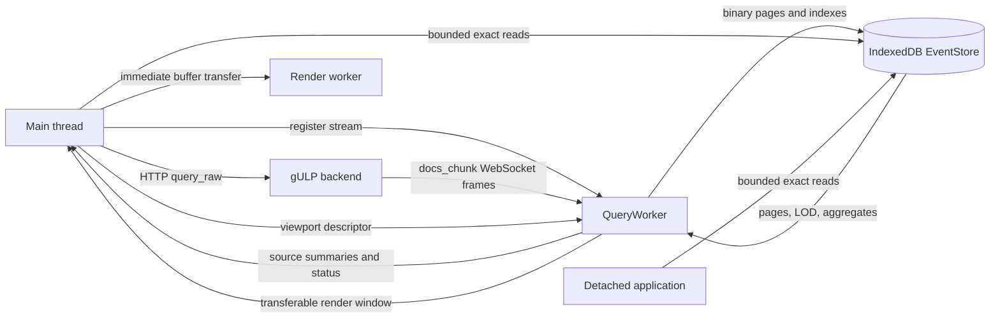
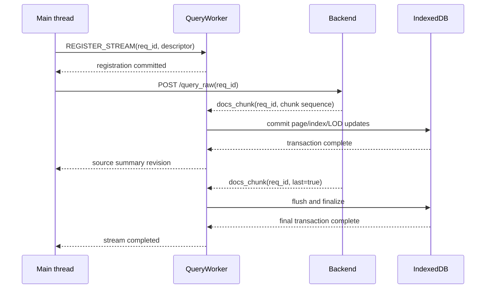

# Query worker and event storage architecture

The query worker owns the high-volume event path used by the timeline. It
receives `docs_chunk` messages from the authenticated WebSocket, normalizes and
persists exact events, and builds compact render-window projections from
IndexedDB. Document payloads do not pass through the main thread.

This architecture keeps the application's long-lived memory related to the
current viewport rather than to the total number of events. IndexedDB is a
rebuildable browser cache; the gULP backend remains the authoritative event
source.

The companion [timeline rendering architecture](engine.architecture.md)
describes how a projection is transferred to the render worker and drawn on the
`OffscreenCanvas`.

## Runtime topology



The main thread starts backend requests and owns visible UI state. The query
worker owns the WebSocket, document routing, storage writes, and LOD projection.
The render worker owns drawing. Main and detached browser realms can open the
same operation database for bounded, asynchronous reads.

## Ownership boundaries

| Component | Owns | Does not retain |
| --- | --- | --- |
| gULP backend | Authoritative events, query execution, detail retrieval | Browser cache state |
| Query worker | WebSocket, stream contexts, normalization queues, IndexedDB writers, viewport projector | A permanent object collection containing every event |
| IndexedDB EventStore | Exact event pages, source manifests, LOD records, density aggregates, document index | Backend-only event details outside the timeline document shape |
| Main thread | React state, source summaries, interaction state, bounded event cache | Full query chunks or a dataset-sized event map |
| Render worker | Current render window, source drawing metadata, overlays, hit regions, bitmap assets | Exact events outside the projected window |
| Detached application | Its own UI state and bounded EventStore readers | A duplicate full event collection |

## Query worker lifecycle

`SmartSocket` is the main-thread facade for the worker-owned transport. It
creates `QueryWorker`, initializes the authenticated WebSocket session, and
exposes correlated control requests to the application.

The worker accepts these command families:

- initialize, reconnect, send, and close the WebSocket;
- register, complete, cancel, or release document streams;
- cancel all streams for an operation epoch;
- request a render window for one viewport revision.

Socket state and non-document WebSocket messages are forwarded to the main
thread. `docs_chunk` messages remain inside the query worker and are given to
the registered persistence context.

### Registration before the backend request

The UI generates the `req_id`. Before calling `/query_raw`, it registers a
stream descriptor with the query worker and waits for the registration
acknowledgement. The backend receives the same ID and uses it in each
`docs_chunk` WebSocket message.

This order establishes ownership before any normal response chunk can arrive:



An unknown-request mailbox exists only as a protocol guard for messages that do
not follow this registration contract, such as a stale server message or a
message racing reconnect and teardown. It retains at most 64 MiB for 30
seconds. It is not part of the normal query flow.

### Stream descriptor

Each registered stream records:

- request ID, operation ID, and operation epoch;
- owner: `persist`, `ignore`, or `passthrough`;
- mutation kind: `replace`, `query-upsert`, `enrichment`, or
  `realtime-ingest`;
- completion mode: final `last` chunk or explicit completion;
- known source IDs and source-specific hash settings;
- optional expected event count and request revision;
- whether numeric chunk sequences can be deduplicated globally for the request.

The router tracks the states `registered`, `streaming`, `flushing`,
`completed`, `canceled`, and `failed`. Terminal request IDs are guarded for a
bounded interval so late chunks cannot reopen a completed or canceled stream.

The UI can dispatch up to four source queries concurrently. Streams targeting
different sources can progress independently. Mutations for the same source are
serialized by source leases, and a superseding replace cancels the obsolete
writer before publishing the newer generation.

The router applies chunks for one stream in arrival order and can discard
duplicate numeric sequences when the endpoint declares them globally unique.
The backend must preserve the sequence order of chunks belonging to the same
stream.

## Ingestion and backpressure

Each accepted chunk passes through four stages:

1. Route the WebSocket frame to its registered stream context.
2. Normalize raw documents into the minimal timeline document shape.
3. Build or update exact pages, LOD records, density aggregates, and document
   index segments.
4. Commit the prepared mutations atomically to IndexedDB.

Normalization yields cooperatively after short work slices so control messages,
click-related reads, and viewport requests remain responsive.

Registered chunks have no application-defined raw-byte ceiling. Temporary RAM
may grow when WebSocket delivery is faster than normalization, but the worker
releases a chunk's raw document array as soon as normalization has consumed it.
This permits short ingestion bursts without making that memory part of the
steady-state dataset.

The normalized queue is deliberately bounded:

- at most 32,768 normalized documents are pending across streams;
- at most two IndexedDB commits execute concurrently;
- pages are flushed incrementally instead of waiting for stream completion;
- queued work receives FIFO credit so a large stream cannot starve every other
  stream.

The raw queue is temporary and limited by the browser and device's natural
memory limits. When normalized credit is temporarily unavailable, an accepted
chunk waits in raw form instead of failing against a raw-byte budget. A single
chunk containing more than 32,768 documents is a backlog protocol failure; the
normal backend chunk size must remain below that bound.

If normalization, storage, quota admission, or the IndexedDB write path fails,
the worker marks the stream failed and reports its `req_id` and failure reason.
The main thread then requests backend cancellation. There is no fallback that
loads the failed stream's documents into main-thread memory.

`last` means complete only after all page builders have flushed and the final
IndexedDB transaction has committed. Other WebSocket messages, including
statistics updates, continue through the normal main-thread event path.

## Operation-scoped EventStore

Every cache is namespaced by `coordinatorId` and `operationId` and uses the
database name:

```text
gulp-event-store:<coordinatorId>:<operationId>
```

The namespace allows the main window, compatible detached windows, and workers
on the same origin to open the same exact event data without copying the whole
dataset between realms. A `BroadcastChannel` distributes compact source
revision summaries; exact documents remain in IndexedDB.

The EventStore contains four object stores.

### `sources`

One source manifest contains:

- active generation and revision;
- status: `building`, `complete`, or `incomplete`;
- active event count and next source-local handle;
- timestamp and hash ranges;
- encoded byte count;
- a compact catalog of exact pages and their ranges.

The manifest is the source authority used for revision checks and page
selection. It contains metadata, not event objects.

### `pages`

An exact page contains at most 16,384 events in columnar binary form:

- `Uint32Array` source-local handles;
- `Float64Array` timestamps, numeric hashes, and event codes;
- UTF-8 document IDs with an offset array;
- a tombstone bitmap;
- page count, ranges, generation, revision, and encoded size.

Columnar values avoid one IndexedDB record per event and allow the projector to
decode only the fields required for rendering. A source-local handle is a
compact event reference; handle `0` is reserved and the largest valid value is
`4,294,967,294`.

Upserts update an existing location when its source and timestamp remain
compatible. Moving an event creates a tombstone at the prior location and
inserts the new value. A page is compacted when tombstones exceed 25 percent.

### `page_lod`

Each exact page has a default-render summary and up to 256 microblocks. The
records store time ranges, counts, and visual representatives without document
objects or decoded IDs. The same object store also contains page-local
one-minute counts for the HeightMap engine.

LOD records are rebuilt only for pages affected by a mutation. Palette changes
do not rewrite exact pages. Color-override revisions select or rebuild the
corresponding representatives before a new projection is published.

### `document_index_pages`

Document lookup uses binary, segmented index pages instead of an IndexedDB
record or JavaScript map per document. A 64-bit document-ID hash is partitioned
by a 12-bit logical prefix and resolves to candidate source, page, offset, and
handle locations. The exact UTF-8 ID in the event page confirms the candidate,
so hash collisions cannot return the wrong event.

Segments use leveled compaction to keep lookups bounded while avoiding a full
index rewrite on every append.

## Replace and mutation semantics

A replace builds a new source generation. When storage permits, the committed
generation remains readable until the building generation is finalized. The
manifest switches generations atomically after the final commit, then obsolete
records are reclaimed incrementally.

If capacity is insufficient for both generations, the coordinator can reclaim
the rollback generation and continue in-place. The source summary identifies
that replacement mode. An interrupted in-place build is marked `incomplete` so
the UI can request the source again instead of treating partial data as final.

Query upserts, enrichment, and real-time ingestion mutate the active generation
under the same source lease. Browser Web Locks coordinate writers across
same-origin realms; a coordinator-local FIFO lease provides the in-realm order.
Leases are acquired in deterministic source order for multi-source chunks.

## Dynamic storage capacity

The query worker performs admission control with `navigator.storage.estimate()`.
The usable capacity is calculated at runtime:

```text
reserve = min(quota, max(1 GiB, quota * 20%))
available = max(0, quota - usage - reserve)
maxAdditionalEvents = floor(available / conservativeBytesPerEvent)
effectiveMaximumEvents = currentEvents + maxAdditionalEvents
```

Until encoded writes have been measured, the estimate uses 160 bytes per event.
Afterward it uses the p95 of recent encoded byte-per-event samples multiplied by
1.5 for IndexedDB overhead. The worker measures before accepting each stream
and again after either 100,000 committed events or 256 MiB of committed data.

The result is a device-specific capacity, not a universal event-count promise.
The source handle range is the absolute per-source format limit, while browser
quota is expected to be the practical limit.

An unavailable quota estimate is reported as unavailable telemetry, not as zero
capacity. An actual quota error during commit fails the affected stream and
preserves the last coherent source state whenever a committed generation still
exists.

## Viewport render projection

Canvas describes the current render window with:

- operation ID and epoch;
- viewport and projection revisions;
- visible time frame, scale, scroll, width, and horizontal overscan;
- visible source rows plus two vertical overscan rows;
- each source revision, timestamp offset, render engine, and frequency setting;
- palette, override, and render-setting revision inputs;
- the maximum representative count and sources to evict.

Horizontal overscan is normally one canvas width on each side. It gives small
pans a ready projection without retaining an operation-wide snapshot.

The query worker keeps one active projection and only the newest pending
request. An obsolete pending viewport may be skipped because each render window
is a complete replacement. After projection, the render client applies its own
one-in-flight plus one-coalesced-pending data queue.

While a source is `building`, committed source summaries trigger projection
refreshes at most once every 250 milliseconds. A terminal `complete` or
`incomplete` summary requests the final projection immediately.

### LOD selection

For the Default engine, the projector chooses the least expensive level that is
pixel-equivalent for the requested scale:

1. Use the page representative when an entire page maps to one pixel bucket.
2. Use microblock representatives when a page spans several buckets.
3. Read the exact page when a microblock needs per-pixel refinement.
4. Within a bucket, choose the most recent applicable event, including the
   active color-override representative rules.

The HeightMap engine reads persisted one-minute counts and aggregates them to
the viewport scale. The Graph engine aggregates source samples into graph
buckets appropriate to the visible width.

The render window carries source-wide totals and hash ranges independently of
the representative arrays. Labels and color scaling therefore describe the
complete committed dataset rather than the LOD sample.

One projection contains at most 1,000,000 representatives. The render worker
may temporarily own the preceding and next atomic projections, keeping the
combined resident bound at 2,000,000. If the requested window would exceed its
budget, the projector increases bucket width to 2, 4, or more pixels and marks
the source as degraded LOD.

### Transfer to the renderer

Projection fields are typed arrays containing only render data:

- representative handles, timestamps, and hashes;
- HeightMap timestamps and counts;
- Graph timestamps and counts;
- covered range, bucket width, total count, hash range, and source revision.

Their `ArrayBuffer` instances are transferred from the query worker to the main
thread. A single-consumer render-window bus synchronously hands the result to
the mounted Canvas, which validates its revisions and transfers the same
buffers to the render worker. The bus does not retain the projection.

## Exact read API

`DataStore.Events` is an asynchronous EventStore facade. It preserves a small
main-thread cache of at most 2,048 documents and exposes bounded reads instead
of a dataset-sized event collection:

- `getById(documentId)` and batched ID resolution;
- `getByHandle(sourceId, handle)`;
- `getNeighbors(sourceId, handle, before, after)`;
- `queryPixelBucket(sourceId, timeRange, limit, cursor?)`;
- source summary and capacity reads.

`queryPixelBucket` returns exact events, the total matching count, a stable
cursor, and the source revision. Its page size is capped at 100. This API is
used for Canvas clicks and the paginated group dialog, including a pixel that
contains more events than can safely be materialized in the main thread.

Notes, links, flags, navigation, and detached views resolve required IDs or
handles through the same facade. They do not require a global in-memory event
map.

## Revisions and consistency

Three independent revision domains prevent stale work from becoming visible:

- the operation epoch changes when the active operation data is reset;
- the source revision changes after a committed source mutation;
- the viewport revision changes with frame, scale, scroll, size, or visible
  rows.

A render projection is accepted only when all relevant revisions still match.
An exact lookup is discarded when its operation epoch or viewport revision is
obsolete. If only the source revision changes during a lookup, the caller may
retry once against the new manifest.

Pixel cursors are tied to a source revision. If a source changes during group
dialog navigation, pagination restarts at the first page and the UI reports the
refresh without retaining an inconsistent mixed result.

## Teardown and recovery

Changing or releasing an operation cancels its streams, increments the
operation epoch, closes transient repositories, and makes older projection and
lookup results ineligible. IndexedDB data remains a namespaced cache until its
normal cleanup lifecycle removes it.

On WebSocket disconnect, active persistence streams fail with a disconnected
reason. Reconnect restores the transport but does not silently declare an
interrupted stream complete; incomplete sources can be queried again from the
backend.

Because the EventStore is reconstructible, schema upgrades may rebuild an
incompatible cache. No browser cache migration is allowed to change backend
event authority.

## Performance invariants

The event path is expected to preserve these bounds:

- no permanent main-thread collection proportional to all events;
- at most 2,048 cached exact documents in the main realm;
- at most 32,768 normalized documents pending in QueryWorker;
- no application-defined byte cap on registered raw chunks retained during
  active normalization;
- no more than two concurrent IndexedDB commits;
- one active and one newest pending projection request in QueryWorker;
- one in-flight and one coalesced pending render data message;
- at most 1,000,000 representatives in one projection and 2,000,000 resident
  during atomic replacement;
- exact pixel and dialog reads return at most 100 events per page.

Benchmarking at 10, 20, and 30 million events must verify IndexedDB throughput,
storage estimates, steady-state memory, query correctness, viewport latency,
and interaction latency on the selected reference device. Admission remains
subject to the origin quota available on that device.

## Source reference

The main implementation entry points are:

- [`Query.worker.ts`](../../gulp-ui/src/event-store-worker/Query.worker.ts)
- [`QuerySocket.session.ts`](../../gulp-ui/src/event-store-worker/QuerySocket.session.ts)
- [`QueryPersistenceCoordinator.ts`](../../gulp-ui/src/event-store-worker/QueryPersistenceCoordinator.ts)
- [`QueryStream.router.ts`](../../gulp-ui/src/event-stream/QueryStream.router.ts)
- [`EventStore.repository.ts`](../../gulp-ui/src/event-store/EventStore.repository.ts)
- [`IndexedDbEventStore.backend.ts`](../../gulp-ui/src/event-store/IndexedDbEventStore.backend.ts)
- [`EventStore.viewport-projector.ts`](../../gulp-ui/src/event-store/EventStore.viewport-projector.ts)
- [`EventStore.facade.ts`](../../gulp-ui/src/event-store/EventStore.facade.ts)
- [`DataStore.ts`](../../gulp-ui/src/store/DataStore.ts)
