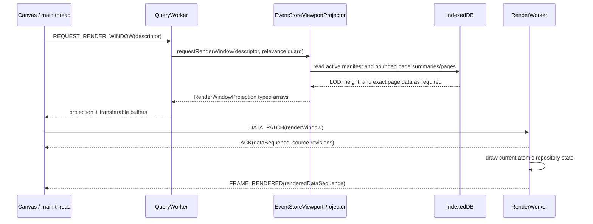

# Render worker and LOD projection architecture

This document describes the viewport-rendering path: how the current timeline
window is read from EventStore, reduced to a level-of-detail (LOD) projection,
transferred, and drawn on the worker-owned `OffscreenCanvas`.

The thread boundary is important. The render worker does not open IndexedDB and
does not receive complete event documents. `EventStoreViewportProjector` runs in
the query worker, reads the active cache, and produces bounded typed arrays.
Canvas immediately transfers those arrays to the render worker. Query execution,
stream persistence, cache reconciliation, and exact document lookup are covered
by [Query worker and event storage architecture](query-worker.md).

## Code-aligned component map

| Component | Code | Responsibility |
| --- | --- | --- |
| Canvas coordinator | `src/app/body/Canvas.tsx` and `CanvasRenderWindowScheduler.ts` | Describes the visible viewport, coalesces projection requests, and transfers accepted projections |
| Query worker coordinator | `src/event-store-worker/QueryPersistenceCoordinator.ts` | Executes projection requests against the operation EventStore and rejects superseded work |
| Viewport projector | `src/event-store/EventStore.viewport-projector.ts` | Selects pages, LOD summaries, exact refinements, HeightMap counts, and Graph samples |
| Projection transfer | `src/event-store-worker/QueryProjection.transfer.ts` | Collects the typed-array transfer list without cloning buffers |
| Render worker protocol | `src/render-worker/RenderWorker.types.ts` | Defines revisioned control messages, data patches, acknowledgements, and frame results |
| Render repository | `src/render-worker/WorkerRenderRepository.ts` | Atomically adopts the current render window and compact overlay state |
| Render core | `src/render-worker/WorkerRenderCore.ts` | Draws Default, HeightMap, Graph, notes, links, flags, targets, and hit regions |
| Render controller | `src/render-worker/RenderWorkerController.ts` | Validates messages, orders patches, schedules frames, and reports ACK/frame progress |

## From viewport to frame



Canvas requests only the visible source rows plus two vertical overscan rows.
Horizontal overscan is normally one canvas width on each side. After a complete
projection is accepted and its typed arrays move to RenderWorker, Canvas retains
only scalar coverage and authority metadata. Normal pans inside that coverage
redraw the transferred projection without issuing another QueryWorker request.

The request envelope identifies the operation. The projector descriptor carries:

- operation epoch, viewport revision, and projection revision;
- selected frame, canvas width, scale, horizontal scroll, and overscan;
- source ID, timestamp offset, render engine, minimum Graph frequency,
  override hashes, settings revision, and override revision;
- the representative budget and source IDs whose projector caches can be evicted.

Source authority, physical generation, durable revision, status, and counts are
read from the active EventStore manifest and returned in the projection. Palette,
localized strings, source labels, and the derived `cacheWarning` boolean are sent
separately to RenderWorker. Query provenance and cache freshness never enter the
render protocol, and none of these values is an input to the EventStore projector.

## Projection scheduling and relevance

Canvas retains one active projection and one coalesced trailing trigger for the
same operation, epoch, and vertically overscanned source window. Horizontal pan
and zoom revisions do not cancel an already coherent read; that snapshot may be
adopted inside its horizontal coverage before the trailing request catches up.
When vertical movement changes the ordered source window, the replacement starts
immediately and QueryWorker cooperatively invalidates the obsolete storage read.

Overscan reuse is limited to complete sources whose operation, frame, width,
scale, source set, settings, generation, revision, authority, and event count
still match the accepted projection. Building sources and terminal convergence
requests always request a fresh projection so ingestion progress cannot be
hidden. Leaving the accepted raw timestamp range also resumes normal projection
scheduling.

For building replacement generations, each accepted partial `docs_chunk`
publishes a lightweight projection invalidation containing only operation and
source IDs. Canvas applies the same 250 ms coalescing used by building summaries
and temporarily treats those sources as non-empty before resolving vertical
visibility. If the first preview reveals a hidden row, Canvas queues that row's
source metadata before the projection; otherwise it requests the latest
viewport when any changed source is visible. These projections are never
overscan-reused as complete snapshots, so successive partial pages continue to
advance on screen. A replacement page remains eligible for this transient
projection while its IndexedDB append is in flight. Its generation/revision
fence makes a concurrently completed durable page win without blocking every
other visible source behind that transaction.

An initial operation viewport can contain selected rows whose per-source query
has not entered the four-request pool yet. QueryWorker represents each such row
with the canonical zero-authority, zero-generation, empty projection. Canvas
accepts that placeholder without weakening terminal fences, so an unregistered
row cannot cause it to discard events already projected for active source
queries. As soon as the first source summary exists, the normal authority,
generation, revision, status, and count checks apply.

The query worker checks a relevance guard throughout page and aggregate scans.
Superseded work stops cooperatively and its buffers are not published. Before a
multi-source result is returned, the projector verifies that every source
manifest still matches the authority used to build the projection. A changed
manifest causes a bounded retry instead of a mixed-generation render window.

## Persisted inputs

The projection path reads three forms of EventStore data:

- source manifests and their compact page catalogs;
- exact columnar pages from `pages`;
- `lod` microblock summaries and `height` minute-count records from `page_lod`.

There is no persisted Graph record. Graph samples are derived for the current
viewport from the active source pages and summaries. Exact documents remain in
IndexedDB and are fetched separately for selection, dialogs, and navigation.

The projector reads all visible source manifests with one batch transaction at
the start and one at the final consistency check. Exact, LOD, and HeightMap
records use independent revision-qualified LRU working sets capped at 16 MiB,
32 MiB, and 4 MiB of encoded data respectively. This absorbs repeated page reads
when parser-order ingestion creates page ranges that overlap in time. A cache
entry cannot survive a generation or page revision change, and vertical source
eviction releases its entries.

## LOD selection

LOD selection is based on the time covered by a rendered pixel bucket, not on a
fixed event-count threshold. For the Default engine the projector follows this
hierarchy:

1. If a complete exact page maps to one output bucket, use its page
   representative without decoding the page.
2. Otherwise load the page's `lod` record. Each exact page has at most 256
   microblocks. A microblock that maps to one output bucket contributes its
   representative.
3. If a microblock crosses bucket boundaries, load that one exact page and scan
   only the affected microblock offsets.
4. Merge candidates by output bucket. The newest event wins unless the bucket
   contains a configured color-override hash, which takes precedence.

The result is at most one Default representative per output bucket and source.
Deep zoom therefore refines only ambiguous page regions; it does not load the
entire source.

Color overrides need persisted representative metadata so an overridden event is
not hidden by a coarser representative. A new override revision is prepared in
bounded page slices. Until every visible page has matching override metadata, the
projection reports a retryable pending condition rather than publishing a
visually incorrect result.

### HeightMap

HeightMap uses fixed one-minute counts. Minute-aligned sources read the persisted
`height` records directly. A source whose original anchor is not minute-aligned
uses microblock refinement to retain the existing source-relative behavior. The
projector collapses counts into viewport buckets and returns their maximum for
color and bar-height normalization.

HeightMap colors are based on bucket density. The configured event field and
hash function are not used to color individual HeightMap buckets.

### Graph

Graph uses a dynamic bucket duration:

```text
max(source frequency_sample, visible time represented by 10 canvas pixels)
```

The duration is recomputed as the viewport changes. The projector returns
viewport-scale timestamps and counts; the render core draws the semi-log values,
labels, and connecting segments. Graph aggregates are not stored as a separate
IndexedDB record.

## Representative budget and degraded LOD

The normal projection budget is 1,000,000 records across the requested visible
sources. Before loading event pages, the projector estimates the number of
pixel-width buckets in the horizontally overscanned window. If one bucket per
pixel per source would exceed the budget, it doubles the shared bucket width
until the estimate fits.

`bucketPixelWidth > 1` is reported as `degradedLod`. Degradation reduces only the
visual density of the current window; it does not change exact pages or cache
authority. This shared budget width applies to Default representatives,
HeightMap output, and Graph projection work. A Default source still building at
least one million events additionally uses a four-pixel minimum until completion.

## Projection payload

Each source projection contains:

- authority revision, generation, durable revision, and source status;
- raw covered range, selected bucket width, and degraded-LOD state;
- `loadedCount` for the complete active generation and exact `frameEventCount`
  for the selected source-adjusted frame;
- hash range;
- Default representative handles, timestamps, and hashes;
- HeightMap timestamps, counts, and maximum count;
- Graph timestamps and counts.

Correlated fields use exact-size typed arrays. `QueryProjection.transfer.ts`
collects their `ArrayBuffer` values so the projection moves from QueryWorker to
Canvas without structured-clone duplication. Canvas immediately transfers the
same buffers to RenderWorker and must not read detached arrays afterward.

## Render-worker state and drawing

The render protocol is version 11. Viewport/input messages travel over the
control channel; revisioned scene and projection patches travel over the data
channel. The worker repository atomically replaces a complete render window, so
arrays from different projection revisions are never merged.

The engines draw the adopted projection as follows:

- **Default** draws at most one one-pixel event line per visible canvas pixel
  bucket. Its hash selects a palette color, with explicit overrides taking
  precedence.
- **HeightMap** draws projected density counts derived from fixed one-minute
  aggregates as normalized vertical bars and maps the count range to the
  configured palette.
- **Graph** dynamically groups count samples, applies a semi-log scale, labels
  bucket counts, and connects adjacent points.

Source metadata, theme colors, notes, links, flags, the selected target, and
supplemental note-linked events arrive as independently revisioned patches. They
remain compact render state and never give RenderWorker access to complete query
documents.

## Supplemental note-linked events

Events explicitly retrieved for notes live in a small operation-scoped
main-thread collection outside EventStore query generations. Canvas publishes
them as a separately revisioned overlay. RenderWorker draws them above the
active LOD projection for all three engines and creates
`supplemental-event` hit regions.

Supplemental events do not change LOD or density aggregates, `loadedCount`,
`frameEventCount`, source authority, query-result totals, or cache freshness.
They are cleared on operation reset, source removal, a new replacement query,
or successful source-local Undo/Redo. Viewport movement, note reload, and
dialog close do not clear them. User-facing retrieval and navigation behavior is
described in [Rendering engines](engine.md#notes-whose-events-are-outside-the-active-query).

## ACKs, frames, and terminal convergence

Data ACKs and rendered-frame messages use different ports and can arrive in
either order. Canvas records the data sequence that acknowledged each source
revision. A terminal render target is complete only when:

- the frame belongs to the current operation epoch and viewport;
- the acknowledged source revision covers the exact terminal revision;
- `renderedDataSequence` covers the sequence that applied that revision;
- the rendered projection matches authority revision, generation, status,
  durable revision, and complete event count.

`globalRevision` is aggregate telemetry and is not sufficient proof. A watchdog
requests another projection after 500 ms and backs off to at most two seconds
until the target frame arrives or the lifecycle changes.

The controller normally waits for an 8 ms quiet window before drawing a dirty
data batch. While the page is visible, a non-renewable 100 ms deadline prevents
continuous traffic from postponing frames indefinitely.

## Errors and compatibility mode

Projection revision conflicts are retried when the request is still current.
Malformed protocol data or a failed atomic patch requests bounded
resynchronization for the affected source or overlay scope. A fatal or
unavailable RenderWorker publishes the same explicit compatibility decision as
an EventStore failure; it never writes the legacy marker or reloads the page
automatically.

The decision banner can retry scalable mode or, after explicit user
confirmation, persist `gulp:event-store-lod-enabled=false` and reload into the
main-thread RAM renderer. Compatibility mode has no persistent query-cache
history and can consume substantially more memory on large operations.

## Diagnostics and performance checks

Canvas diagnostics expose render queue depth, maximum frame interval,
resynchronization/error/fallback counts, terminal-target age, ACK and frame data
sequences, and their timestamps. Combine them with the QueryWorker snapshot
described in [query-worker.md](query-worker.md#on-demand-diagnostics) to locate a
delay before storage, during projection, on the data channel, or during drawing.

Renderer resource profiles are available at:

```text
/renderer-test?docs=10m
/renderer-test?docs=20m
/renderer-test?docs=30m
```

These direct profiles distribute events across eight sources. The default
`cache=cold` run clears those sources, then generates, encodes, indexes, and
persists bounded pages in a dedicated worker. It sends compact source summaries
to the page and transfers visible-row projections to Canvas while writes continue.
The page uses the live physical Canvas viewport width and scale for projection.
It retries transient projection errors and fails a run if Canvas keeps rejecting
the visible window; completion requires an accepted terminal projection.
The fixture clock is fixed at 2025-01-01 UTC so repeat runs have the same event
times. Use a fresh browser profile for a measured cold run when quota and storage
state must be comparable.

After a cold run completes, the same browser profile can open, for example,
`/renderer-test?docs=10m&cache=warm`. Warm mode checks every source's complete
status, exact count, and deterministic timestamp edges before reusing its
IndexedDB pages. It reports `cache-miss` and skips if the cache is absent or
incompatible; it never rewrites as a fallback. The warm write throughput is zero
because no ingestion occurs. Both modes retain the engine, overlay, and `?gate=1`
scenarios. A measured gate delta changes the cache and can make a later warm
request incompatible.

`window.__rendererBenchmarkDiagnostics` and the
`renderer-benchmark-complete` event expose the status, cache mode, persisted and
processed counts, committed encoded bytes, worker write time, bounded queue and
cache maxima, and optional heap counters. The existing `heap*` fields describe
the storage worker; `mainHeap*` describes the page. Unsupported heap counters
are flagged explicitly, and failed runs carry `failureReason`. Browser process
resident memory and first nonempty frame timing require browser instrumentation
and are not implied by these
fields. `quota-exhausted` and `cache-miss` are skips, not successful performance
results.

The real socket/persistence replay profiles are:

```text
/renderer-test?queryReplay=steady
/renderer-test?queryReplay=burst
```

The steady profile defaults to 14,000,000 events and accepts configurable totals,
source counts, and distributions:

```text
/renderer-test?queryReplay=steady&docs=20m&sources=140&distribution=uniform
/renderer-test?queryReplay=steady&docs=20m&sources=140&distribution=skewed
```

For a first 10M comparison with the eight-source direct profile, use
`/renderer-test?queryReplay=steady&docs=10m&sources=8&distribution=uniform`.
The replay still includes synthetic socket chunks and `QuerySocketSession`, so
its input and normalization cost differs from direct generation.

It sends actual JSON chunks through `QuerySocketSession` in a dedicated worker,
persists exact pages and indexes in browser IndexedDB, and uses the real
RenderWorker. The HTTP/WebSocket peer is synthetic; no backend is required.
The skewed distribution places 90% of events in one source and divides the
remainder among the others. Each run checks source-exact counts and deterministic
first/middle/last document samples, then repeats the batch and verifies all cache
hits with no additional HTTP query. Page counts allow bounded pressure flushes.
This checkout does not contain the previously documented
`scripts/test-timeline-query-replay.cjs` browser runner. Native Chromium
interaction, first-frame latency, process resident memory, and full-query
latency gates therefore need a separate browser capture; the page diagnostics
alone do not establish those acceptance results. The benchmark repair and
remaining browser verification are tracked in
[renderer-test-benchmark-plan.md](renderer-test-benchmark-plan.md).
Replay projections use the live transient Canvas transform, including an
unsettled wheel scale. Native interaction captures should exercise horizontal
pan, vertical zoom, and drags across source-overscan boundaries.

`cacheWarnings=all` marks every synthetic replay source with a settled stale
cache owned by that exact source. The warning-focused workload is available at
`/renderer-test?queryReplay=steady&docs=500000&sources=202&cacheWarnings=all`.
Its intended browser acceptance gates are input-to-frame p95 at most 33.4 ms,
main-frame p95 at most 20 ms, and no main-thread long task; this checkout does
not produce that full-query evidence automatically.

The burst profile must stop with controlled reason
`backlog` while remaining inside the raw-memory bounds documented for the query
worker.

## Timeline updates during queries

The main thread forwards compact summaries and transferred projection buffers;
there is no direct channel between QueryWorker and RenderWorker. Loading state,
source metadata, projection settings, and data revisions have separate change
checks. Request-statistics changes that do not affect loading produce no Canvas
projection. Query-owned source metadata is coalesced into browser-idle work with
a 250 ms latency bound, and its React publication is a transition so pointer and
pan input can preempt it. Loading changes use the same bounded idle priority and
collapse start/finish pairs that have no net visual effect before synchronizing
RenderWorker source decorations. They do not invalidate canonical document data.
A completed source does not invalidate the whole timeline.

Cache warnings have no DOM row overlay and no scroll-store or request-store
subscription. A shared predicate derives one boolean from settled cache state
and exact query/source ownership; that boolean participates in source metadata
revisions. Both renderers measure the complete localized source label, including
its loading suffix, and paint the 14-pixel glyph five pixels later in a final
visible-row pass. `cache-warning` is a topmost hit region in protocol v11. The
main thread imperatively shows one non-interactive tooltip at pointer entry,
clamped to the Canvas, and does not update it during movement within the same
icon.
An actively loading source remains visible even when empty rows are hidden, so
its query stripe is visible before the first durable page. A completed empty
result follows the normal empty-row visibility setting.

First durable availability and completion get prompt projection requests;
other progress is coalesced within 250 ms. During pan and zoom, an existing
projection remains usable inside its horizontal overscan while the same building
generation advances. Data-driven refreshes still request the newer revision.
For the default engine, building sources with at least one million durable events
use LOD buckets at least four pixels wide. This bounds exact boundary refinement
work while events arrive. Completion restores the normal viewport resolution;
stored events, source counts, override precedence and exact winners within each
selected bucket remain unchanged. Height and graph aggregation retain their
engine-specific resolution.
Generation changes, incomplete authority, settings changes, and movement beyond
coverage require a new projection. Render data retains one active and one pending
message; resynchronization explicitly resends affected source metadata.

Completed projection work carries its original request through the main-thread
bus. If input has advanced the viewport, Canvas verifies source settings and actual
range coverage before adopting that work at the current viewport revision. During
zoom it may briefly display the received LOD while the trailing request refines
resolution. Projection requests retain one active and one trailing slot per
operation across input changes, so continuous pan cannot discard every refresh.
Each source is validated independently, but a projection is published only when
every row in the current vertical viewport passed authority validation and is
present in the covered request. Invalid offscreen rows do not discard current
rows, and an older eviction list cannot remove a currently visible row. This
prevents an old partial window from being relabeled as current after vertical pan.

For exact LOD boundary selection, QueryWorker retains small persisted render-column
blocks in a separate 128 MiB cache. This avoids repeatedly cloning entire IndexedDB
pages when the 16 MiB exact-page cache fills. Generation and page-revision keys
isolate replacements; transient uncommitted blocks are excluded. Source-indexed
eviction and byte accounting keep this cache bounded.

Replay progress latency measures persisted visible building data waiting for its
acknowledged rendered sequence. It excludes offscreen-only changes and time spent
waiting for the next durable page. Gaps between data frames remain diagnostic;
the progress gate allows at most two seconds from visible data to its frame.

## Troubleshooting order

1. If summaries do not advance, inspect QueryWorker stream and persistence
   diagnostics first.
2. If summaries advance but projections do not complete, inspect projection
   started/completed/superseded/retry counts and viewport churn.
3. If a projection completes but its ACK does not advance, inspect the two-slot
   render data queue and resynchronization requests.
4. If the ACK advances but a terminal target remains pending, compare its source
   revision and applying sequence with `renderedDataSequence` and the current
   viewport revision.
5. If frames arrive slowly during traffic, compare the maximum frame interval
   with the 100 ms visible-page deadline and check page visibility or fatal
   worker errors.

## Source reference

- [`Canvas.tsx`](../../gulp-ui/src/app/body/Canvas.tsx)
- [`CanvasRenderWindowScheduler.ts`](../../gulp-ui/src/app/body/CanvasRenderWindowScheduler.ts)
- [`CanvasTerminalRenderConvergence.ts`](../../gulp-ui/src/app/body/CanvasTerminalRenderConvergence.ts)
- [`EventStore.viewport-projector.ts`](../../gulp-ui/src/event-store/EventStore.viewport-projector.ts)
- [`QueryPersistenceCoordinator.ts`](../../gulp-ui/src/event-store-worker/QueryPersistenceCoordinator.ts)
- [`QueryProjection.transfer.ts`](../../gulp-ui/src/event-store-worker/QueryProjection.transfer.ts)
- [`RenderWorker.types.ts`](../../gulp-ui/src/render-worker/RenderWorker.types.ts)
- [`RenderWorkerController.ts`](../../gulp-ui/src/render-worker/RenderWorkerController.ts)
- [`WorkerRenderRepository.ts`](../../gulp-ui/src/render-worker/WorkerRenderRepository.ts)
- [`WorkerRenderCore.ts`](../../gulp-ui/src/render-worker/WorkerRenderCore.ts)
- [`RendererTest.page.tsx`](../../gulp-ui/src/page/RendererTest.page.tsx)
- [`RendererQueryReplay.worker.ts`](../../gulp-ui/src/page/RendererQueryReplay.worker.ts)
- [`RendererQueryReplay.page.tsx`](../../gulp-ui/src/page/RendererQueryReplay.page.tsx)
