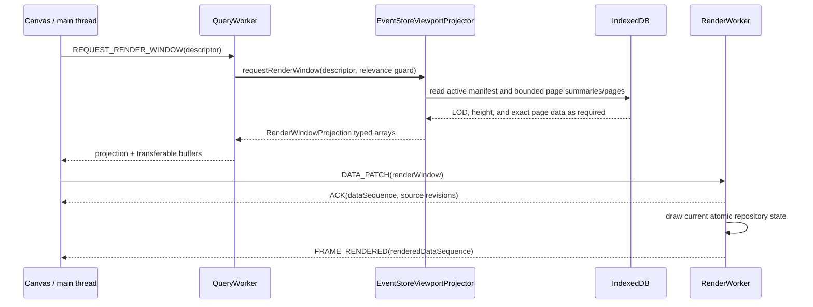

# Render worker and LOD projection architecture

This document describes the viewport-rendering path: how the current timeline
window is read from EventStore, reduced to a level-of-detail (LOD) projection,
transferred, and drawn on the worker-owned `OffscreenCanvas`.

The thread boundary is important. The render worker does not open IndexedDB and
does not receive complete event documents. `EventStoreViewportProjector` runs in
the query worker, reads the active cache, and produces bounded typed arrays.
Canvas immediately transfers those arrays to the render worker. Query execution,
stream persistence, cache reconciliation, and exact document lookup are covered
by [Query worker and event storage architecture](query-worker.md).

## Code-aligned component map

| Component | Code | Responsibility |
| --- | --- | --- |
| Canvas coordinator | `src/app/body/Canvas.tsx` and `CanvasRenderWindowScheduler.ts` | Describes the visible viewport, coalesces projection requests, and transfers accepted projections |
| Query worker coordinator | `src/event-store-worker/QueryPersistenceCoordinator.ts` | Executes projection requests against the operation EventStore and rejects superseded work |
| Viewport projector | `src/event-store/EventStore.viewport-projector.ts` | Selects pages, LOD summaries, exact refinements, HeightMap counts, and Graph samples |
| Projection transfer | `src/event-store-worker/QueryProjection.transfer.ts` | Collects the typed-array transfer list without cloning buffers |
| Render worker protocol | `src/render-worker/RenderWorker.types.ts` | Defines revisioned control messages, data patches, acknowledgements, and frame results |
| Render repository | `src/render-worker/WorkerRenderRepository.ts` | Atomically adopts the current render window and compact overlay state |
| Render core | `src/render-worker/WorkerRenderCore.ts` | Draws Default, HeightMap, Graph, notes, links, flags, targets, and hit regions |
| Render controller | `src/render-worker/RenderWorkerController.ts` | Validates messages, orders patches, schedules frames, and reports ACK/frame progress |

## From viewport to frame



Canvas requests only the visible source rows plus two vertical overscan rows.
Horizontal overscan is normally one canvas width on each side, allowing small
pans to reuse the current projection.

The request envelope identifies the operation. The projector descriptor carries:

- operation epoch, viewport revision, and projection revision;
- selected frame, canvas width, scale, horizontal scroll, and overscan;
- source ID, timestamp offset, render engine, minimum Graph frequency,
  override hashes, settings revision, and override revision;
- the representative budget and source IDs whose projector caches can be evicted.

Source authority, physical generation, durable revision, status, and counts are
read from the active EventStore manifest and returned in the projection. Palette,
localized strings, and source labels are sent separately to RenderWorker.
Cache-freshness warnings remain in a main-thread DOM overlay. None of these
values is an input to the EventStore projector.

## Projection scheduling and relevance

Canvas allows one projection request in flight and one coalesced trailing
trigger. A refresh for the same operation, epoch, and viewport does not cancel an
already coherent read; that snapshot may publish before the trailing request
catches up. A different operation, epoch, or viewport invalidates the old request
immediately.

The query worker checks a relevance guard throughout page and aggregate scans.
Superseded work stops cooperatively and its buffers are not published. Before a
multi-source result is returned, the projector verifies that every source
manifest still matches the authority used to build the projection. A changed
manifest causes a bounded retry instead of a mixed-generation render window.

## Persisted inputs

The projection path reads three forms of EventStore data:

- source manifests and their compact page catalogs;
- exact columnar pages from `pages`;
- `lod` microblock summaries and `height` minute-count records from `page_lod`.

There is no persisted Graph record. Graph samples are derived for the current
viewport from the active source pages and summaries. Exact documents remain in
IndexedDB and are fetched separately for selection, dialogs, and navigation.

## LOD selection

LOD selection is based on the time covered by a rendered pixel bucket, not on a
fixed event-count threshold. For the Default engine the projector follows this
hierarchy:

1. If a complete exact page maps to one output bucket, use its page
   representative without decoding the page.
2. Otherwise load the page's `lod` record. Each exact page has at most 256
   microblocks. A microblock that maps to one output bucket contributes its
   representative.
3. If a microblock crosses bucket boundaries, load that one exact page and scan
   only the affected microblock offsets.
4. Merge candidates by output bucket. The newest event wins unless the bucket
   contains a configured color-override hash, which takes precedence.

The result is at most one Default representative per output bucket and source.
Deep zoom therefore refines only ambiguous page regions; it does not load the
entire source.

Color overrides need persisted representative metadata so an overridden event is
not hidden by a coarser representative. A new override revision is prepared in
bounded page slices. Until every visible page has matching override metadata, the
projection reports a retryable pending condition rather than publishing a
visually incorrect result.

### HeightMap

HeightMap uses fixed one-minute counts. Minute-aligned sources read the persisted
`height` records directly. A source whose original anchor is not minute-aligned
uses microblock refinement to retain the existing source-relative behavior. The
projector collapses counts into viewport buckets and returns their maximum for
color and bar-height normalization.

HeightMap colors are based on bucket density. The configured event field and
hash function are not used to color individual HeightMap buckets.

### Graph

Graph uses a dynamic bucket duration:

```text
max(source frequency_sample, visible time represented by 10 canvas pixels)
```

The duration is recomputed as the viewport changes. The projector returns
viewport-scale timestamps and counts; the render core draws the semi-log values,
labels, and connecting segments. Graph aggregates are not stored as a separate
IndexedDB record.

## Representative budget and degraded LOD

The normal projection budget is 1,000,000 records across the requested visible
sources. Before loading event pages, the projector estimates the number of
pixel-width buckets in the horizontally overscanned window. If one bucket per
pixel per source would exceed the budget, it doubles the shared bucket width
until the estimate fits.

`bucketPixelWidth > 1` is reported as `degradedLod`. Degradation reduces only the
visual density of the current window; it does not change exact pages or cache
authority. The same width is used consistently for Default representatives,
HeightMap output, and Graph projection work.

## Projection payload

Each source projection contains:

- authority revision, generation, durable revision, and source status;
- raw covered range, selected bucket width, and degraded-LOD state;
- `loadedCount` for the complete active generation and exact `frameEventCount`
  for the selected source-adjusted frame;
- hash range;
- Default representative handles, timestamps, and hashes;
- HeightMap timestamps, counts, and maximum count;
- Graph timestamps and counts.

Correlated fields use exact-size typed arrays. `QueryProjection.transfer.ts`
collects their `ArrayBuffer` values so the projection moves from QueryWorker to
Canvas without structured-clone duplication. Canvas immediately transfers the
same buffers to RenderWorker and must not read detached arrays afterward.

## Render-worker state and drawing

The render protocol is version 10. Viewport/input messages travel over the
control channel; revisioned scene and projection patches travel over the data
channel. The worker repository atomically replaces a complete render window, so
arrays from different projection revisions are never merged.

The engines draw the adopted projection as follows:

- **Default** draws at most one one-pixel event line per visible canvas pixel
  bucket. Its hash selects a palette color, with explicit overrides taking
  precedence.
- **HeightMap** draws projected density counts derived from fixed one-minute
  aggregates as normalized vertical bars and maps the count range to the
  configured palette.
- **Graph** dynamically groups count samples, applies a semi-log scale, labels
  bucket counts, and connects adjacent points.

Source metadata, theme colors, notes, links, flags, the selected target, and
supplemental note-linked events arrive as independently revisioned patches. They
remain compact render state and never give RenderWorker access to complete query
documents.

## Supplemental note-linked events

Events explicitly retrieved for notes live in a small operation-scoped
main-thread collection outside EventStore query generations. Canvas publishes
them as a separately revisioned overlay. RenderWorker draws them above the
active LOD projection for all three engines and creates
`supplemental-event` hit regions.

Supplemental events do not change LOD or density aggregates, `loadedCount`,
`frameEventCount`, source authority, query-result totals, or cache freshness.
They are cleared on operation reset, source removal, a new replacement query,
or successful source-local Undo/Redo. Viewport movement, note reload, and
dialog close do not clear them. User-facing retrieval and navigation behavior is
described in [Rendering engines](engine.md#notes-whose-events-are-outside-the-active-query).

## ACKs, frames, and terminal convergence

Data ACKs and rendered-frame messages use different ports and can arrive in
either order. Canvas records the data sequence that acknowledged each source
revision. A terminal render target is complete only when:

- the frame belongs to the current operation epoch and viewport;
- the acknowledged source revision covers the exact terminal revision;
- `renderedDataSequence` covers the sequence that applied that revision;
- the rendered projection matches authority revision, generation, status,
  durable revision, and complete event count.

`globalRevision` is aggregate telemetry and is not sufficient proof. A watchdog
requests another projection after 500 ms and backs off to at most two seconds
until the target frame arrives or the lifecycle changes.

The controller normally waits for an 8 ms quiet window before drawing a dirty
data batch. While the page is visible, a non-renewable 100 ms deadline prevents
continuous traffic from postponing frames indefinitely.

## Errors and compatibility mode

Projection revision conflicts are retried when the request is still current.
Malformed protocol data or a failed atomic patch requests bounded
resynchronization for the affected source or overlay scope. A fatal or
unavailable RenderWorker publishes the same explicit compatibility decision as
an EventStore failure; it never writes the legacy marker or reloads the page
automatically.

The decision banner can retry scalable mode or, after explicit user
confirmation, persist `gulp:event-store-lod-enabled=false` and reload into the
main-thread RAM renderer. Compatibility mode has no persistent query-cache
history and can consume substantially more memory on large operations.

## Diagnostics and performance checks

Canvas diagnostics expose render queue depth, maximum frame interval,
resynchronization/error/fallback counts, terminal-target age, ACK and frame data
sequences, and their timestamps. Combine them with the QueryWorker snapshot
described in [query-worker.md](query-worker.md#on-demand-diagnostics) to locate a
delay before storage, during projection, on the data channel, or during drawing.

Renderer resource profiles are available at:

```text
/renderer-test?docs=10m
/renderer-test?docs=20m
/renderer-test?docs=30m
```

The real socket/persistence replay profiles are:

```text
/renderer-test?queryReplay=steady
/renderer-test?queryReplay=burst
```

The steady profile produces 14,000,000 events in 10,000-event chunks and checks
855 normally filled pages, bounded in-flight chunks, exact terminal authority,
and ACK-covered rendering. The burst profile must stop with controlled reason
`backlog` while remaining inside the raw-memory bounds documented for the query
worker.

## Troubleshooting order

1. If summaries do not advance, inspect QueryWorker stream and persistence
   diagnostics first.
2. If summaries advance but projections do not complete, inspect projection
   started/completed/superseded/retry counts and viewport churn.
3. If a projection completes but its ACK does not advance, inspect the two-slot
   render data queue and resynchronization requests.
4. If the ACK advances but a terminal target remains pending, compare its source
   revision and applying sequence with `renderedDataSequence` and the current
   viewport revision.
5. If frames arrive slowly during traffic, compare the maximum frame interval
   with the 100 ms visible-page deadline and check page visibility or fatal
   worker errors.

## Source reference

- [`Canvas.tsx`](../../gulp-ui/src/app/body/Canvas.tsx)
- [`CanvasRenderWindowScheduler.ts`](../../gulp-ui/src/app/body/CanvasRenderWindowScheduler.ts)
- [`CanvasTerminalRenderConvergence.ts`](../../gulp-ui/src/app/body/CanvasTerminalRenderConvergence.ts)
- [`EventStore.viewport-projector.ts`](../../gulp-ui/src/event-store/EventStore.viewport-projector.ts)
- [`QueryPersistenceCoordinator.ts`](../../gulp-ui/src/event-store-worker/QueryPersistenceCoordinator.ts)
- [`QueryProjection.transfer.ts`](../../gulp-ui/src/event-store-worker/QueryProjection.transfer.ts)
- [`RenderWorker.types.ts`](../../gulp-ui/src/render-worker/RenderWorker.types.ts)
- [`RenderWorkerController.ts`](../../gulp-ui/src/render-worker/RenderWorkerController.ts)
- [`WorkerRenderRepository.ts`](../../gulp-ui/src/render-worker/WorkerRenderRepository.ts)
- [`WorkerRenderCore.ts`](../../gulp-ui/src/render-worker/WorkerRenderCore.ts)
- [`RendererTest.page.tsx`](../../gulp-ui/src/page/RendererTest.page.tsx)
- [`RendererQueryReplay.worker.ts`](../../gulp-ui/src/page/RendererQueryReplay.worker.ts)
- [`RendererQueryReplay.page.tsx`](../../gulp-ui/src/page/RendererQueryReplay.page.tsx)
