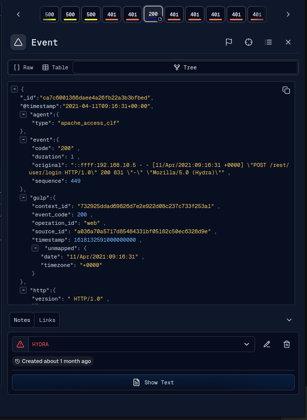
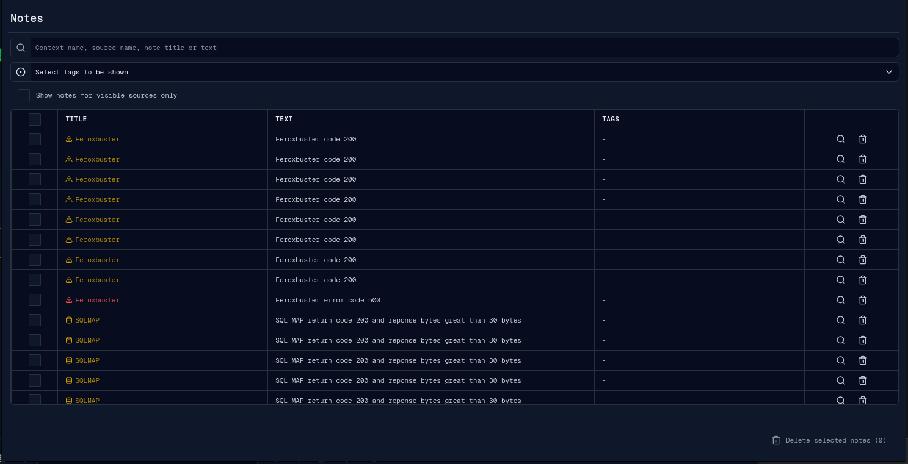
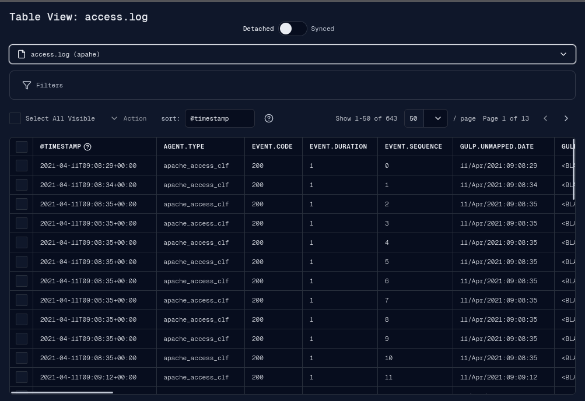
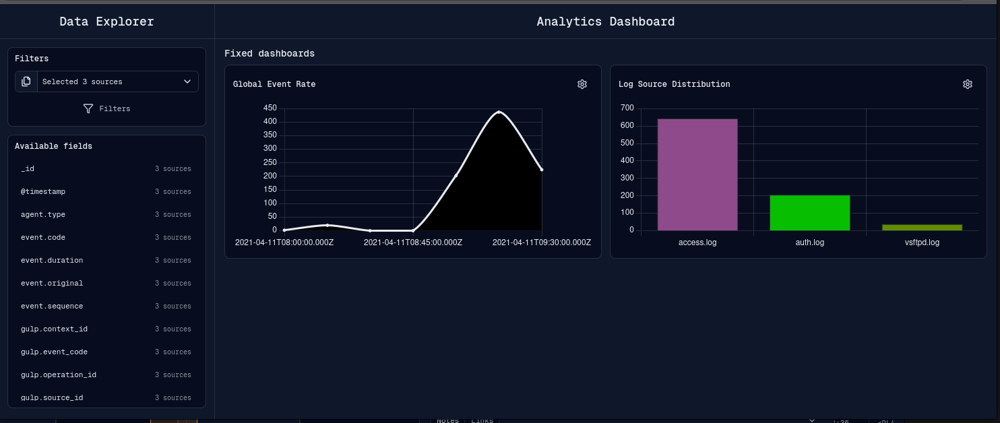
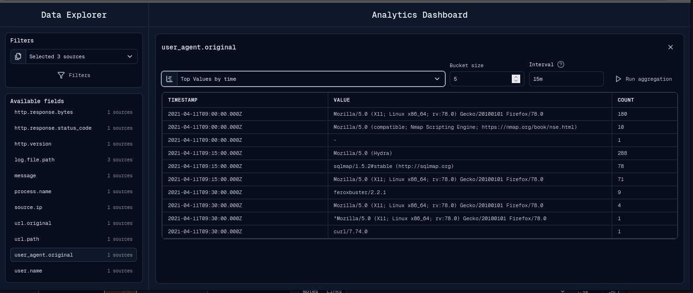
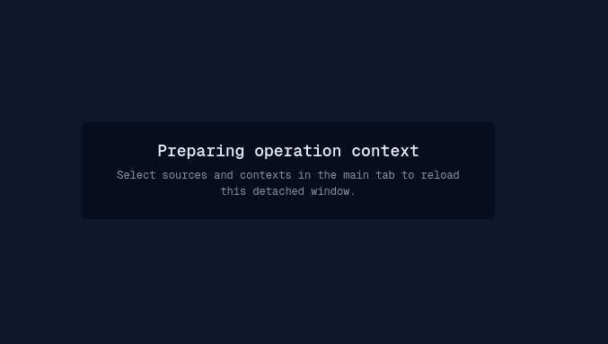

# View

The View area contains event detail, notes, source event tables, dashboards, and
detached windows.

## Event Detail

Event Detail opens when an analyst selects an event on the timeline or from a
table/list view.

While Event Detail remains open, the timeline keeps its crosshair on the event
shown in the panel. Clicking a source row or another empty timeline position
does not clear that event target.

The event detail view provides:

- event navigation across nearby events;
- raw JSON view;
- table view;
- tree view;
- copy/download JSON actions;
- flag and target actions;
- enrichment actions;
- Send IOC when a `send-data` plugin is available;
- plugin-provided event actions;
- Notes and Links tabs.

The event panel can be docked inside the operation workspace or opened as a
detached dialog window. The detached form retains nearby-event navigation,
event details, Notes/Links markers, and collaboration content. Event details
are loaded on demand and cached by operation and event ID, while navigation
uses a compact projection instead of copying the source event collection from
the main Canvas.

The selected event representation—Tree, Raw, or Table—is stored in
same-origin localStorage. It therefore remains selected while navigating
between events, reopening the dialog, or moving between docked and detached
windows. A missing or unsupported stored value falls back to Tree.

## Notes Window

The detached Notes window gives a table-level view of operation notes.

It supports search, tag selection, visible-source filtering, row targeting, row
deletion, multi-select, and bulk deletion. Notes are fetched from the
collaboration API in pages, with controls for page size, result range, and page
navigation. The event timestamp column identifies the timestamp of the event
targeted by each note, rather than the note creation time. The selection control
can select all filtered note IDs already held in the canonical data store.

The canonical note snapshot used for free-text matching, tag options, timeline
badges, and cross-page selection is separate from the open result page. Timeline
hydration can replace that snapshot without marking the table stale.

Websocket create and delete notifications for the active operation show a
localized “Notes changed” warning. They do not replace the visible page while
the analyst is reading it. Refresh requests the first matching page and count,
then clears only the changes covered by that successful request; a later change
or failed request leaves the warning visible. Websocket updates synchronize the
canonical note data without showing the create/delete warning.

The detached Notes route has its own JavaScript realm and data store. Its
client-private bridge receives an authoritative note snapshot when it
initializes or reconnects, when the operation or selected-source context
changes, and when timeline note hydration finishes. Individual websocket
changes use compact create/update/delete deltas addressed only to Notes.

If a note targets an event that is not currently loaded in the main timeline, the
main tab can fetch that event before opening its detail dialog.

## Source Events Table

The Table View window displays source events in a paginated table.

Table View supports:

- selecting one or more sources across the active contexts;
- synced mode, which follows global filters and timeline range;
- detached mode, which uses local search and independent time filters;
- local structured filters;
- sortable fields;
- page size and pagination;
- selecting visible rows;
- creating notes from selected events;
- opening target events in the main tab.

Table View keeps one point-in-time snapshot for the current operation, source,
filters, search text, time range, flags, sort, and page size. This makes page
contents stable while navigating and allows the page-number input to jump
directly beyond 10,000 or 100,000 events. Adjacent pages reuse an opaque cursor;
an unvisited page is located from its logical offset. Changing any of those
query settings closes the old snapshot and starts a new one, so newly ingested
events become visible in the new session.

If the snapshot expires before it is used, Table View shows a localized notice,
returns to page 1 once, and creates a fresh snapshot. A superseded or canceled
request does not replace the last successfully displayed page.

When horizontal scrolling is required, the optional row-selection column stays
fixed to the left edge and the optional row-actions column stays fixed to the
right edge. Wide schemas keep every column logically visible while mounting only
the columns inside the horizontal viewport plus a small overscan. Row and column
virtualization therefore bound the rendered cell matrix independently of the
operation's event count.

Table View loads field metadata for at most eight sources at a time. An
unfiltered first page can render immediately with columns inferred from its
documents; the complete union of source fields replaces that temporary schema
when metadata is ready. Structured filters wait for field types because their
OpenSearch clauses depend on those types. Metadata-only schema updates do not
repeat the event query. The logical `timestamp` sort value remains stable while
its displayed field changes to the backend `@timestamp` name, so asynchronous
metadata updates do not clear the sorting selector or repeat the initial query.

The column-visibility menu opens from the menu button in the fixed Action
header; right-clicking a data header has no special behavior. The Action column
remains available even when no row action exists, so the visibility menu stays
reachable after every data column has been hidden. Once opened, the menu keeps
its viewport position while fields are shown or hidden instead of following the
moving Action column. The menu is limited by both the table height and the
available viewport space around its trigger. Its selected and unselected field
lists shrink independently and remain scrollable through their final item while
virtualizing their contents. Scrolling therefore reaches every column without
mounting the entire schema, while its search box filters both lists from the
complete catalog.

Selected fields can be reordered from their drag handle with a pointer or the
keyboard. Its drag preview is rendered against the current window viewport so
it remains aligned with the pointer in both main and detached windows.
Reordering is disabled while search text is present because a filtered subset
does not provide an unambiguous full-table order. Visibility and the complete
field order, including hidden fields, are stored in IndexedDB; showing a hidden
field restores it to its preserved position. Always-visible controls select or
deselect the full column catalog, disable the action that already matches the
current state, and preserve the saved order. Column entries highlight on hover
so the field about to change remains clear. Dotted columns resolve flat, nested,
and hybrid event shapes, including values stored below literal `gulp.unmapped`
or `gulp.enriched` object keys. Highlighted rows keep opaque frozen selection
and action cells so horizontally scrolling values never show through them.

## Dashboard

The Dashboard window combines a Data Explorer sidebar with fixed dashboards and
ad-hoc field aggregation.

Fixed dashboard cards are based on dashboard definitions and selected sources.
The visible dashboard examples include global event rate and log source
distribution.

Ad-hoc aggregation lets an analyst pick an available field and run top values,
top values by time, or rare values.

Aggregation controls include bucket size, max document count, result size, and
date histogram interval. Interval values are resolved as either calendar or fixed
OpenSearch date histogram intervals.

## Detached Windows

Notes, Table View, Dashboard, Assistant, and supported event dialogs can run in
separate browser windows. Each route receives lifecycle and theme state plus
only the operation data it consumes. Notes receives note snapshots and deltas;
Table can subscribe to global query/frame state; Dashboard receives dashboard
context; Assistant owns its connection state; and Dialog receives a compact
event and collaboration projection.

Common detached-window waiting states:

- `Preparing operation context`: the main tab is opening an operation or no
  source/context selection is active yet.
- `Waiting for an operation`: the main tab is outside an operation.
- `Login required`: the session is missing or rejected.

Notes, Table View, and Dashboard resume automatically across detached-page and
main-tab refreshes. Assistant and Dialog windows last for the lifetime of their
open browser window.

For bridge behavior, recovery, per-application state, and network-request
expectations, see [Detached Applications](detached-windows.md).

## Troubleshooting

If a window remains in `Preparing operation context`, confirm that the main tab
is logged in, has an operation open, and has at least one source selected. After
a main-tab reload, wait for that operation context to finish restoring. If the
browser blocked the popup, allow popups for the gULP origin and open the
application again from the operation menu.
